# Electrical Drawing Studio 取扱説明書

## 1. はじめに

### 1.1 このツールについて

Electrical Drawing Studio は、ブラウザで動作する単一 HTML ファイルの電気図面作図ツールです。
リレー回路図（ラダー図）、端子接続図、PLC入出力図、機器配置図といった
設備の電気図面を、部品パレットから部品を置いて配線するだけで作図できます。

AutoCAD Electrical のような電気図面作成の考え方を参考にしながら、次の点を重視しています。

- **インストール不要**: `index.html` を1つ配るだけで、どのPCでもすぐ使えます。
- **初心者でも迷わない**: 左の部品パレットから置く→つなぐ→印刷、の3ステップが基本です。
- **自動化で手間を減らす**: 線番の採番、部品タグ、コイルと接点の相互参照、
  各種帳票（部品表・端子台プラン表など）を自動で作れます。

### 1.2 対象読者と学習の進め方

本書は「電気図面のCADを初めて使う方」を想定しています。おすすめの読み進め方は次のとおりです。

1. まず **3章「画面構成」** で、画面の各部の名前と場所を確認してください。
2. 次に **26章「チュートリアル: はじめてのリレー回路図」** を、実際に手を動かしながら一度通してください。
   基本操作（ページ作成→部品配置→配線→線番→保存・印刷）が15分程度で身につきます。
3. 作図中に分からない操作が出てきたら、目次から該当する章を引いてください。
   各章は「何ができるか→手順→補足」の順で書かれています。
4. 用語が分からないときは **27章「用語集」**、うまく動かないときは
   **28章「困ったときは（逆引き）」** を参照してください。

目的から探す場合は、次の順に読むと最短です。

| やりたいこと | 最初に読む章 | 次に確認する章 |
|---|---|---|
| 画面の各部の名前を知りたい | 3章「画面構成」 | 上部「ヘルプ」の「画面の見かた」 |
| 部品を置いて配線したい | 6章「部品配置」 | 7章「選択後の編集」→9章「配線作図」 |
| ラダー図を作りたい | 26章「チュートリアル」 | §4.6「テンプレートページ」→21章「ラダー様式とシンボル」 |
| 端子台・PLC図を作りたい | 10章／11章 | §19.1／§19.2「よくある操作」 |
| 線番・タグ・参照を自動化したい | 12章「自動処理」 | 22章「クロスリファレンス」 |
| 保存・受け渡し・印刷をしたい | 16章「保存と読込」 | 17章「出力」 |
| 操作結果がおかしい | 28章「困ったときは」 | 20章「トラブル対応」 |

### 1.3 本書の表記

本書では次の記法を使います。

- `「◯◯」` : 画面上のボタン名・メニュー名・入力欄の名前です。
- `機能メニューの「◯◯」` : 左パネルの機能メニュー（プルダウン）から選ぶ項目です（§3.4）。
  グループ名も示すときは、機能メニュー「一覧・管理」→「◯◯」のように書きます。
- `Ctrl+Z` のような書体: キーボードのキーや、入力する値です。
- §5.3・5章 : 本書の節と章の番号です。§5.3 は5章の3番目の節を指します。
- 図の中の ①②… : 本文の手順や説明に付けた番号と対応しています。
- 💡 **ヒント** : 知っていると便利な補足です。読み飛ばしても操作はできます。
- ⚠️ **注意** : 守らないとデータが消える・図面が崩れるなど、重要な注意点です。

### 1.4 動作環境

- 推奨ブラウザ: Google Chrome または Microsoft Edge の最新版。
- インターネット接続: 不要です（すべての機能がオフラインで動きます）。
- インストール・管理者権限: 不要です。
- 画面サイズ: 横幅 1366 ピクセル以上を推奨します。左右のパネルは「‹」「›」ボタンや `Tab` キーで隠して、
  図面を広く表示できます（§3.5）。

## 2. 起動方法

1. `index.html` をダブルクリックするか、ブラウザへドラッグして開きます。
2. 画面中央に A4 縦の図枠付きページ（ページ名 `P1`）が表示されます。
3. 左側に部品パレット、右側にページ設定と選択部品の編集欄が表示されます。

起動できたかは、上部に濃紺のツールバー、中央に白い用紙、左右に操作パネルが
表示されていることで確認できます。ツールバーのステータス表示には
「A4縦の図枠付きページを作成しました。」と表示されます。

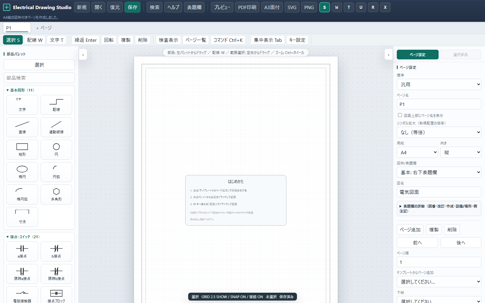{: .shot-full}

メール添付や GitHub からダウンロードした場合も、`index.html` をブラウザで開くだけで使用できます。

> 💡 **ヒント:** 空のページの中央には「はじめかた」という操作ガイドが薄く表示されます。
> 画面だけの案内で、印刷には出ません。部品を置くと自動的に消えるので、
> まずはガイドに従って部品を1つ置いてみてください。

> ⚠️ **注意:** 作業内容は操作のたびにブラウザ内へ自動保存されます。ブラウザを閉じた後でも、
> 次に開いたときに上部の「復元」から前回の状態へ戻せます（§16.3）。開き直した直後は
> 「最新（直前の操作まで）」が前回の状態です。開き直してから作図を始めた場合は、前回の状態は
> 「世代1」へ移ります。ただし、ブラウザの閲覧データ（Cookieとサイトデータ）を消去すると
> 自動保存も消えるため、恒久的な保存には上部の「保存」（JSONファイル）を使ってください（§16.1）。

### 2.1 作業を始める前の3点確認

1. **既存図面なら最初にJSONを開く**: 上部の「開く」でJSONファイルを読み込みます。
   PDFや画像は閲覧用で、元の編集情報を持ちません。
2. **ページ設定を先に決める**: 用紙、向き、図枠を確認してから配置すると、後の位置調整を減らせます（5章）。
3. **節目ごとにJSON保存する**: ファイル名へ日付や版を付けると戻しやすくなります
   （例: `制御盤図_2026-07-26_revA.json`）。

> 💡 **おすすめ:** テンプレートで骨組みを作る → 部品と配線を編集する → タグ・線番を採番する →
> 監査する → JSON保存する → プレビューしてPDF出力、の順に進めます。

## 3. 画面構成

画面は次の6つの領域でできています。図3-1の色枠と番号は、以降の説明で使う領域名を示しています。

1. 上部ツールバー（§3.1）: ファイル操作、検索、印刷・出力、作図ツール、ステータス表示
2. ページタブ（§3.2）: ページの切り替えと追加
3. クイック作図リボン（§3.3）: よく使う作図・編集操作のボタン
4. 左パネル（§3.4）: 部品パレット、表示設定、配線・レイヤ、自動処理と機能メニュー
5. 中央キャンバス（§3.5）: 図面を描く領域
6. 右パネル（§3.6）: ページ設定と、選択した部品の編集欄

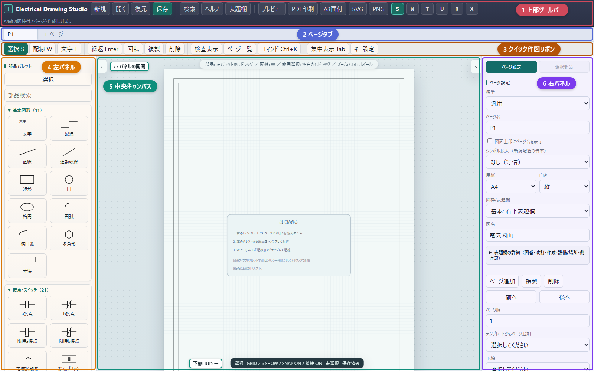{: .shot-full}

> 💡 **ヒント:** 迷ったら上部ツールバーのステータス表示を見てください。
> 「◯◯を配置しました」「◯◯を選択してください」など、直前の操作の結果や次にすべきことが表示されます。
> ステータス表示は通常ツールバーの2段目にあり、画面の横幅が十分に広いときはボタン列の右側に並びます。
> 長い文が途中で切れているときは、マウスを乗せると全文が表示されます。

### 3.1 上部ツールバー

画面最上部の濃紺の帯です。ボタンはグループごとに区切られており、図3-2の番号は次の見出しの番号に対応しています。

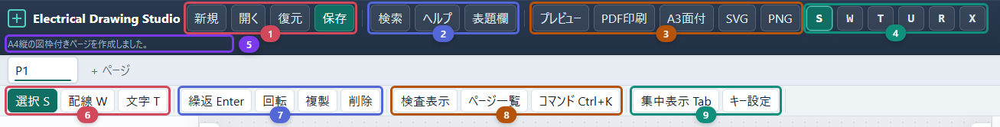{: .shot-wide}

**1 ファイル**

- 新規: 確認のあと、A4縦1ページだけの新しい図面にします。ページ、表題欄の内容、改訂履歴、
  ケーブル・芯線の情報は消えます。ユーザー部品、ユーザー回路、部品カタログ、PLCモジュールDB、
  配線種別、レイヤ、表題欄レイアウト、標準パック、採番書式などの登録内容と設定は引き継がれます。
  誤って押したときは、作図を始める前に「復元」の「最新（直前の操作まで）」で元の図面へ戻せます。
- 開く: 保存済みの JSON ファイルを読み込みます（§16.2）。
- 復元: ブラウザ内の自動保存から、直前の状態や少し前の状態（世代1〜3）へ戻します（§16.3）。
- 保存: 現在の図面を JSON ファイルに保存します。再編集できる正式な保存形式です。`Ctrl+S` でも保存できます（§16.1）。

**2 検索・ヘルプ・表題欄**

- 検索: 線番、タグ、ラベル、文字、説明、品番、端子名、属性メモなどを全ページから探し、
  まとめて置き換えます（13章）。
- ヘルプ: 使い方ガイド（はじめの5ステップ、画面の見かた、部品の配置や配線のコツなどの分野別の説明、
  キーボードショートカット一覧、困ったとき）を表示します。
- 表題欄: 全ページの表題欄をまとめて更新します（14章）。

**3 印刷・出力**

- プレビュー: 印刷前に、ページ順・用紙・図枠・出力範囲を画面で確認します（§17.1）。
- PDF印刷: 全ページを1ページずつ印刷します。印刷先で「PDFに保存」を選ぶとPDFになります。
  ブラウザの印刷（`Ctrl+P`）でも同じ内容を印刷できます（§17.2）。
- A3面付: A4 のページを2ページずつ、A3 用紙へ等倍で並べて印刷します
  （A4縦は A3横に左右、A4横は A3縦に上下。§17.3）。
- SVG／PNG: 現在ページを SVG／PNG ファイルに出力します（§17.4、§17.5）。

**4 作図ツール**

- S／W／T: 選択・配線・文字ツールへ切り替えます（キーボードの `S`（または `V`）・`W`・`T` と同じです）。
- U／R／X: 元に戻す・やり直し・選択要素の削除を実行します。
  キーボードでは `Ctrl+Z`・`Ctrl+Y`・`Delete` を使います（`R` キーは矩形ツールの切り替えです）。

**5 ステータス表示**

- 直前の操作の結果や次の手順を表示します（3章冒頭のヒントを参照）。

### 3.2 ページタブ

ツールバーの下に、ページごとのタブが並びます。

- 各ページタブ: クリックするとそのページへ切り替わります。並べて表示では、そのページへスクロールして
  編集対象にします（§4.5）。
- タブをダブルクリックすると「ページ名」の入力欄が開き、ページ名を変更できます。
- `+ ページ`: 新しいページを末尾に追加します（右パネルの「ページ追加」と同じです。§4.1）。

### 3.3 クイック作図リボン

ページタブの下の帯には、よく使う操作のボタンが並んでいます（図3-2の6〜9）。
コマンドパレットやページナビゲータなど、ボタンから開く機能の詳しい使い方は§24.18で説明します。

**6 作図ツール**

- 選択 S／配線 W／文字 T: 作図ツールを切り替えます（上部ツールバーの S・W・T と同じです）。

**7 編集**

- 繰返 Enter: 直前に使った部品の配置、複製、機能メニューの操作をもう一度実行します
  （選択ツールのときに `Enter` またはスペースキーを押しても同じです）。
- 回転: 選択中の要素を右へ90°回転します。
- 複製: 選択中の要素を複製します（`Ctrl+D` と同じです）。
- 削除: 選択中の要素を削除します（`Delete` と同じです）。

**8 確認・呼び出し**

- 検査表示: 未接続・未採番・重複などの指摘がある要素に、図面上で赤い「!」を表示します。
  もう一度押すと消えます。
- ページ一覧: 全ページをサムネイルで一覧表示するページナビゲータを開きます。
- コマンド Ctrl+K: 部品名や機能名を入力して探し、そのまま実行するコマンドパレットを開きます。
  図面の中の文字を探す上部の「検索」とは別の機能です。

**9 画面**

- 集中表示 Tab: 左右のパネルを同時に隠して図面を広く表示します。もう一度押すと戻ります。
- キー設定: 選択・配線・文字などの1文字ショートカットキーを変更します。

### 3.4 左パネル

左パネルは、上から「部品パレット」「表示」「配線・レイヤ」「自動処理・ツール」の4つの区画に分かれています。
下の区画はパネル内をスクロールして表示します。

**部品パレット**

部品はドラッグして用紙上へ配置できます。部品をクリックして配置モードにし、用紙上をクリックして
置くこともできます（同じ部品を続けて置けます。`Esc` で終了）。詳しくは§6.1を参照してください。

- 「選択」ボタン（パレット最上部）: 部品の配置モードを終了して、選択ツールへ戻ります。
- 部品検索: 入力するとカテゴリを横断して絞り込めます。部品名のほか、別の呼び方や部品タグの接頭辞、
  JIS図記号番号でも探せます。**`Enter` キーで先頭候補がそのまま配置モード**になります
  （キーボードだけで配置まで完了）。
- カテゴリ: 「基本図形」「接点・スイッチ」「コイル・表示」「電源・負荷」「保護・素子」「端子・接続」
  「機器・枠・表」「注釈・マーク」「回路ライブラリ」などに分かれており、見出しをクリックすると開閉できます。
- 最近使用: パレット先頭に、直前に置いた部品が最大6件まで自動で並びます（ブラウザを閉じるまで）。
- お気に入り: 各パレットタイルへマウスを重ねると右上に☆が表示され、クリックすると
  パレット先頭の「★ お気に入り」へ追加／解除できます。機能メニューの「お気に入り設定」でも同じ設定を管理できます。
- 回路ライブラリ: 「自己保持回路」「起動・停止回路」「タイマ遅延回路」「ランプ表示行」「ブザー警報行」「非常停止行」の
  **組み立て済み回路**です。タイルをクリックして用紙上をクリックすると（またはドラッグすると）、
  配線・接点・コイルごとまとめて配置されます。タグ（`CR1` など）を右パネルで実際の番号に変えて使います。

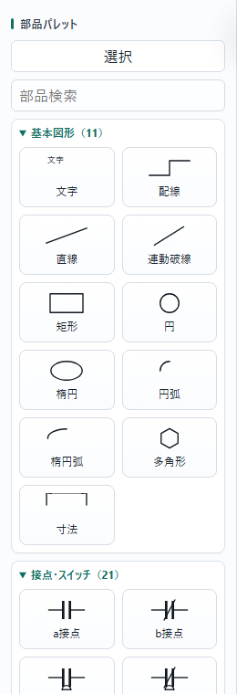{: .shot-panel}

**表示**

- ズーム: スライダー、「縮小」「拡大」ボタン（1回で約1.25倍ずつ）、`Ctrl+ホイール`（マウス位置を中心に拡大・縮小）、
  キーボードの `+`・`-` で変更します。スライダーの目盛は 0.8〜24 です。
  ズームの変更は「元に戻す」の対象にならず、図面の未保存状態にも影響しません。
- 標準／全体表示: 「標準」は原寸（スライダーの目盛で約3.8）で表示します。「全体表示」（キーボードの `0`）は、
  用紙全体が作業領域に収まる倍率にします。
- ページ表示: タブ（1ページずつ）／並べて表示（横・縦）を切り替えます（§4.5）。
- グリッド mm／スナップ／グリッド表示／端点スナップ: グリッド間隔（既定 2.5mm）、グリッドへの吸着（スナップ）、
  グリッドの表示／非表示、配線の端点や部品の接続点への吸着（端点スナップ）を設定します。
  グリッドを非表示にしてもスナップは独立して使用できます。
- 下絵をPDF/SVG/PNGに含める: 下絵を印刷や出力に含めるかを切り替えます（§4.7）。

**配線・レイヤ**

- 配線種別: これから引く配線の種別（制御線・動力線・安全線・盤外/参考線など）を選びます（§9.2）。
- 作図レイヤ: これから置く要素のレイヤを選びます（§18.1）。

**自動処理・ツール**

よく使う「線番採番」（§12.1）と「監査」（§12.8）はボタンのまま、その他の機能は**機能メニュー**（プルダウン）に
グループ分けして集約しています。線番・部品タグの書式（`%S-%N` など）は、その上の
**「採番の書式設定」**の折りたたみ内にあります（普段は閉じたままで使えます。§12.1、§12.6）。

機能メニューには、次のグループと項目があります。

- 自動処理: プロジェクト一括更新 / シンボル一括置換 / カタログ差分更新 / 端子番号の振り直し / 部品タグ採番 /
  接続点生成 / 指定回転（中心指定） / 配線順序(FROM/TO) / ラング追加 / 行挿入/行削除（行シフト）
- 一括生成: ラング回路（接点+コイル/ランプ） / 非常停止チェーン / 電源投入回路（自己保持） / ブレーキ/整流回路 /
  縦配線列 / 横配線行 / ツイストペア / モータ分岐回路 / PLCユニット / 盤レイアウト連携 / DINレール／配線ダクト /
  ユーザー回路を挿入
- 一覧・管理: コマンドパレット / お気に入り設定 / 属性スポイト / 選択要素の一括編集 / クイックプロパティ /
  ショートカット設定 / ページナビゲータ / 図面上のエラー表示切替 / 接続点スマート整列 /
  プロジェクト管理（ブラウザ内保存） / 端子台エディタ / ケーブル・芯線エディタ / 設置場所・接続ビュー /
  PLCモジュールDB / フットプリント検索DB / 項目番号・バルーン・銘板 / ケーブル展開（ファンイン／アウト） /
  選択範囲をユーザー回路登録 / 部品タグ規則 / 配線種別管理 / レイヤ管理 / 部品カタログ / ユーザー部品管理 /
  シンボルビルダー（マウス作図） / 履歴タイムライン（操作をさかのぼる） / 改訂履歴
- 帳票・確認: クロスリファレンス / 帳票CSV出力 / 表計算データ往復編集 / 図面要素一覧 / 帳票表挿入 /
  部品集計表(BOM) / 端子台プラン表 / 目次生成（全ページ一覧） / ネットリスト（ページ間統合）
- 取込・出力: 端子CSV取込 / PLC CSV取込 / DXF取込 / DXF出力（現在ページ） / DXF出力（全ページ） /
  標準パック出力 / 標準パック取込 / 表題欄レイアウト編集（JSON） / 図面差分（旧版JSONと比較）

盤レイアウトと回路図の双方向同期（§24.4）は、一括生成の「盤レイアウト連携」の画面から実行します。

以降の章で「機能メニューの「◯◯」」とある場合は、このプルダウンから選択してください
（選択すると即実行され、メニューは「選択してください…」に戻ります）。

### 3.5 中央キャンバス

図面を作図する領域です。

- キャンバス上部の中央には**操作ヒント**が常に表示され、「いま選んでいるツールで何ができるか／
  次に何をすればよいか」を案内します（例: 何も選んでいないときは「部品: 左パレットからドラッグ ／ 配線: W …」、
  部品を選択中は「選択中: ドラッグで移動 ／ … ／ Ctrl+D 複製 ／ Delete 削除 …」）。
  長い文が途中で切れているときは、マウスを乗せると全文が表示されます。
- 部品をクリックすると選択できます。選択した部品はドラッグで移動できます。
- 何もない場所からドラッグすると、範囲内の要素をまとめて選択できます。
- 配線、直線、矢印はドラッグで始点と終点を指定します（9章）。
- 要素を選択すると、近くに小さなボタン（ミニツールバー。部品なら配線／回転／複製／編集）が表示されます
  （7章「ミニツールバー」）。
- 右クリックすると、要素の上ではその場編集・コピー・複製・削除・回転・ミラー・ロックなどの編集メニュー、
  何もない場所では「貼付」「全体表示」のメニューが開きます（7章）。

中央キャンバスの左上と右上の角には、**パネルの開閉ボタン**「‹」「›」があります。
「‹」で左パネル、「›」で右パネルを閉じ、もう一度押すと開きます（パネルを閉じているときは画面の端に表示されます）。
`Tab` キーまたはリボンの「集中表示 Tab」では、左右のパネルを同時に開閉できます。開閉の状態は図面と一緒に保存されます。

キャンバス下端の黒い帯（**下部HUD**）には、現在の状態が常に表示されます。

- ツール: 「選択」、「作図中」、配置中の部品名など。
- `GRID 2.5 SHOW`: グリッド間隔（mm）と、グリッドの表示（SHOW）／非表示（HIDE）。
- `SNAP ON`／`接続 ON`: グリッドスナップと端点スナップの ON／OFF。
- 指摘 N: リボンの「検査表示」が ON のとき、現在ページで指摘のある要素の数。
- 未選択／選択 N: 選択している要素の数。
- 保存済み／未保存: 「未保存」は、JSONファイルへ保存していない変更があることを示します。

### 3.6 右パネル

右パネルは**「ページ設定」「選択部品」**の2タブです。未選択時はページ設定、部品を選択すると
選択部品へ自動で切り替わります。タブを押して手動で切り替えることもでき、未選択時の「選択部品」は押せません。
タブの帯はパネルをスクロールしても上端に表示されたままです。

「ページ設定」タブには、上から次の項目があります（図3-4）。テンプレートや下絵のプルダウンもこのタブにあるため、
部品を選択している間に使うときは「ページ設定」タブを押してから操作します。

- 標準: 汎用などの標準設定や、取り込んだ標準パックを切り替えます（§5.4、18章）。
- ページ名／図面上部にページ名を表示（§5.4）。
- シンボル拡大（新規配置の倍率）: このページで以後配置するシンボルの倍率です（§5.4）。
- 用紙・向き・図枠/表題欄・図名（5章）。
- 表題欄の詳細（折りたたみ）: 図番・改訂・作成・日付・設備コード・場所コード・側注記（左余白の縦書き）。
  見出しをクリックすると開きます（§5.3）。
- ページ追加・複製・削除、前へ・後へ、ページ順、テンプレートからページ追加、下絵（4章）。

「選択部品」タブでは、選択した図形や記号の位置、寸法、回転、ラベル、線番、属性メモなどを編集できます（7章）。
「文字スタイル」などの折りたたみの開閉状態は、部品種別と見出しごとにブラウザへ記憶されます。

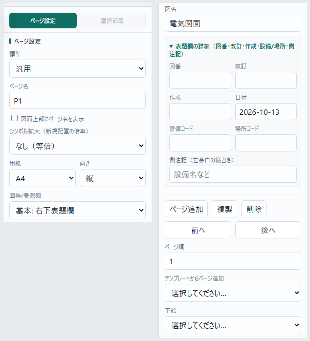{: .shot-panel}

## 4. ページ操作

ページの追加・複製・削除・並べ替えは、右パネル「ページ設定」タブの下部にあるボタンで行います（図3-4）。

### 4.1 ページ追加

1. 右パネル「ページ設定」タブの「ページ追加」を押します（ページタブ右端の「+ ページ」でも同じです）。
2. 末尾に新しいページ（ページ名 `P` + 番号）が追加され、そのページへ切り替わります。

新しいページは、現在ページの用紙サイズ・向き・図枠と、表題欄（図名・図番・改訂・作成・日付・
設備コード・場所コード・側注記）を引き継ぎます。ページ番号と総ページ数だけは自動採番されます。
シンボル拡大の倍率は引き継がず、等倍から始まります（§5.4）。

### 4.2 ページ複製（アドレス一括オフセット対応）

同じ形のページを作るときに使います。複製と同時に、アドレスやタグの番号をずらすこともできます。

1. 複製したいページを開き、右パネル「ページ設定」タブの「複製」を押します。
2. 「ページ複製」ダイアログ（図4-1）で、「複製数」（1〜20）と「1枚ごとのオフセット(10進。0=変更なし)」を入力します。
3. 「複製」を押します。複製したページはページの最後尾に追加され、最後に作ったページが表示されます。

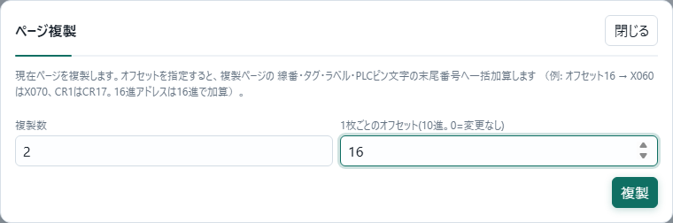{: .shot-wide}

オフセットが `0` のときは、ページ名の後ろに「copy」が付いた同じ内容のページになります。

オフセットを指定すると、複製ページの線番・タグ・ラベル・PLCピン文字（各行）・ページ名・図名の
**末尾の番号へ一括加算**されます。1枚目にはオフセットの1倍、2枚目には2倍…が加算され、
接頭辞と桁数は保持されます。

- PLCアドレス（`X`・`Y`・`RX`・`RY` に続く番号）は16進で加算します（例: オフセット16で `X060`→`X070`、`Y07F`→`Y08F`）。
  `B`・`W`・`SB`・`SW` に続く番号は、番号に A〜F を含むときだけ16進で加算します。
- それ以外は、末尾の数字を10進で加算します（例: オフセット16で `PB1`→`PB17`、`CR1`→`CR17`、`W01`→`W17`、`1-9`→`1-25`）。
- 末尾が数字でない文字（`MC` など）や、計算結果がマイナスになるものは変わりません。

例: オフセット16・複製2枚 → `X060` のページから `X070`・`X080` のページが一度に作れます
（設備の入出力回路のような同型ページの量産向け）。

### 4.3 ページ削除

右パネル「ページ設定」タブの「削除」を押すと、確認なしで現在ページを削除します。
誤って削除したときは `Ctrl+Z`（または上部の「U」）で元に戻せます。
最後の 1 ページは削除できません（ステータス表示に「最後の1ページは削除できません。」と表示されます）。

### 4.4 ページ順変更

- 「前へ」「後へ」: 現在ページを1つ前・1つ後ろへ移動します。
- 「ページ順」: 移動先の番号を入力して `Enter` を押す（または欄から抜ける）と、任意の位置へ一度に移動します。
- 並べて表示中は、各ページ見出しの◀▶（縦のときは▲▼）でも並び順を変更できます（§4.5）。

並び順は、ページタブの順、表題欄の頁番号、PDF印刷・A3面付・帳票のページ順に反映されます。

### 4.5 ページ表示モード（タブ／並べて表示）

左パネル「表示」の **「ページ表示」** で、ページの表示方法を切り替えられます。

- **タブ（1ページずつ）**: 既定。上部のページタブで切り替えながら、1ページずつ表示・編集します。
- **並べて表示（横）**: 全ページを**横一列**に並べ、どのページも直接編集できます。
- **並べて表示（縦）**: 全ページを**縦一列**に並べます。

並べて表示では、次のように操作します。

- ページをクリックすると、そのページが現在ページ（編集対象／アクティブページ）へ自動的に切り替わります。
  アクティブページは**緑の枠と緑の見出し**で強調され、上部タブの選択も連動します。
- 部品の配置、配線、同じ要素を素早く2回押すその場編集、右クリックメニューなどを、どのページにも直接実行できます。
  操作を始めたページがアクティブページになります。
- 各ページ見出しの **◀▶**（縦のときは **▲▼**）で、ページの並び順をその場で入れ替えられます。
  タブ順、PDF印刷、A3面付、帳票のページ順も連動します。
- 上部タブをクリックすると、そのページへスクロールして編集対象にします。
- ページが大きく表示されて全体が見渡せないときは、左パネル「表示」のズームを小さくするか、`Ctrl+ホイール` で縮小します。

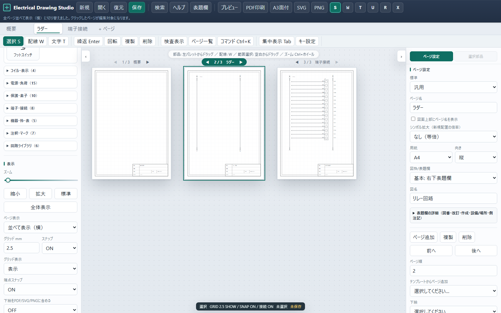{: .shot-full}

ページをまたぐ比較・転記や、図面全体の見通し確認に便利です。ページ数が多い図面
（目安10ページ超）では表示が重くなることがあるため、通常の作図はタブ表示、確認時は
並べて表示、という使い分けをおすすめします。

> 💡 **表示と保存・出力:** ページ表示モードと並び方向は図面JSONへ保存されます。
> 表示モードはPDF印刷、A3面付、SVG／PNG／DXF出力の内容には影響しません。
> 「現在ページ」を出力する機能では、緑枠のアクティブページが対象です。

### 4.6 テンプレートページ

回路の骨組みを入れたページを、テンプレートから追加できます。

1. 右パネル「ページ設定」タブの「テンプレートからページ追加」プルダウンで、テンプレートを選びます。
2. 設定ダイアログが開くテンプレート（設備ラダー、AC電源回路、DC電源回路、PLC電源回路、セーフティリレー回路、
   PLC入出力回路、インターロック接続）では、内容を確認して「ページ追加」を押します。
   端子接続図、ラダー（汎用）、目次、機器配置は、選ぶとすぐに追加されます。
3. 末尾に新しいページが追加され、そのページへ切り替わります。プルダウンは「選択してください…」に戻ります。

テンプレートで追加するページは A4 縦で、図枠は「基本: 右下表題欄」です（「ラダー（汎用）」だけは
「詳細: 右下+改訂欄」）。ページ名と図名はテンプレートごとの名前になり、それ以外の表題欄（図番・改訂・作成・日付・
設備コード・場所コード・側注記）は現在ページから引き継ぎます。
行番号（00〜20）、行への吸着、機器符号表を使うときは、追加した後で右パネルの図枠を
「ラダー: 行番号+機器符号表」へ切り替えてください（§5.3、§21.1）。

- 設備ラダー: 左レール（既定 `P1`）と右レール（既定 `N1`）の縦レール、上端の極性マーク（⊕・⊖）、
  電源注記（既定 `(DC24V)`）を配置したリレー回路ページです。左レールはカンマ区切りで複数置けます。
- AC電源回路（受電・分岐）: AC200V三相またはAC100V単相の受電から、ELB、表示灯、
  盤内照明・ファン・コンセント・REC/GOT送りなどのCP分岐までをまとめて配置します。
  200V時は変圧器（100VA/500VA/なし）も選択できます。
- AC電源回路（モータ）: サーボアンプ（1軸/2軸）またはインバータのモータ回路を追加します。
  サーボ時はエンコーダ送り・ブレーキ回路・リレー回路、インバータ時はサーマル・整流器・
  CC-Linkツイストペアまで生成します。
- DC電源回路: CP、スイッチング電源、N1/P0/P24/N24/Gの送り回路を追加します。
- PLC電源回路: PLCベースとスロット構成、P0A/N1/P1/P3/P3Mの電源・接点分岐を追加します。
- セーフティリレー回路: セーフティリレーユニット、2チャンネル非常停止ループ、
  安全出力、モニタリレー、ユニット電源を追加します。
- PLC入出力回路: 種別（入力/出力）と開始アドレスを選ぶと16進連番で一括生成します。
  入力は接点+配線+端子+ユニット列（右置き）、出力はユニット列（左置き）+端子+配線+コイルの構成です。
  モジュールプリセット（入力16点X000など）を選ぶと各欄が自動入力され、
  「現在値をプリセット保存」で自分のモジュール構成をプロジェクトへ登録できます
  （標準パックにも含まれます）。
- 端子接続図: P1/N1レールと、端子小円から始まる横配線16行、ユニット列の端子台（`TB1`）を配置した端子接続図ページです。
- インターロック接続: 盤枠（実線）と相手設備枠（一点鎖線）の間に、境界端子付きの
  送り（→発信元）/受け（←受信先）信号行を生成します（図枠内に収まる10信号まで）。矢印ラベルに信号名を入れると
  相手ページとのクロス参照・頁注記が働きます。
- ラダー（汎用）: 左右の母線と、番号付きの10本のラングを持つ汎用のラダーページです。
- 目次: 見出し「図面目次」と、編集できる目次表（No.・図番・図名・備考の4列）を配置したページです。
- 機器配置: 盤内の設備枠と、PLC・端子台・電源・リレー・予備の外形（矩形）を配置した機器配置図ページです。

「設備ラダー」を選ぶと、図4-3の設定画面が開きます。通常は左レール `P1`、右レール `N1`、
電源注記 `(DC24V)` の既定値のまま「ページ追加」を押します。左レールを複数置く場合は、
「左レール名（カンマ区切り・1つ目を左端に右へ順に配置）」へ名称をカンマ区切りで入力します。
例えば `P1,P2,P3` と入力すると、`P1` が左端になり、5mm 間隔で右へ並びます。
電源注記は最後の左レールの右に置かれます。

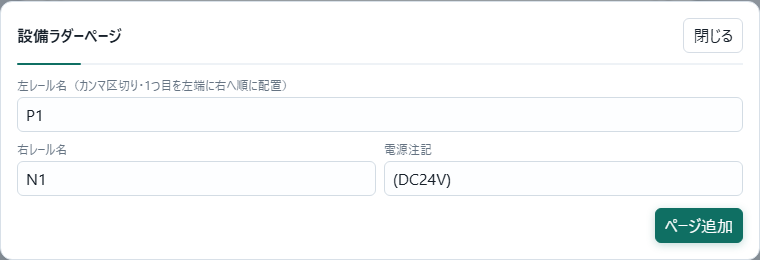{: .shot-wide}

### 4.7 下絵画像

下絵は、紙図面のスキャン画像などを用紙に薄く敷き、なぞって作図するための補助画像です。
右パネル「ページ設定」タブの「下絵」プルダウンから操作します。

**下絵を挿入する**

1. 「下絵」プルダウンで「下絵画像を挿入」を選びます。
2. PNG、JPEG、WebP、SVG のいずれかの画像ファイル（25MBまで）を選びます。
3. 画像が現在ページの用紙内に収まる大きさで、薄く（不透明度 `0.35`）配置されます。
   下絵は初期状態でロックされています。

**位置と大きさを合わせる**

1. 「下絵」プルダウンで「下絵を選択（ロック中も可）」を選びます。
   ロック中の下絵は、通常のクリックや範囲選択では選ばれないようにしています。
2. 右パネル（選択部品タブ）の「ロック解除」を押します。
3. 次の欄で位置や見え方を調整します（下絵はドラッグでも移動できます）。
    - 「位置 X mm」「位置 Y mm（上が＋）」: 画像の左上の点の位置です。Y は用紙の下端からの距離です。
    - 「幅 mm」「高さ mm」「回転 deg」: 画像の大きさと回転角度です。
    - 「不透明度（0.05〜1・小さいほど薄い）」: 位置合わせ中は `0.2`〜`0.4` 程度にすると、
      下絵と新しく描いた線を見分けやすくなります。1より大きい値は百分率として扱います（`30` → `0.3`）。
    - 「表示範囲」: 全体、上半分、下半分、左半分、右半分から選べます。表示範囲を変えると、高さはそのままで
      幅が切り出した部分の縦横比に合わせて自動で変わります（画像は引き伸ばされません）。
4. 位置が決まったら「ロック」を押して固定します。

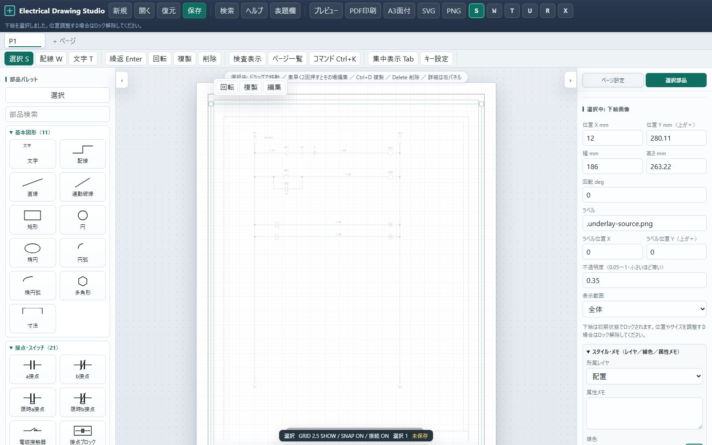{: .shot-full}

**A3スキャンからA4ページを2枚作る**

「下絵」プルダウンの「2面下絵ページを作成」では、A4図面を2ページ並べた A3 用紙のスキャン画像 1 枚から、
A4 の下絵ページを 2 枚作成します。

1. 「下絵」プルダウンの「2面下絵ページを作成」を選びます。分割のしかたを選ぶダイアログが開きます。
2. スキャンした紙の並び方に合わせて、分割のしかたを選びます。
    - 「自動（横長の画像は左右、縦長の画像は上下に分割）」: 画像が横長なら左右、縦長なら上下に分割します。
      はじめはこれが選ばれています。
    - 「横長のスキャンを左右に分割（A4縦×2）」: A3横の用紙に A4縦の図面が左右に並んだ紙
      （「A3面付」（§17.3）で A4縦のページを印刷した紙など）を、そのままの向きでスキャンした画像です。
      左半分が `-1`、右半分が `-2` の A4縦ページになります。
    - 「縦長のスキャンを上下に分割（A4横×2）」: A3縦の用紙に A4横の図面が上下に並んだ紙
      （「A3面付」で A4横のページを印刷した紙など）を、そのままの向きでスキャンした画像です。
      上半分が `-1`、下半分が `-2` の A4横ページになります。
    - 「90°右に回して左右に分割（従来の向き）」: A4縦の図面が左右に並んだ A3横の用紙を、縦長の画像として
      （左へ90度倒れた向きで）スキャンした画像です。画像を時計回りに90度回して元の向きに戻してから、
      左半分を `-1`、右半分を `-2` の A4縦ページにします。
3. 「画像を選択」を押し、スキャン画像を選びます。

各ページの用紙の向き（縦／横）は、分割した画像の向きに合わせて設定されます。ページ名は、ページ番号の後ろに
`-1`・`-2` が付きます（例: `P4-1`・`P4-2`）。アプリを開いている間は、選んだ分割のしかたが次回の既定になります。

複数の画像をまとめて選択することもできます。その場合は、画像ごとに2ページずつ
（`P4-1`・`P4-2`・`P5-1`・`P5-2` のように）末尾へ追加されます。

**下絵の扱い**

- 下絵はスキャン画像をなぞって作図するための補助要素です。帳票とクロス参照には含まれません。
- 既定では下絵はPDF印刷、SVG出力、PNG出力に含まれません。確認用として下絵も一緒に出したい場合は、
  左パネル「表示」の「下絵をPDF/SVG/PNGに含める」を `ON` にします。DXFには下絵画像を埋め込みません。
- PDFのスキャンは直接読み込めません。必要なページをPNGまたはJPEG画像に変換してから読み込んでください（§20.5）。

## 5. 用紙と図枠

用紙サイズ・向き・図枠は、ページごとに右パネル「ページ設定」タブで設定します。

### 5.1 用紙サイズ

「用紙」で次のどちらかを選びます。

- A4
- A3

### 5.2 用紙向き

「向き」で次のどちらかを選びます。

- 縦
- 横

### 5.3 図枠/表題欄

「図枠/表題欄」で、次の6種類から選べます（図5-1）。**新規ページの既定は「基本: 右下表題欄」**です。

- 基本: 右下表題欄（既定）: 右下に、図名・図番・作成・日付・SHEET（頁）の欄を持つ表題欄を置きます。
- 詳細: 右下+改訂欄: 右下の表題欄に、設備の欄と改訂履歴の欄が加わります。
- 側面表題欄: 用紙の右端に縦長の帯を置き、上に改訂履歴、下に図名・図番などの欄を並べます。
- 目次/表紙: 大型表欄: 見出し「図面目次」と大きな一覧表の欄を中央に置き、右下に表題欄を置きます。
- ラダー: 行番号+機器符号表: 左端に行番号 00〜20（ピッチ9.5mm）、下部に機器符号表と表題欄を置きます（§21.1）。
- 枠線のみ: 外枠だけを描きます。

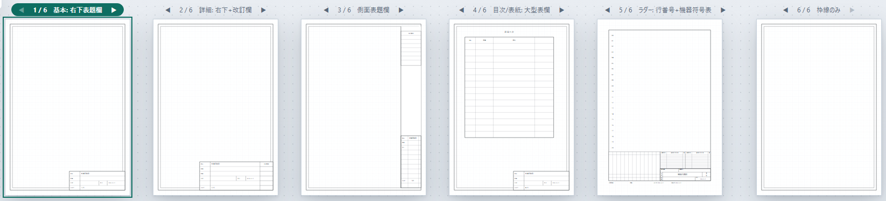{: .shot-wide}

表題欄の図名、図番、改訂、作成、日付、設備コード、場所コード、側注記はページごとに保持されます。
図名は「図名」欄、それ以外は折りたたみの「表題欄の詳細」を開いて入力します（図3-4）。
「基本」の日付も独立した罫線セル内に表示され、`20○○/○○/○○` の形式でも枠内に収まります。

起動直後のページと、上部「新規」で作ったページの日付には、その日の日付（`2026-07-26` の形式）が自動入力されます。
「ページ追加」「複製」「テンプレートからページ追加」で作ったページは、現在ページの日付を引き継ぎます
（現在ページの日付が空のときは、「ページ追加」とテンプレートで作ったページにはその日の日付が入ります）。
日付欄は固定値ではなく、任意の日付や社内書式へ変更できます。

複数ページがある図面で表題欄の項目を変更し、ほかのページにその項目と違う値が入っているときは、
**「表題欄の変更を他のページへ反映しますか？」**と確認されます（図5-2）。

- 「このページだけ」: 編集したページだけを変更します。
- 「全ページへ反映」: 値が違うほかのページへ、同じ値を反映します。
- 「以後このセッションでは確認せず、選んだほうを繰り返す」を ON にすると、ブラウザを閉じるまで同じ選択を自動適用します。

ほかのページがすべて同じ値のときや、1ページだけのときは確認されません。全ページへの反映は `Ctrl+Z` で取り消せますが、
最初に編集したページの値は残ります。上部の「表題欄」による一括更新（14章）とは別の機能です。

入力は `Enter` を押さなくても、別欄や別ページをクリックしてフォーカスが外れた時点で確定します。
ページ切替と同時に確定した場合も、値は入力を始めたページへ入り、その後に反映確認が表示されます。

{: .shot-wide}

位置の目安には、ラダー図枠の**行番号**（ピッチ9.5mm）とグリッドを使います
（見本図面の様式に合わせ、用紙外周の座標目盛は設けていません）。
行への吸着、図枠内のクロス参照表、機器符号表を使うページは、右パネルで図枠を
「ラダー: 行番号+機器符号表」へ切り替えてください。図枠を切り替えても、配置済みの部品や配線はそのまま残ります。

> 💡 **表題欄のカスタマイズ:** 「基本」「詳細」表題欄の罫線・欄の配置は、
> 機能メニューの「**表題欄レイアウト編集（JSON）**」で自社様式に変更できます。
> 変更したレイアウトは図面JSONと一緒に保存され、**標準パック**（機能メニューの「標準パック出力」。§24.19）にも同梱されるため、
> チームで同じ表題欄様式を配れます。「既定に戻す」でいつでも元に戻せます
> （ラダー図枠は寸法固定のため対象外です）。

### 5.4 ページ設定のその他の項目

右パネル「ページ設定」タブの上部には、用紙と図枠のほかに次の項目があります（図3-4）。

- **標準**: 汎用などの標準設定や、取り込んだ標準パックを切り替えます（18章）。切り替えると、
  グリッド間隔と線番・部品タグの書式も、選んだ標準の値に置き換わります。
  標準パックの出力・取込は、機能メニューの「標準パック出力」「標準パック取込」で行います（§24.19）。
- **ページ名**: ページタブや並べて表示の見出しに表示される名前です。
- **図面上部にページ名を表示**: ページ名は既定では図面に表示されません。ON にすると、全ページの上部中央に
  それぞれのページ名が表示されます（図面ファイル全体で共通の設定です）。
- **シンボル拡大（新規配置の倍率）**: `なし（等倍）`／`1.5倍`／`2倍`／`2.5倍`／`3倍` から選びます。
  倍率は**ページごと**の設定で、そのページで以後パレットから配置するシンボルだけが拡大され、
  接続点とDXF出力も同じ倍率になります。既存要素、配線・直線等、テンプレートの一括生成には影響しません。
  倍率を戻しても、すでに配置したシンボルの大きさは変わりません。
  「ページ追加」やテンプレートで追加したページは等倍から始まり、「複製」したページは元ページの倍率を引き継ぎます。

## 6. 部品配置

この章では、図面に部品（接点・コイル・端子などの記号）を置く方法を説明します。
部品を置く→つなぐ（9章の配線）→編集する（7章）が作図の基本サイクルです。

### 6.1 基本操作

部品の置き方は2通りあります。どちらでも結果は同じです。

**方法1: ドラッグで置く（1個だけ置くとき）**

1. 左パネルの部品パレットから、置きたい部品をマウスで**ドラッグ**します。
2. 用紙上の置きたい位置でマウスボタンを**離す**と配置されます。

**方法2: クリックで置く（同じ部品を続けて置くとき）**

1. パレットの部品を**クリック**します。タイルが緑の枠になり、配置モードに入ります。
   キャンバス上部には「a接点: 用紙をクリックで配置（連続配置可）。Esc で終了」のように案内が出ます。
2. 用紙上を**クリック**するたびに、その位置へ部品が置かれます。
3. 終わったら `Esc` キーを押すか、パレット上部の「選択」を押して配置モードを抜けます。

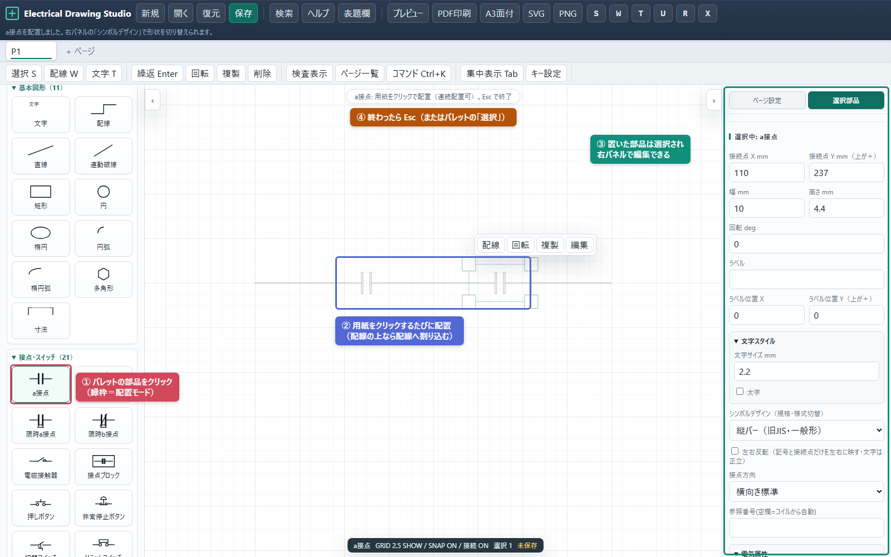{: .shot-full}

置いた部品は自動で選択され（緑の選択枠）、右パネルが「選択部品」タブに切り替わって編集欄が表示されます。
編集の方法は7章で説明します。
形を切り替えられる部品を置くと、画面上部のステータス表示に
「a接点を配置しました。右パネルの「シンボルデザイン」で形状を切り替えられます。」のような案内が出ます。

> ⚠️ **注意:** 方法2の配置モード中に用紙上の部品をクリックすると、そこへもう1つ部品が置かれます。
> 置いた部品を選び直すときは、先に `Esc` で配置モードを抜けてください。

> 💡 **ヒント:** 部品は自動的にグリッド（方眼。既定2.5mm）へ吸着し、クリックした点（ドラッグでは離した点）に
> 部品の第1接続ピンが合うように置かれます。ラダー図枠のページでは、近くの行（ピッチ9.5mm）にも吸着します。
> 接点やコイルなどのインライン部品を、曲がり角のないまっすぐな配線の途中へ置くと、配線が自動で分割されて
> 部品が線の中へ割り込みます（配線を引き直す必要はありません）。

> 💡 **ヒント:** 間違えて置いたら `Ctrl+Z`（元に戻す）を押すか、選択して `Delete` で削除します。

配置に関する設定と補助機能は次のとおりです。

- **1個ずつ置く**: 機能メニューの「お気に入り設定」で「部品を配置後も同じ部品を連続配置する」をOFFにすると、
  1個置くたびに選択ツールへ戻ります。
- **等間隔に置く**: 同じ部品を2個置いた後、3個目以降を同じ間隔の位置の近く（8mm以内）でクリックすると、
  直前と同じ間隔の位置へ置かれます。
- **拡大して置く**: 右パネル「ページ設定」の「シンボル拡大（新規配置の倍率）」で1.5倍〜3倍を選ぶと、
  以後パレットから置く部品がその倍率で置かれます（置いてある部品は変わりません）。
  接続点・配線の吸着・DXF出力も倍率に追従します。

#### 部品を探す

部品数が多い場合は、部品パレット上部の「部品検索」に語句を入力すると、候補を絞り込めます。
検索対象は、パレットの表示名と内部の種別名だけでなく、**現場での別名、部品タグ接頭辞、
シンボルデザイン名に含まれるJIS図記号番号**です。たとえば電磁接触器は
`電磁接触器`、`接触器`、`コンタクタ`、`マグネットスイッチ`、`電磁開閉器`、`MC`、
`07-13-02` のどれでも見つかります（JIS図記号番号で探すと、その番号を持つ部品が先頭に並びます）。
ほかにも次の語で見つかります。

- `ブレーカ`／`NFB` → 遮断器
- `セレクタ` → 切替スイッチ
- `アース` → 接地
- `サーマル` → サーマルリレー、サーマル素子
- `シーケンサ` → PLC/I-O
- `整流器` → 電源（AC/DC変換器のデザイン）、ダイオード（ブリッジ整流器のデザイン）。`ブリッジ` → ダイオード

検索欄で `Enter` を押すと先頭の候補が配置モードになり、そのまま用紙をクリックして続けて置けます。
検索欄で `Esc` を押すと検索語が消え、カテゴリ表示に戻ります。

#### 最近使用とお気に入り

部品を置くと、パレット先頭の「最近使用」に直近の6件が並びます（ページを再読み込みすると空に戻ります）。
タイルにマウスを重ねると右上に☆が表示され、クリックすると「★ お気に入り」カテゴリへ固定できます。
もう一度押すと解除されます。機能メニューの「お気に入り設定」でもまとめて設定できます。

### 6.2 配置できる部品

左パネルの部品パレットは、次のカテゴリに分かれています。見出し（例: 「接点・スイッチ（21）」）を
クリックすると開閉でき、括弧内はそのカテゴリの部品数です。部品を置いた後は「最近使用」、
☆を付けた部品は「★ お気に入り」、ユーザー部品（15章）を登録すると「ユーザー部品」のカテゴリも表示されます。

| カテゴリ（部品数） | 部品（パレットの表示名） |
|---|---|
| 基本図形（11） | 文字、配線、直線、連動破線、矩形、円、楕円、円弧、楕円弧、多角形、寸法 |
| 接点・スイッチ（21） | a接点、b接点、限時a接点、限時b接点、電磁接触器、接点ブロック、押しボタン、非常停止ボタン、切替スイッチ、リミットスイッチ、光電スイッチ、近接スイッチ、熱電対、マットスイッチ、リードスイッチ、ライトカーテン（光電管）、圧力スイッチ、フロートスイッチ、温度スイッチ、フロースイッチ、フットスイッチ |
| コイル・表示（4） | コイル、ランプ、ブザー、計器(V/A) |
| 電源・負荷（15） | ソレノイド弁、センサ、電源、トランス、接地、モータ、発電機、ファン、リアクトル、ヒータ、バッテリ、避雷器、変流器(CT)、断路器、コンセント／プラグ |
| 保護・素子（10） | ヒューズ、遮断器、トランジスタ、論理ゲート、フォトカプラ、抵抗、コンデンサ、ダイオード、サーマルリレー、サーマル素子 |
| 端子・接続（8） | 端子、端子台、端子配線セット、コネクタ、ケーブル、ケーブル束、端子箱、接続点 |
| 機器・枠・表（5） | 設備枠、場所枠、機器箱、PLC/I-O、表 |
| 注釈・マーク（7） | 雲マーク、改訂三角、信号矢印、ポジション表示、極性マーク、電流種別（JIS 限定図記号）、操作機構（JIS 限定図記号） |
| 回路ライブラリ（6） | 自己保持回路、起動・停止回路、タイマ遅延回路、ランプ表示行、ブザー警報行、非常停止行 |

多くの部品は、置いた後に右パネルの「シンボルデザイン」でJIS形・見本形などの別の形へ切り替えられます（§21.4）。
パレットから新しく置く電気部品のラベルは空欄です。必要な機器記号だけ、置いた後に右パネルの「ラベル」、
または素早く2回押すその場編集で入力してください。ページテンプレートや回路ライブラリが作る回路では、
回路を識別するためのラベルが入ります。

#### 部品ごとの補足

**基本図形**

- **文字**: クリックした位置に置かれます。本文・文字サイズ・横位置・縦位置は右パネルで編集します（§7.2）。
- **配線・直線・連動破線・寸法**: 用紙上でドラッグして作図します（配線は9章）。寸法は測りたい2点をドラッグし、
  水平/垂直を自動で判定して実寸mmを表示します。「ラベル」に入力すると表示を上書きでき、
  「寸法線オフセット mm」で寸法線の位置を調整できます。
- **矩形**: 既定は35×20mmです。4つの角と4辺の中央の8点が配線接続点です。
- **円／楕円**: 円は直径20mm、楕円は25×15mmで置かれます（楕円は幅と高さが違う円として扱われます）。
  外周の8点が配線接続点です。円では0°（右）から45°刻みの8点、楕円では上下左右の頂点と、
  外接矩形の対角方向の4点です。角度は0°=右、時計回りで、回転すると接続点も一緒に回ります。
- **円弧／楕円弧**: 右パネルの「開始角（0=右・時計回り）」「終了角（度）」で弧の範囲を指定します。
  幅と高さが違うと楕円弧になり、開始角と終了角を同じにすると全周になります。
  ラベルを入力すると弧の中央に表示され、ラベル位置X/Y、文字サイズ、太字も反映されます。
  **弧の両端点は移動時に配線・端子・直線の端点へ吸着**します。DXFへは円弧=ARC、楕円弧=折れ線近似で出力されます。
- **多角形**: クリックした位置を中心に正六角形で置かれます。右パネルの「辺数（3〜12）」または「外接半径 mm」を
  変えると、中心位置を保ったまま**正多角形へすぐに作り直されます**（更新ボタンはありません）。
  「頂点追加」「頂点削除」と、図面上の頂点ハンドルのドラッグで自由な形にできます。
  **全頂点と各辺の中央は配線接続点**になり、端子・配線・直線の端点へ吸着します。
  「分解（直線にばらす）」を押すと、辺ごとの独立した直線に変換され、個別に編集・削除できます。

**接点・スイッチ**

- **限時a接点／限時b接点**: タイマ接点です。限時記号つきで、タイマコイルとのクロス参照（22章）に対応します。
- **電磁接触器**: JIS 07-13-02 の主メーク接点（既定）とブレーク接点です。タグ接頭辞は `MC` で、
  コイルとのクロス参照に対応します。
- **接点ブロック**: 枠の中に小型接点を持つ部品です（§7.2「接点方向」の後の説明を参照）。
- **非常停止ボタン**: 既定は一般形（キノコ＋b接点）です。シンボルデザインでJIS形（07-07-06）、
  縦連結2接点/3接点、バー押込式などへ切り替えられます（§21.4）。
- **近接スイッチ**: 近接検出装置（JIS 07-20-02・近接操作＋a接点。既定）と近接センサ（JIS 07-19-01）の2形です。
  タグ接頭辞は `PXS` で、配線の途中に置くと配線へ割り込みます。
- **熱電対**: JIS 08-06-01。2本の脚が左側から入り、右端の測温接点で合わさる形で、極性（＋／−）が付きます。
  タグ接頭辞は `TC` です。配線へは割り込まないので、左側の2つの接続点から配線を引きます。
- **光電スイッチ**: 透過形などの2端子形、+24V系を配線できる3線式／4線式の多端子形、ラダー図用の接点表現があります。
- **マットスイッチ**: 一般形、a接点付、b接点付、安全2チャンネル。
- **リードスイッチ**: 線だけのa/b接点、縦バー形a/b接点、切替接点、磁石併記形、シリンダ取付形。
- **ライトカーテン（光電管）**: 投光・受光一体、投光器/受光器単体、安全形（OSSD）、光電管、
  投光器3線式、受光器4線式、OSSD2出力の接点表現。

**コイル・表示／電源・負荷**

- **計器(V/A)**: 指示計（既定）、電圧計V、電流計A、角形、積算計、針付きなどに切り替えられます。
- **リアクトル**: 既定はコイル形のインダクタ（JIS 04-03-01）です。シンボルデザインで、
  リアクトル（JIS 06-09-08）、磁心入り、気隙入り、箱形などへ切り替えられます。
- **ヒータ**: 箱＋斜線の一般形（既定）と、抵抗器形の箱（JIS 04-01-01）。
- **断路器**: 断路器（JIS 07-13-06。既定）と負荷開閉器（JIS 07-13-08）。
- **コンセント／プラグ**: 一般家庭用の外観形、JISのおす形・めす形接点、盤内コンセント（見本形）など。
- **センサ**: 汎用、誘導、光電、静電容量、磁気・リード、超音波、レーザ、ホール。
- **整流器**: 単独の部品はありません。「ダイオード」のデザイン「ブリッジ接続の整流器（JIS 06-14-04・◇4端子）」、
  または「電源」のデザイン「AC/DC変換器」を使います（部品検索で `整流器` と入力すると両方が出ます）。

**保護・素子**

- **トランジスタ**: NPN（既定）／PNP（外囲みの円あり・なし）、接合形FET、フォトトランジスタ。
- **論理ゲート**: AND（既定）／OR／NOT／NAND／NOR／XOR。IEC/JISの矩形式で「&」「≥1」「1＋否定丸」
  「&＋否定丸」「≥1＋否定丸」「=1」と描かれ、入出力ピンは2.5mmグリッドに合います。
- **フォトカプラ**: 箱の中にLEDと受光素子を描いた形で、入出力4ピンです。

**端子・接続／機器・枠・表**

- **ケーブル**: パレットの表示名は「ケーブル」です。本書ではケーブルマーカーとも呼びます。
- 端子台は§10.2、端子箱は§10.3、機器箱とPLC/I-Oは§11.1、設備枠と場所枠は§7.5、表は8章、
  接続点は§9.6で説明します。

**注釈・マーク**

- **雲マーク**: 改訂範囲などを囲む雲形の枠です。角ハンドルで大きさを変えられます。
- **改訂三角**: 改訂番号入りの△です。置いたときの番号は、機能メニュー「改訂履歴」の最新の改訂記号です
  （改訂履歴が空ならページの「改訂」、それも空なら `1`）。素早く2回押すその場編集、または右パネルの
  「ラベル」で変更できます。雲マークとセットで改訂範囲の明示に使います。
- **信号矢印**: ページ間の信号の受け渡しを示します（§9.7）。
- **電流種別（JIS 限定図記号）**: 直流、交流、交直流、三相交流の4種類です。
- **操作機構（JIS 限定図記号）**: 手動、スイッチの確実動作、押し、引き、回転、キー、ローラ、足踏み、
  非常停止、電磁、近接効果、接触、電動機、熱の14種類です。

**回路ライブラリ**

- 自己保持回路などの組み立て済み回路を、ほかの部品と同じ操作（ドラッグ、またはクリックしてから用紙をクリック）で
  まとめて置けます。置いた後はタグ（CR1など）を右パネルで実際の番号へ変更してください。

## 7. 選択後の編集

この章では、置いた部品の選び方と、右パネルでの編集方法を説明します。

部品を選択すると、右パネルが自動で「選択部品」タブへ切り替わり、編集欄がすぐ表示されます。
右パネル上部の「ページ設定」「選択部品」タブは、パネルをスクロールしても上端に残るので、いつでも切り替えられます。

選択のしかた:

- **1つ選ぶ**: 部品をクリック。
- **複数選ぶ**: `Shift` を押しながらクリックで追加/解除。
- **範囲で選ぶ**: 用紙の空白部分からドラッグすると範囲選択枠が表示され、枠に重なった要素をまとめて選択します。
  `Shift` を押しながら空白からドラッグすると、今の選択に追加します。下絵画像は範囲選択に含めません。
- **重なった要素を選ぶ**: `Alt` を押しながら同じ場所をクリックするたびに、重なった要素を前面から順に選択します。
- **選択を外す**: 空白をクリック、または `Esc`。

シンボルは線の上だけでなく**外形の少し外側まで**クリックで掴めます
（設備枠・矩形・円などの枠系は、内側の部品を選べるように枠線付近だけが対象です）。
斜めの直線・連動破線・信号矢印は実際の線上、寸法は測定線・引出線・寸法線の
どこをクリックしても選択できます。

選択ツール（`S` / `V`）で端子や部品の接続点をクリックしても配線は始まらず、そのまま選択・移動できます。
端子から配線を始める場合は、先に `W` で配線ツールを選びます（9章）。

#### 右パネルの並び

図7-1はコイルを選択した画面です。キャンバス上の選択枠と右パネルが同じ部品を示します。
右パネルは上から次の順に並んでいるので、上から順に確認すると編集箇所を見失いません。

1. 位置と寸法: 「接続点 X mm」「接続点 Y mm（上が＋）」「幅 mm」「高さ mm」「回転 deg」（§7.1）
2. ラベル: 「ラベル」「ラベル位置 X」「ラベル位置 Y（上が＋）」と「文字スタイル」（§7.2）
3. 部品ごとの設定: 「シンボルデザイン」「左右反転」「接点方向」「参照番号」など（§7.2、§21.4）
4. 「電気属性」: タグ、説明、設備、場所、メーカー、品番、定格、項目と「図面表示」（§7.4）
5. コイルと接点では「接点へ移動」「親コイルへ移動」（22章）
6. 「スタイル・メモ（レイヤ／線色／属性メモ）」（§7.3）
7. 操作ボタン: 「同種をページ内全選択」「ユーザー部品に登録」「ロック」「コピー」「貼付」「複製」「削除」
   「前面へ」「背面へ」「左90°」「右90°」「左右ミラー」「等間隔複製」と、1mm移動の「←」「↑」「→」「↓ 1mm移動」

▼の付いた見出し（「文字スタイル」「電気属性」など）はクリックで折りたためます。
開閉状態は、同じ種類の部品を次に選んだときも再現されます。

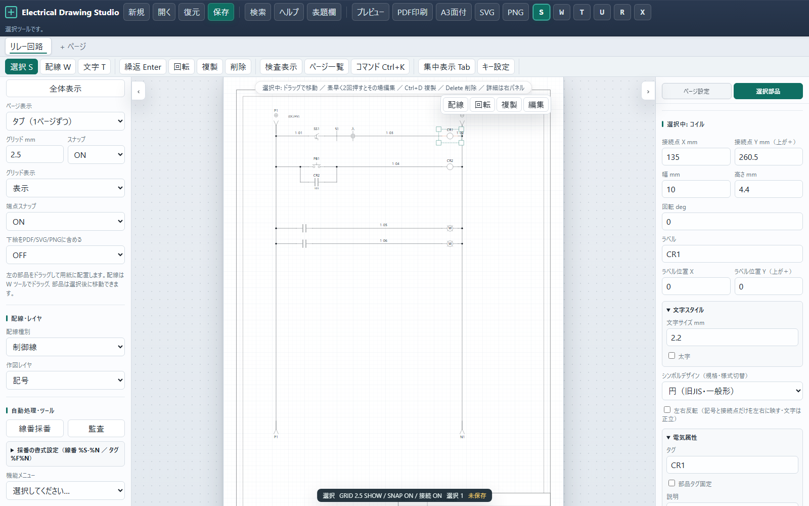{: .shot-full}

#### ミニツールバー

選択要素の近く（要素から離れた上方。上に収まらない場合は下方）には、対象に合ったボタンだけを並べた
ミニツールバーが表示されます。

| 選択した要素 | ミニツールバーのボタン |
|---|---|
| 接続点を持つ部品・図形（接点・コイル・端子・矩形・円など） | 「配線」「回転」（右90°）「複製」「編集」（クイックプロパティ） |
| 接続点を持たない要素（表・設備枠/場所枠・雲マークなど） | 「回転」（右90°）「複製」「編集」（クイックプロパティ）。「配線」は表示されません |
| 配線 | 「線番」（その場編集）「曲がり角＋」「分割」「削除」 |
| 文字 | 「編集」（その場編集）「左回転」（左90°）「複製」「削除」 |

「配線」を押すと配線ツールに切り替わり、選択中の部品の接続点が緑の小円で強調されます。
小円を押して終点までドラッグすると、その接続点から配線を引けます。
ミニツールバーは画面のスクロールに追従し、要素が見えなくなると隠れます。
ドラッグ中、その場編集中、ダイアログの表示中は表示されません。

#### 右クリックメニュー

要素を**右クリック**すると、「その場編集（ラベル/線番/文字）」「コピー (Ctrl+C)」「複製 (Ctrl+D)」
「削除 (Delete)」「右90°回転」「左右ミラー」「ロック」（ロック中は「ロック解除」）「同種をページ内全選択」を
その場で実行できます。同じタグの相手がいるコイルには「接点へ移動（…）」、接点には
「親コイルへ移動（…）」も表示されます。空白を右クリックすると「貼付 (Ctrl+V)」「全体表示 (0)」が出ます。

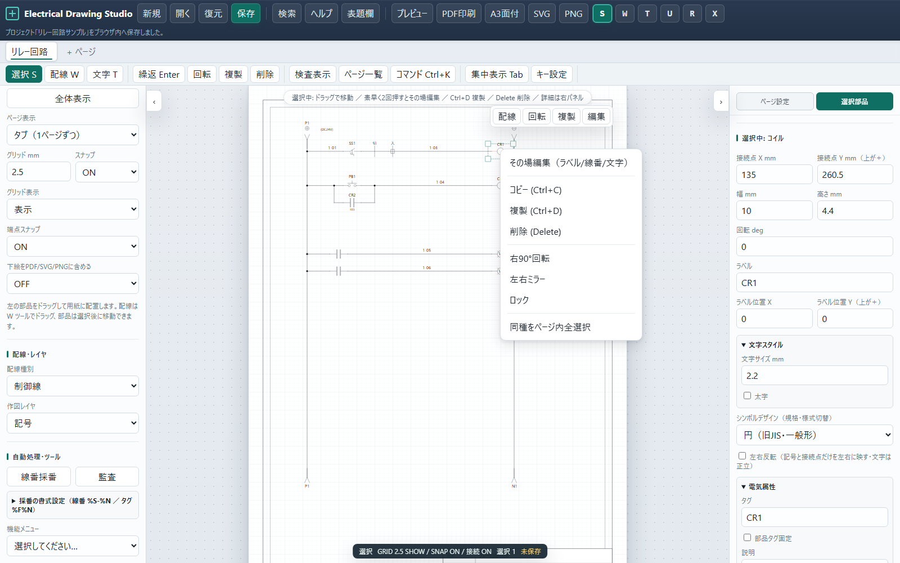{: .shot-full}

#### その場編集

同じ要素を**0.45秒以内に素早く2回押す**と、図面上に小さな入力欄が開き、その場で編集できます
（部品=ラベル、配線=線番、文字=本文）。`Enter` で確定、`Esc` で取消、
`Tab` で確定して同じ種類の次の要素へ移ります（§9.3）。2回目の押下からドラッグした場合は移動が優先されます。
ロック中の要素はその場編集できません。

### 7.1 位置と寸法

右パネル上部の欄で、位置・寸法・回転を数値で指定できます。座標の原点は用紙の左下で、
Xは右向き、Yは上向きが正です。

- **「接続点 X mm」「接続点 Y mm（上が＋）」**: 接続点を持つ部品・図形では、第1接続点の座標です
  （電気部品は第1配線接続点、矩形は左上の角、円は右端の点）。値を変えると、第1接続点がその座標へ移動します。
- **「位置 X mm」「位置 Y mm（上が＋）」**: 接続点を持たない要素（文字・表・設備枠/場所枠・雲マーク・改訂三角・
  下絵など）では、外形の左上の座標です。
- **「幅 mm」「高さ mm」**: 矩形・円・文字・表・機器箱・端子箱・PLC/I-O・枠・雲マーク・コネクタ（端子列）・
  ブザー（ホーン形・スピーカー形）など、大きさを自由に決められる要素で変更できます。
  接点・コイルなど**形の決まった記号では入力欄が灰色になり、変更できません**
  （マウスを重ねると「形の決まった記号は大きさを変えられません（ページ設定のシンボル拡大を使用）」と表示されます）。
  記号を大きく描きたい場合は、置く前に右パネル「ページ設定」の「シンボル拡大（新規配置の倍率）」で倍率を選びます。
- **「回転 deg」**: 数値を入れると要素の左上を中心に回転します。接続ピンがグリッドから外れることがあるため、
  通常は「左90°」「右90°」ボタン（§7.10）を使います。

配線・直線・矢印・寸法を選んだ場合は、始点・中間点・終点ごとに「X」「Y（上が＋）」が表示されます。

大きさを自由に決められる要素を1つ選ぶと、選択枠の四隅の□をドラッグして図面上で直接サイズを変更できます。
形の決まった記号、配線・直線・矢印・寸法・多角形、接続点、ロック中の要素は角ハンドルでリサイズできません
（□は選択範囲を示すだけです）。

### 7.2 ラベルと線番

部品にはラベル、配線には線番を入力できます（線番の入力方法は§9.3）。

部品を選択すると、右パネルの「ラベル」で文字を、「ラベル位置 X」「ラベル位置 Y（上が＋）」で位置を調整できます。
ラベル位置Yは、正の値ほど上へ移動します。新しく置いた記号のラベルは、記号の上側に表示されます。
ラベルの文字サイズと太字は、その下の「文字スタイル」で変更します。

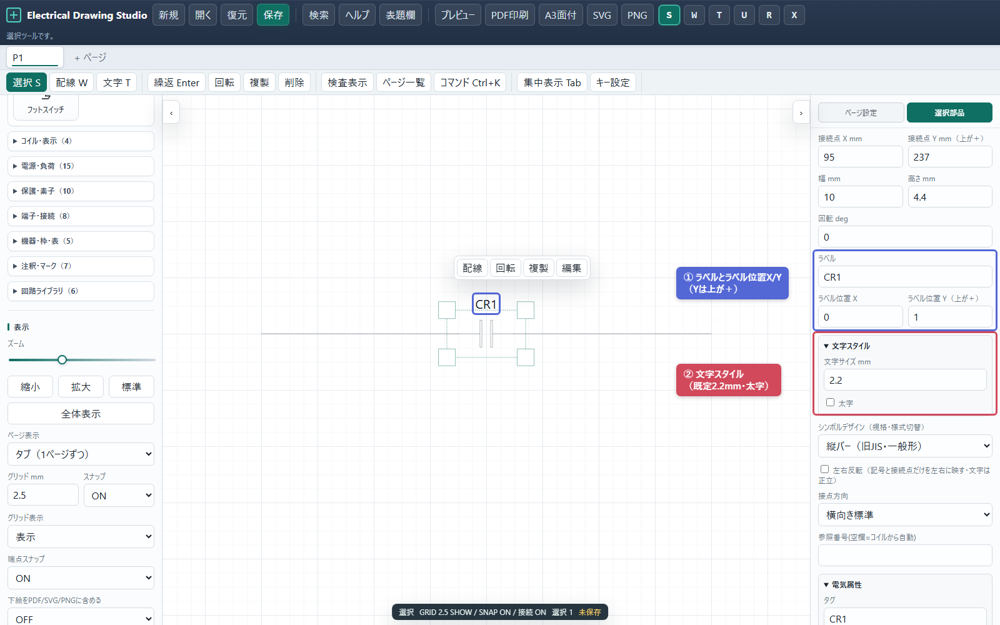{: .shot-full}

ラベル位置X/Yで動くのは**ラベルだけ**です。機器箱の端子文字、端子台・PLCユニット列・端子箱の
端子名、`COM`／`0V`など記号構造の固定文字は、たまたまラベルと同じ文字列であっても動きません
（文字サイズの変更も同様で、端子文字は専用の「端子文字サイズ」で変えます）。

各要素の「文字スタイル」では、その要素が表示する文字のサイズと太字を変更できます。
配線では線番の文字サイズと太字を設定できます。文字部品では、本文の文字サイズは「文字」欄の下の「文字サイズ mm」で、
太字は「文字スタイル」で設定します。
シンボルラベルの既定文字サイズは**2.2mm**で、右パネルの表示値と実際の描画は常に一致します。
直線と連動破線のラベルだけは既定**2.4mm**です。文字サイズ入力は0.1mm刻みです。
形の決まった記号でもラベルへ反映されますが、COM/0V、OSSD、接点内の機能文字など
記号構造の一部である固定文字は対象外です。
入力値はEnterを押さずに別の要素を選択しても、編集していた要素へ確定され、選択先へ誤って書き込まれません。

文字部品では複数行のテキストを入力できます。「横位置」（左・中央・右）と「縦位置」（上・中央・下）を組み合わせ、
左上・上中央・右上・左中央・中央・右中央・左下・下中央・右下へ配置できます。「下線」も付けられます。
文字、機器箱の端子名、端子台の端子名などは入力中にフォーカスが外れず、そのまま連続入力できます。

機器箱・端子箱・PLCなど複数の接続点を持つ部品の既定の接続点間隔は、2.5mmの倍数（端子台とPLCユニット列は
ラダー図枠の行ピッチ9.5mm）です。端子ピッチなどを自分で指定するときも2.5mmの倍数にすると、
配線がグリッドに乗ります。

#### 接点方向

a接点、b接点、電磁接触器、押しボタン、サーマルリレーを選択すると、右パネルで「接点方向」を選べます。

「横向き標準」は、横配線上へ置きやすい小型の接点記号です。新しく置く接点はこの形が既定です。

「縦配線上の回転配置用」は、縦配線上へ縦向きに置きたい場合の形です。まず横向き標準で置き、
必要に応じて右パネルの「接点方向」や「左90°」「右90°」（§7.10）で向きを変えます。

接点ブロックは、枠の中に小型接点を持つ部品です。配線上をクリックすると配線の中心に合わせて置かれ、
配線は左右の端子位置で自動分割されます。選択後、右パネルの「ブロック内接点」でa接点／b接点を、
「ブロック枠」で実線（既定）／点線を切り替えられます。

ヒューズと遮断器は、右パネルの「保護部品方向」で「横配線用」／「縦配線用」を切り替えられます。
抵抗は「方向」で横／縦を切り替えます。ヒューズ・遮断器・抵抗は、縦配線上をクリックして置いた場合は
縦向きの寸法へ自動で切り替わり、配線は上下の端子位置で自動分割されます。

ランプを選択すると、右パネルの「ランプ形状」で「丸形パイロット（見本形）」「ランプ（JIS 08-10-01・円＋✕）」
「筒形表示灯（実務形）」「蛍光灯・盤内照明（見本形・箱形）」を切り替えられます。
「ランプ色文字(W/R/G等)」には色記号を入力します。
ブザーは「ブザー形状」で、音響信号装置・一般（JIS C 0617 08-10-06）、ブザー（08-10-10）、サイレン（08-10-09）、
ホーン（既定）、スピーカー、発音強調、電子ブザーから選べます（§21.4）。

単体端子は、新規配置時は丸端子として置かれます。右パネルの「端子形状」で「丸」「二重円（貫通）」「角」を、
「方向」で横／縦を切り替えられます。

「シンボルデザイン」「抵抗形状」「ランプ形状」「ブザー形状」の下に「左右反転」のチェックがある部品では、
チェックすると記号と接続点だけが左右に映り、文字は正立のままになります（§21.4「左右反転」）。

### 7.3 属性メモ

すべての要素に属性メモを入力できます。右パネルの「スタイル・メモ（レイヤ／線色／属性メモ）」にある
「属性メモ」欄へ入力します。同じ欄では「所属レイヤ」と「線色」も変更できます。
線色が標準の黒（左端の色）の要素は、所属レイヤの線色（§18.1）で描かれます。

属性メモは検索・一括置換（13章）の対象になり、帳票CSV（§17.7）にも出力されます。

### 7.4 電気属性

端子、端子台、接点、コイル、ランプ、PLC/I-O、機器箱などの電気部品には、右パネルの「電気属性」で
次の属性を入力できます（文字・矩形・円・雲マーク・改訂三角・表・枠などには表示されません）。

- タグ
- 説明
- 設備
- 場所
- メーカー
- 品番
- 定格
- 項目

「メーカー」「品番」は、「カタログから選択」で部品カタログ（23章）の登録内容から入力することもできます。
タグを入力したときにラベルが空欄なら、ラベルにも同じ文字が入ります。

「部品タグ固定」を ON にすると、部品タグの自動採番（§12.6）を実行しても、その部品のタグとラベルは上書きされません。
複製（§7.6）でも番号が進みません。既に手入力した機器番号を保持したい場合に使います。

電気属性は検索対象になり、帳票CSVでは列として出力されます。

「設備/場所コピー」を押すと、選択中の部品の設備と場所をコピーできます。
コピー後に別の電気部品を選択して「設備/場所貼付」を押すと、その部品へ設備と場所を貼り付けます。
Shift クリックなどで複数の部品を選択している場合も、右パネルの「設備/場所貼付」でまとめて貼り付けできます。

#### 属性を図面に表示する

電気属性欄の「図面表示」で、図面上に表示する属性にチェックを付けます。表示できる項目は、
タグ・説明・設備・場所・メーカー・品番・定格・項目です。図面上では「TAG: CR1」「MFG: オムロン」のように、
項目の略号（TAG、DESC、INST、LOC、MFG、CAT、RATE、ITEM）を付けて1行ずつ表示されます。

- 「表示X」「表示Y」: 部品の外形の左上から見た表示位置（mm）です。表示Yは値を大きくすると**下へ**移動します
  （ラベル位置Yとは向きが逆です）。
- 「表示文字サイズ mm」: 属性表示の文字サイズです。

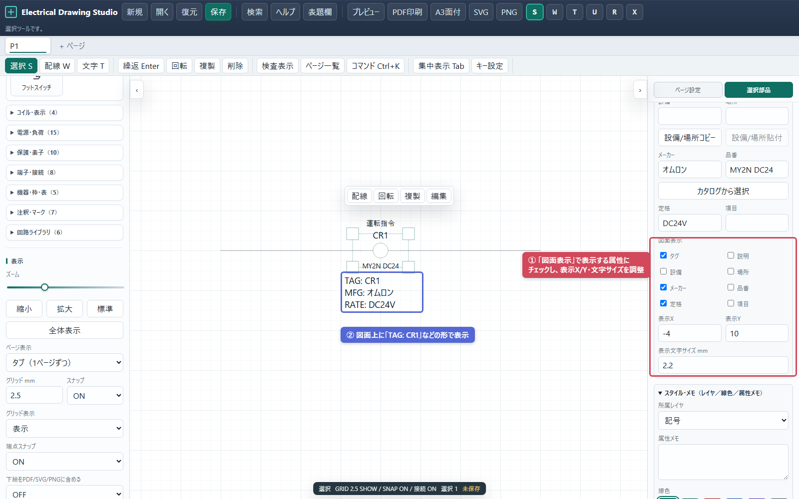{: .shot-full}

表示した属性は、PDF印刷、SVG、PNG、DXF出力にも反映されます。
なお、コイルは「品番」を記号の下に、接点・コイル・押しボタン・ランプなど多くの記号は「説明」の1行目を
記号の上に、図面表示の設定とは別に小さく表示します（図7-4の「運転指令」「MY2N DC24」）。

#### 機器箱の端子文字

機器箱を選択すると、右パネルで「左右ピン数」「左端子文字（1行1点）」「右端子文字（1行1点）」を編集できます。

左端子文字と右端子文字は1行1点で入力します。箱の左側と右側に別々の端子番号や信号名を出したい場合に使います。
「端子記号」が既定の「文字に連動」では、文字がある位置にラベルなしの端子円を表示し、文字を消すと端子円も消えます。
「常に表示」「非表示」で一括切替できるほか、「端子ごとの表示（個別）」で左右各端子を個別にON/OFFできます。
端子円は単体端子と同じ直径・白抜き表現で、機器箱の輪郭や接続配線を円内で隠します。
機器箱の一部として移動・回転に追随し、SVG表示とDXF出力にも反映されます。
中央ラベルは「文字スタイル」、左右の端子名は専用の「端子文字サイズ mm」で個別に設定します。
「端子ピッチ mm」「上下マージン mm」を指定すると、箱の高さは
`2×上下マージン+(端子数-1)×端子ピッチ`へ自動追従します。両方を空欄にすると現在の箱の高さを等分し、
ピッチだけ指定した場合は上下マージンもピッチと同じ値、上下マージンだけ指定した場合は端子ピッチが5mmになります。
「端子の一括編集…」では、左右端子文字と端子表示を表形式でまとめて変更できます（機器箱の詳細は§11.1）。

### 7.5 設備枠/場所枠

設備枠・場所枠は、枠で囲んだ範囲の電気部品へ、設備名や場所名をまとめて入力するための点線枠です。

1. 左パネル「機器・枠・表」の「設備枠」（または「場所枠」）を用紙へ置きます。
   既定は120×80mmの破線枠で、左上に「INST: INST1」（場所枠は「LOC: LOC1」）の見出しが付きます。
2. 枠の四隅の□をドラッグして、対象の部品を囲む大きさにします。
3. 枠を選択し、右パネルの「ラベル」に設備名（場所名）を入力します。見出しの後半がその名前になります。
4. 「枠内へ設備属性を適用」（場所枠では「枠内へ場所属性を適用」）を押します。

中心が枠の内側にある電気部品の「設備」（または「場所」）にラベルの文字が入り、ステータス表示に
「N個の部品へ設備属性を適用しました。」と表示されます。既に入っている値は上書きされ、ロック中の部品は対象外です。

「枠線破線（一点鎖線: 6 1.5 1.5 1.5）」では、`4 2`（既定）のように線と隙間の長さ（mm）で破線パターンを指定します。

適用された設備/場所属性は、検索、帳票CSV、帳票表、属性表示に反映されます。

### 7.6 コピーと貼付

選択中の要素は、右パネルのボタンで操作できます。

- コピー
- 貼付
- 複製
- 削除

「複製」と「貼付」は、元の要素から右へ5mm、下へ5mmずらした位置に作られます。
2.5mmグリッドの倍数なので、コピーした部品の接続ピンも元と同じ格子上に残ります。
コピーした内容はアプリの中だけで使え、別のページを開いてから貼り付けることもできます。

「複製」（`Ctrl+D`、右パネル、右クリック、ミニツールバー、リボン）では、タグ・ラベル・線番・ケーブルタグ・芯番号の**末尾の番号が1つ進みます**。

- 末尾の数字を10進で進めます。接頭辞と桁数は保ちます（`CR1`→`CR2`、`MC9`→`MC10`、`PB09`→`PB10`）。
- PLCアドレス（`X`・`Y`・`RX`・`RY` に続く番号）は16進で進めます（`X06F`→`X070`）。
  リンクデバイス（`B`・`W`・`SB`・`SW`）は、番号に`A`〜`F`を含むときだけ16進です（`W0A`→`W0B`、`W09`→`W10`）。
- 末尾に数字がない文字（`MC`、`COM` など）は変わりません。
- PLC/I-Oでは「I/O名」の各行の番号も進みます。
- 「部品タグ固定」がONの部品はタグとラベルを、「線番固定」がONの配線は線番を変えずに複製します。

「貼付」（`Ctrl+V`）では番号は進みません。同じリレーの接点を増やすときなど、同じタグのまま増やしたい場合は
「コピー」→「貼付」を使います。

グループ化した要素（§24.19）を複製・貼付すると、複製した要素どうしが新しいグループになり、
元のグループとは別に選択・移動できます。

右パネルの「等間隔複製」では、「複製数」（既定3）、「間隔X mm」、「間隔Y mm」（既定9.5mm＝ラダー図枠の1行）を
指定して、まとめて複製できます。間隔Yは正の値で下へ並び、n個目の複製は番号がn進みます（`CR1`→`CR2`、`CR3`、`CR4`）。

キーボード操作も使用できます。

- `Ctrl+C`: コピー
- `Ctrl+V`: 貼付
- `Ctrl+D`: 複製
- `Delete`（または `Backspace`）: 削除
- `Ctrl+K`: コマンドパレット（リボンの「コマンド Ctrl+K」と同じ）
- `Enter` または `Space`（選択ツール中）: 直前の配置・複製・機能メニューの操作を繰り返す（リボンの「繰返 Enter」と同じ）
- `Q`: 選択要素のクイックプロパティ
- `Alt+クリック`: 重なった要素の選択候補を順に切替
- `Alt+←` / `Alt+→`: 検索・参照移動の履歴を戻る／進む
- `Tab`: 集中表示（左右パネルを隠す／戻す）
- `S` または `V`: 選択ツール
- `W`: 配線ツール
- `T`: 文字ツール
- `L`: 直線ツール
- `R`: 矩形ツール
- `C`: 円ツール

選択・配線・文字・直線・矩形・円・クイックプロパティのキーは、リボンの「キー設定」で変更できます（`V` は常に選択ツールです）。

### 7.7 移動

選択した要素はドラッグで移動できます。
クリックして選択しただけでは、位置や端点は吸着で動きません。吸着するのはドラッグ移動、
端点ハンドルのドラッグ、または作図確定時だけです。

Shift クリックや範囲選択で複数の要素を選択している場合は、選択中のいずれかの要素をドラッグすると、
選択中の要素全体を一緒に移動できます。

ドラッグ移動では第1接続ピンをグリッドの格子へ乗せ直し、複数選択では相対配置を保ちます。
吸着半径内では**接続点を最優先**し、接続点がない場合だけ図形の角・中心・線上へ吸着します。
格子からずれた部品も、一度ドラッグし直すだけで接続ピンが格子へ揃います。
接続済みの配線の端点は、部品と一緒に動きます（9章）。

右パネルの「←」「↑」「→」「↓ 1mm移動」ボタンで1mmずつ移動できます。
キーボードの矢印キーでも1mmずつ、`Shift` を押しながら矢印キーを押すと5mmずつ移動します。
どちらも接続済みの配線の端点が一緒に動きます。1mm移動では接続ピンが2.5mmグリッドから外れるので、
配線をつなぐ部品は、最後にドラッグし直すとピンがグリッドへ戻ります。

> 💡 **タッチ操作:** タブレット等のタッチ画面では、**2本指の開閉でズーム**、
> **2本指のスライドでスクロール（パン）**ができます。1本指はマウスと同じ操作
> （タップで選択・ドラッグで移動/作図）です。現場での図面閲覧にも使えます。

> 💡 **整列ガイド:** 部品をドラッグ中、その部品の**接続ピン**が他の部品のピンと
> 縦・横の位置でぴったり一致している間、**マゼンタの破線ガイド**が表示されます。
> 「上の行の接点と同じX位置に揃えたい」ときは、ガイドが出た位置で離せば正確に揃います
> （画面表示のみで、印刷や出力には写りません）。

### 7.8 整列と均等配置

Shift クリックや範囲選択で複数の要素を選択すると、右パネルに「複数選択: N件」の編集ボタンが表示されます。
整列と均等配置のボタンは、パネルの下のほうにあります。

- 「左揃え」「中揃え」（左右の中心）「右揃え」
- 「上揃え」「中央」（上下の中心）「下揃え」
- 「横均等」「縦均等」

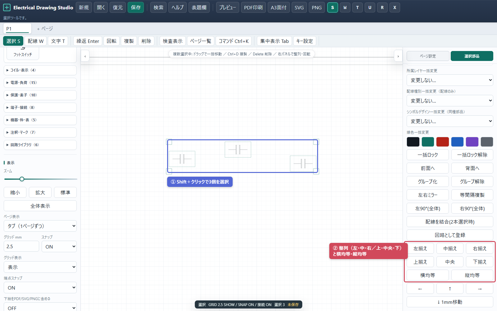{: .shot-full}

整列は2つ以上、均等配置は3つ以上の要素を選択したときに実行されます。
ロック中の要素が含まれている場合は、整列と均等配置は実行されません。
整列・均等配置は外形の端や中心を基準に動かすため、接続ピンがグリッドから外れることがあります。
配線をつなぐ部品は、整列後にドラッグし直すとピンがグリッドへ戻ります。

> 💡 **同種をページ内全選択:** 部品を1つ選択し、右パネル（または右クリック）の「**同種をページ内全選択**」を押すと、
> 同じ種類の部品（例: ページ内の全a接点）がまとめて選択されます。
> 下記の一括変更（デザイン・線色・ロック）と組み合わせると、ページ全体の様式替えが数クリックで済みます。

複数選択では、次の**一括変更**も使えます。

- **所属レイヤ一括変更** / **配線種別一括変更（配線のみ）**（配線種別は選択中の配線だけが対象）
- **シンボルデザイン一括変更（同種部品）**: 選択した部品が**すべて同じ種類**のとき表示されます。
  例: ページ内のa接点を全選択 → 「メーク接点（JIS 07-02-01・斜め線のみ）」を選ぶと一度に切替。
  切替前の第1接続ピン位置を保持するため、一括で切り替えても既存配線はずれません。
- **線色一括変更**: カラーパレットから選ぶと選択全体に適用されます。
- **一括ロック / 一括ロック解除**: 完成した部分をまとめて保護できます。

複数選択の右パネルには、ほかに「コピー」「貼付」「複製」「削除」「設備/場所貼付」（§7.4）、「前面へ」「背面へ」、
「グループ化」「グループ解除」「左右ミラー」（§24.19）、「等間隔複製」（§7.6）、「左90°(全体)」「右90°(全体)」（§7.10）、
「配線を結合(2本選択時)」（§9.1）、「回路として登録」（15章）があります。

### 7.9 前面/背面

- 「前面へ」: 重なり順を1つ前に移動します。
- 「背面へ」: 重なり順を1つ後ろに移動します。

### 7.10 回転

- 「左90°」: 反時計回りに90°回転します。
- 「右90°」: 時計回りに90°回転します。

複数選択時は「左90°(全体)」「右90°(全体)」になります。ミニツールバーの「回転」、リボンの「回転」、
右クリックの「右90°回転」は「右90°」と同じです（文字のミニツールバーの「左回転」は「左90°」と同じです）。

選択している要素全体の外形の中心を回転中心として回転します。
複数選択している場合は、回路の形を保ったまま全体が回転します（剛体回転）。
スナップがONのときは、回転後に選択全体を最大1.25mmずらして接続ピンをグリッドへ合わせます
（ラダー図枠のページでは、2.5mm以内の行にも合わせます）。右90°→左90°や、右90°を4回行うと元の位置へ戻ります。

回転中心を変えたい場合は、機能メニューの「指定回転（中心指定）」を使います。

1. 回転する要素を選択します。
2. 機能メニューから「指定回転（中心指定）」を選びます。
3. 「角度」で 90°／180°／270°（時計回り）を選びます。
4. 「回転中心」で「選択枠の中心」または「座標を指定」を選びます。「座標を指定」では「中心X mm」「中心Y mm（上が＋）」を、
   右パネルの位置欄と同じ座標で入力します。
5. 「回転」を押します。この場合もスナップがONなら、接続ピンがグリッドへ合うように位置が補正されます。

### 7.11 ロック

「ロック」を押すと、選択中の要素を移動・削除・回転・整列・角ハンドルでのリサイズができない状態にします。
図面上のその場編集もできなくなりますが、右パネルの入力欄（ラベル・属性など）からは変更できます。
ロック中は同じボタンが「ロック解除」になり、押すと再び編集できます。
所属レイヤがレイヤ管理でロックされている場合は「レイヤロック中」と表示され、要素ごとには解除できません（§18.1）。
複数選択時は「一括ロック」「一括ロック解除」を使います。

## 8. 表の編集

表部品は、図番一覧や機器表などの罫線表を図面に描く部品です。行数・列数・列幅・行高・セル文字を右パネルで編集します。

1. 左パネル「機器・枠・表」の「表」を用紙へ置きます。既定は86×48mm、6行×4列で、
   1行目に「No.」「項目」「内容」「備考」が入り、表の上にラベル「表」が表示されます（ラベルを消すと非表示）。
2. 表を選択し、右パネルの「行」「列」で行数と列数を指定します。
3. 「セル文字（タブ/カンマ区切り）」に文字を入力します。1行が表の1行で、列はカンマで区切ります。
4. 必要に応じて「列幅（カンマ区切り）」「行高（カンマ区切り）」「斜線セル（行,列;行,列）」「表文字サイズ mm」を設定します。

例（3行×4列の表）:

```text
No.,図番,図名,備考
1,EL-001,電源回路,
2,EL-002,端子接続図,
```

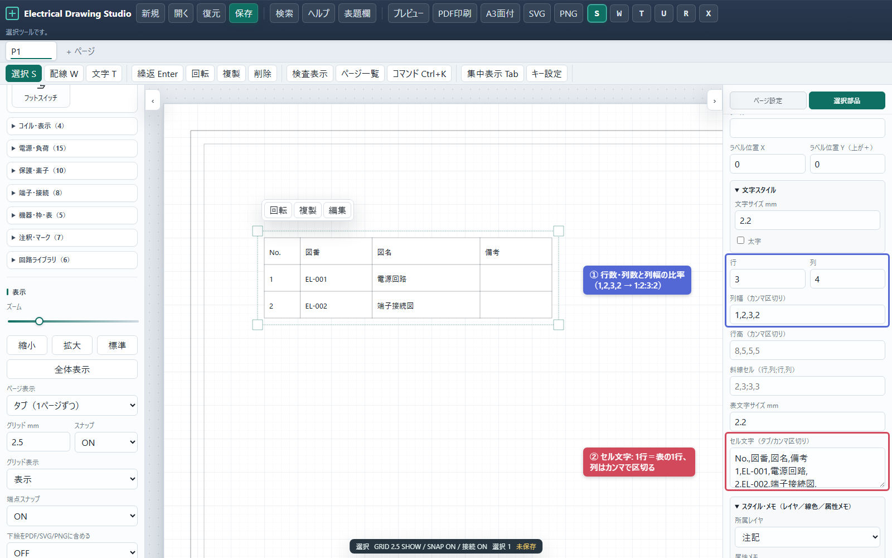{: .shot-full}

- **区切り文字**: 列はカンマまたはタブで区切ります。入力欄の中で `Tab` キーを押すと欄から抜けてしまうため、
  手入力ではカンマを使います。Excelなどからコピーした表を貼り付けると、タブ区切りのまま入ります。
  行の中にタブが1つでもあれば、その行はタブだけで区切られ、カンマは文字として残ります。
- **行数・列数**: セル文字に合わせて自動では増えません。「行」「列」より多い行・列の文字は表示されないので、
  先に行数・列数を設定してください。
- **列幅・行高**: カンマ区切りの**比率**です（例: `1,2,3,2` は1:2:3:2）。合計が表の幅・高さに配分されます。
  値の個数が列数・行数と合わないときや空欄のときは、等幅・等高になります。表全体の大きさは「幅 mm」「高さ mm」
  または四隅の□で変えます。
- **斜線セル**: `行,列;行,列` の形で入力すると（例: `2,3;3,3`）、そのセルに斜線を引きます。
- **表文字サイズ mm**: セル文字の大きさです（既定2.2mm）。

セル文字は検索・一括置換（項目名「表セル」）の対象です。帳票から表を作る場合は「帳票表挿入」（§17.8）、
全ページの目次を作る場合は機能メニューの「目次生成（全ページ一覧）」も使えます。

## 9. 配線作図

この章では、部品と部品を電気的につなぐ「配線」の描き方を説明します。
配線は単なる線ではなく、線番（§9.3・§12.1）・ネット（同じ電位のつながり）・帳票の対象になる電気要素です。

### 9.1 配線の作成

#### 基本の引き方

1. 配線ツールを選びます。次のどれでも同じです。
   - キーボードの `W`
   - 上部ツールバーの「W」、またはクイック作図リボンの「配線 W」
   - 左の部品パレット「基本図形」の「配線」
2. つなぎたい始点（部品の端子など）でマウスボタンを押し、終点まで**ドラッグ**して離します。
3. 配線が確定すると、自動的に選択ツールへ戻ります。続けて配線する場合は、もう一度 `W` を押します。

配線は自動的に**直交配線**（水平と垂直だけの折れ線）になります。斜めにドラッグしても L字に整形されます。

> 💡 **ヒント:** 配線の端点は、近くの端子・接点・コイルなどの**接続点へ自動で吸着**します（§9.8）。
> 吸着した配線は、部品を動かすと端点が一緒についてきます。
> 丸端子へ接続した配線は、接続判定上は端子中心につながりますが、表示線は円の外周で止まり、円内には描画されません。

> 💡 **ヒント:** 描き直したいときは `Ctrl+Z`、配線だけ消したいときは選択して `Delete` です。
> ドラッグ中に `Esc` を押すと、その配線を取り消せます。

#### 選択中の部品から引く

複数の端子を持つ部品では、どの端子から配線を出すかを先に選ぶと確実です。

1. 部品をクリックして選択します。部品の近くに「配線」「回転」「複製」「編集」の小さなボタン（ミニツールバー）が出ます。
2. ミニツールバーの「配線」を押します。部品を選択したまま `W`、上部の「W」、リボンの「配線 W」、パレットの「配線」を選んでも同じです。
3. その部品の接続点だけが**緑の小円**で表示されます。配線を伸ばしたい小円からドラッグします。

部品本体（緑の小円以外）を押しても配線は始まらず、ステータス表示に
「選択中シンボルの緑の小円（接続点）を押して配線を始めてください。」と表示されます。
部品の外側を押した場合は、その位置から通常どおり配線を引けます。

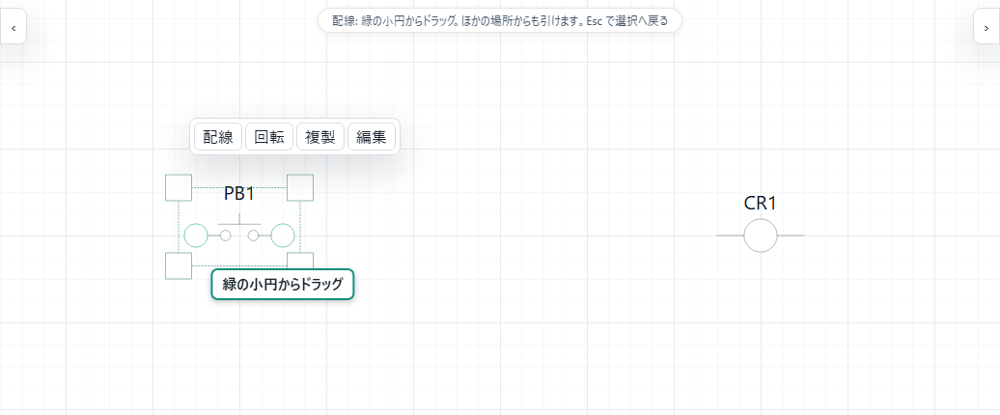{: .shot-wide}

#### 折れ向きと折れ形状

L字の折れ向きは、ドラッグを始めた方向で決まります。先に横へ動かすと「横→縦」、
先に縦へ動かすと「縦→横」になります。その向きの経路が部品の本体を横切り、逆向きなら横切らない場合だけは、
自動で逆向きのL字になります（コの字が自動で選ばれることはありません）。

ドラッグ中（マウスボタンを押したまま）は、次のキーで形を変えたり確定方法を選んだりできます。

| キー | 動作 |
|---|---|
| `Shift` | 押している間、表示中の形の折れ向きを反転します（L字⇔逆向きのL字、コの字⇔逆向きのコの字）。マウスを動かさなくても押した瞬間・離した瞬間に切り替わります。`Shift` を押したままマウスボタンを離すと、反転した形で確定します |
| `スペース` または `Tab` | 表示中の形から、L字（縦→横）→ L字（横→縦）→ コの字（横→縦→横）→ コの字（縦→横→縦）→ L字（縦→横）… の順に次の形へ切り替えます |
| 数字・`,`・`@` → `Enter` | 長さ・角度・座標を数値で指定して確定します（次項） |
| `N` | 「長さ・角度で確定」画面を開きます（次項） |
| `J` | 終点に接続点（黒丸）を置いて確定します。配線ツールのまま、続けて次の配線を引けます |
| `Esc` | 作図中の配線を取り消します |

ドラッグ中は、ツール切替のキー（`S`、`W` など）は働きません。

`スペース`／`Tab` で形を切り替えると、ステータス表示に「コの字（横→縦→横）で作図中（スペース/Tabで次の形、Shiftで向き反転）」のように現在の形が表示されます。
コの字は、始点と終点の中間で1回折り返す配線です（スナップON時は折り返し位置もグリッドへ合います）。
確定すると通常の折れ点つき配線になるため、中間点のハンドルをずらして折り返し位置を後から調整できます。

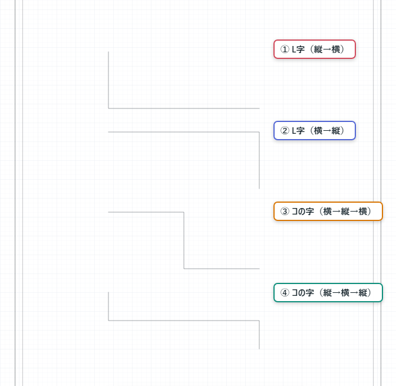{: .shot-panel}

#### 数値で長さ・位置を指定する

マウスボタンを押したまま数字を入力すると、画面上部に「長さ,角度 / X@Y: …」の入力欄が表示されます。
入力後に `Enter` を押すと確定します（`Backspace` で1文字ずつ消せます）。

| 入力例 | 意味 |
|---|---|
| `25` | 今ドラッグしている向きのまま、長さ 25mm で確定します |
| `30,90` | 長さ 30mm・角度 90° で確定します。角度は右向きが 0°、上向きが 90° の反時計回りです |
| `100@150` | 終点を X=100mm、Y=150mm に置いて確定します。座標は右パネルの座標欄と同じく、用紙の左下が原点で上が＋です |

- 配線の終点はグリッドへ合わせられ（スナップON時）、作図中に表示していた折れ形状のまま確定します。確定後は選択ツールへ戻ります。
- 直線・信号矢印・連動破線・寸法は、入力した値どおりに確定し、ツールはそのまま残ります。
- 終点が始点と重なる指定は「指定した終点が始点と重なるため確定できません。」と表示され、確定しません。

ドラッグ中に `N` を押すと「長さ・角度で確定」画面が開きます。マウスボタンを離してから
「長さ mm」と「角度 deg（0°=右・90°=上）」を入力し、「確定」を押します。

#### グリッドへの合わせ方

水平に近い方向へ配線を伸ばすと終点Xだけがグリッドへ吸着し、Yは始点と完全に一致します。
垂直に近い方向では終点Yだけがグリッドへ吸着し、Xは始点と一致します。
始点が `Y=120.42` や `X=80.31` のような端数座標でも水平・垂直を保てます。
斜め方向へドラッグして折れ配線を作る場合は、終点のX/Yがグリッドへ吸着します。

基本図形の「直線」を新規作成すると、ドラッグ方向は始点を基準に15度刻み（0、15、30、45、60、75、90度…）へ自動でそろい、
水平なら始点と終点のY、垂直ならXが正確に一致します。作成後は始点・終点のX/Y欄で任意の角度へ変更できます。
信号矢印と連動破線も同じ軸別スナップで、水平に作図・伸縮するときはYを、垂直のときはXを始点側に固定します。

直線の両端は配線の接続部です。配線ツール選択中は緑の小円から配線を開始でき、配線の終点も吸着します。
直線を選択すると、始点を青い「始」、終点を橙色の「終」で区別します。

#### 作成後の形を直す

配線を選択すると、端点と中間点に四角い□ハンドルが表示されます。ハンドルをドラッグすると、図面上で直接点を動かせます。
右パネルの「選択部品」タブには「配線種別」と、「始点 X」「始点 Y（上が＋）」「中間1 X」…「終点 Y（上が＋）」の座標欄が並び、
数値を入力して各点を正確に動かすこともできます。

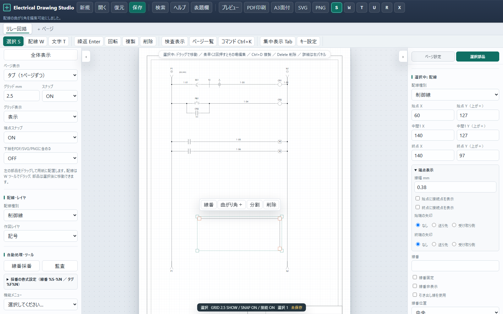{: .shot-full}

右パネルを下へスクロールすると、配線の形を整えるボタンが並んでいます（図9-4）。

| ボタン | 動作 |
|---|---|
| 曲がり角追加 | L字配線では、画面に見えている角を編集できる中間点に変えます。それ以外の配線では、いちばん長い線分の中央へ中間点を追加します。配線を選択したときのミニツールバーの「曲がり角＋」も同じです |
| 最後の曲がり角削除 | 終点側の最後の中間点を削除します。中間点がなくなると、消した角と同じ側に折れるL字になります |
| 直交整形 | 点を動かして斜めの区間ができたとき、必要な折れ点を足して水平・垂直だけの配線に整えます |
| 折れ向き反転 | 始点と終点だけのL字配線で、「縦→横」と「横→縦」を切り替えます（線番の位置や接続判定も追従します）。中間点のある配線では使えません |
| 終点を延長 | 終点側の線分を同じ向きへ伸ばし、最初に交差する配線まで延長します |
| 終点をトリム | 終点側の線分を、最初に交差する配線の位置まで切り詰めます |
| 配線を分割 | L字配線は折れ角の位置、まっすぐな配線は中央、折れ点の多い配線は中ほどの折れ点で2本に分けます。後ろ側の配線の線番は非表示になります |
| 中央ギャップ追加／交差ギャップ追加／全解除 | 交差の表現に使います（§9.4） |

2本の配線をShift+クリックで選択し、端点が一致している場合は、右パネルの「配線を結合(2本選択時)」で1本にまとめられます。

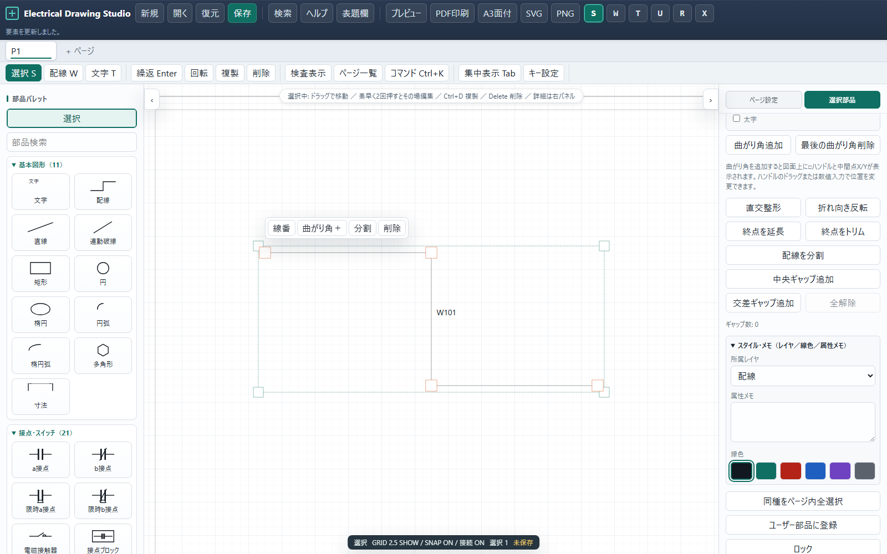{: .shot-full}

接続済みの部品を移動すると、配線の端点が部品の接続点に追従します。始点と終点だけの配線はL字に組み直され、
コの字や手で足した曲がり角を持つ配線は、中間の折れ点を保ったまま、動いた端につながる線分だけが伸び縮みします。

#### 線の太さ・色と端点の表示

配線・直線・連動破線は、右パネルの「端点表示」グループにある「線幅 mm」で太さを、
「スタイル・メモ（レイヤ／線色／属性メモ）」の「線色」で色を変更できます。指定した太さと色は、線と端点の矢印の両方に反映されます。
「端点表示」では次も設定できます。

- 「始点に接続点を表示」「終点に接続点を表示」: 端点に黒い接続点を個別に表示します（§9.6）。
- 「始端の矢印」「終端の矢印」: それぞれ「なし」「送り先」「受け取り側」から選びます。送り先は信号矢印の開き矢印、
  受け取り側は信号矢印の「フォーク（母線端）」と同じ形です。

#### 配線をまとめて並べる

機能メニュー「一括生成」グループの「縦配線列」で、複数の縦配線を一括生成できます。
本数、ピッチ mm、開始X mm、上端Y mm（上が＋）、下端Y mm（上が＋）、線番接頭辞、線番開始番号を指定して「生成」を押します。
上端Yには下端Yより大きい値を入れます。端子台へ伸びる縦配線を先に並べると、部品配置の基準にできます。

同じグループの「横配線行」では、本数、開始X、終了X、開始Y mm（上が＋）、ピッチ、線番接頭辞、線番開始番号を指定して
複数の横配線を生成します。開始Yは1本目の位置で、2本目以降はピッチごとに下へ並びます。
横方向の母線、盤間配線、上下に並ぶ信号線を先に引くと、後から端子や部品を合わせやすくなります。

> 💡 **ヒント:** この2つの画面のY（上端Y・下端Y・開始Y）は、右パネルの座標と同じく用紙の下端から測った位置で、
> 上が＋です。右パネルに表示された配線や部品のYをそのまま入れると、その高さに配線が引かれます。
> スナップON時は開始位置とピッチも現在のグリッドへ揃います。用紙またはラダー図枠の作図範囲を越える指定や、
> 上端Yが下端Y以下の指定では生成せず、ステータス表示に理由を出します。

### 9.2 配線種別

配線には「配線種別」があり、種別ごとに色・線幅・破線と、自動線番の対象にするかどうかが決まっています。
初期状態の種別は次の4つです。

- 制御線
- 動力線
- 安全線
- 盤外/参考線（自動線番の対象外）

これから引く配線の種別は、左パネル「配線・レイヤ」の「配線種別」で選びます。
作成済みの配線の種別は、配線を選択して右パネルの「配線種別」で変更します。

種別そのものを編集するには、機能メニューの「配線種別管理」を開きます。

1. 表の「名称」「色」「線幅」「破線」（例: `3 2`）「採番外」を編集します。「採番外」にチェックを入れた種別は、自動線番の対象外になります。
2. 新しい種別が必要なときは「種別追加」を押し、「配線種別ID（半角英数字）」と「配線種別名」を入力します。表で編集中の内容はそのまま残ります。
3. 「適用」を押すと、表の内容が保存されます。

### 9.3 線番

配線を選択すると、右パネルの「線番」欄で線番を入力できます。

もっと速いのは**その場編集**です。配線を**素早く2回押す**と図面上に小さな入力欄が開き、そのまま線番を打てます。

- `Enter` = 確定 ／ `Esc` = 取消
- `Tab` = 確定して**次の配線**の入力欄へ移動（`Shift+Tab` で前へ）

`Tab` で移る順番は、線番の位置が上のものから順（同じ高さなら左から）です。
上から順に 11 → 12 → 13 … と線番を続けて入力できます。部品を素早く2回押すとラベル、文字要素では本文を同じ操作感で編集できます。

右パネルでは、線番の表示を次のように調整できます。

| 項目 | 内容 |
|---|---|
| 線番固定 | ONにすると、「線番採番」を実行してもその配線の線番は上書きされません。画面上では線番の下に小さく「FIX」と表示されます（印刷・PDF・SVG・PNGには出ません） |
| 線番非表示 | ONにすると、線番はデータとして保持したまま図面上の表示だけを隠します。「線番採番」を実行しても、ここで隠した設定は保たれます |
| 引き出し線を使用 | 配線上の基準点から線番まで細い引き出し線を表示します |
| 線番位置 | 「中央」「始点寄せ」「終点寄せ」から選びます |
| 線番調整X／線番調整Y | 線番の表示位置をmm単位でずらします。線番調整Yはプラスで上、マイナスで下へ移動します |

線番の文字サイズと太字は「文字スタイル」で変更します。線番は近くのシンボルや文字と重なっても自動では退避しません。
重なる場合は「線番位置」や「線番調整X/Y」で位置を直してください。

#### 自動線番

左パネル「自動処理・ツール」の「線番採番」を押すと、自動で線番を付与できます（詳しくは§12.1）。
線番の付け方は、同じ欄の「採番の書式設定」を開いた中の「線番書式」で決めます。書式には次の記号を使えます。

- `%S`: シート番号
- `%P`: ページ名
- `%D`: 図番
- `%I`: ページの設備コード
- `%L`: ページの場所コード
- `%R`: **行番号**（ラダー図枠の行00〜20。2桁）
- `%N`: 連番（2桁。`01`、`02`…）

例: `%S-%N`（1ページ目なら `1-01`、`1-02`…）、`%I-%L-%N`

> 💡 **行ベース採番:** 書式を `%S%R` にすると「1頁の05行 → 105」のような
> **頁+行アドレス式の線番**になります（ラダー様式の線番規則）。
> 同じ行に複数のネットがある場合は番号が重なるため、必要なら `%S%R-%N` のように連番を足してください。

### 9.4 配線ギャップ

交差しているが電気的にはつながっていない線を、交差部分の線を途切れさせて表現できます。参照線や一部の図面表現にも使います。

- 「中央ギャップ追加」: 配線を選択して押すと、配線の中央に隙間を作ります。もう一度押すと（ボタン名は「中央ギャップ解除」）元に戻ります。
- 「交差ギャップ追加」: 選択した配線が他の配線と交差している位置へ、まとめて隙間を作ります。接続点（黒丸）が置かれている交点は接続とみなし、対象外です。
- 「全解除」: その配線のギャップをすべて解除します。

ギャップは、選択した配線そのものの線が交点の前後で途切れる表現です。交差している相手の配線は途切れずに描かれます。
画面、印刷、SVG・PNG、DXFのどれも同じ見え方になります。右パネルの「ギャップ数」で、付いているギャップの数を確認できます。

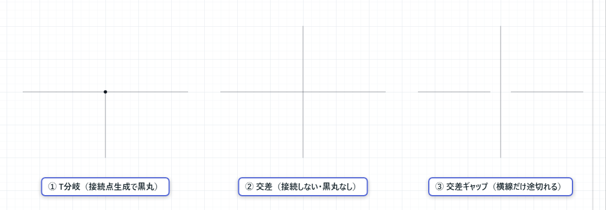{: .shot-wide}

帳票 CSV と帳票表の詳細には、ギャップ付き配線が `gap=true` と `gapCount=数` として出力されます。

### 9.5 配線順序

配線を選択すると、右パネルの「FROM」「TO」で配線の行き元と行き先を入力できます。
空欄のままにすると、帳票では配線端点の近くにある端子、部品、接続点などから自動推定します。

現在ページの配線をまとめて確認・入力するには、機能メニュー「自動処理」グループの「配線順序(FROM/TO)」を開きます。

1. 「配線順序」画面の表で、線番ごとに「自動FROM」「自動TO」（自動推定）を確認します。
2. 手動で決めたい配線だけ「FROM」「TO」欄へ入力します。「選択」を押すと、その配線を図面上で選択できます。
3. 「配線順序を更新」を押すと、入力した FROM/TO が配線へ保存されます。

同じ画面の「From-To一覧CSV（全ページ）」を押すと、全ページの配線を1行ずつ並べた `wire-from-to.csv` を書き出せます。
列は page（ページ名）、wireNo（線番）、from、to、wireType（配線種別名）で、手動のFROM/TOがあればそれを、なければ自動推定を出力します。
CSVはExcelでそのまま開ける形式（UTF-8・BOM付き）です。

帳票 CSV と帳票表の詳細には、手動指定した配線が `sequence=manual` として出力されます。

### 9.6 接続点生成

配線の分岐点に置く黒丸（接続点）を、機能メニューの「接続点生成」でまとめて配置できます。
実行すると「全ページで接続点を生成しますか？」と確認され、「OK」で全ページ、「キャンセル」で現在ページだけが対象になります。

黒丸が置かれるのは次の2か所です。

- **T分岐**: 配線の端点が、別の配線の途中（折れ点を含む）に接している位置
- 3本以上の配線端点が1か所（0.6mm以内）に集まっている位置

単純に交差しているだけの位置、2本の配線が端点同士でつながっている位置、L字の角、重ね描き、
1つの端子に2本の配線がつながっているだけの位置には置きません。JISでは黒丸のない交差は「接続しない」を
表すためです。既に接続点がある位置には重ねて置かず、図面上にある接続点はそのまま残って接続として扱われます。

> ⚠️ **注意:** 手で置いた接続点は、交差の位置にあっても接続として扱われ、線番採番でも同じネットになります。
> つながっていない交差に接続点が残っていないか、出図前に確認してください。

配線を重ねたり選択したりしただけでは、黒い接続点は自動生成されません。分岐を明示する場合は、
「接続点生成」のほか、部品パレットの「接続点」を置くか、配線ドラッグ中に `J` を押して終点へ接続点を置きます。

配線・直線・連動破線の始点／終点にも、右パネル「端点表示」の「始点に接続点を表示」「終点に接続点を表示」で接続点を個別表示できます。
黒丸は接続点部品と同じ半径0.5mmで、SVG表示だけでなくDXFにも出力されます。

> 💡 **ヒント:** 「つないだつもり」のミスは、左パネルの「監査」（§12.8）の未接続端点チェックで発見できます。

### 9.7 信号矢印

信号矢印は、別ページや別位置への接続参照に使います。
矢印のラベルに同じ信号名を入力すると、クロス参照で関連を確認できます。

右パネルの「信号矢印種別」で次の3つを選べます。

- 参照
- 発信元
- 受信先

### 9.8 端点スナップ

左パネル「表示」の「端点スナップ」を ON にすると、配線作図時に既存配線の端点、端子、端子台の端子、接点端、コイル端、
ランプ端、ブザー端、機器端子、接続点などへ吸着します。矩形・多角形は頂点と辺の中央、円・楕円は外周の8点（円は0°から45°刻み）も吸着先です。

吸着は、作図の確定、要素の移動、端点ハンドルの移動のときだけ働きます。選択のためにクリックしただけでは座標は変わりません。

配線端点がシンボルの接続点に重なっている場合、そのシンボルをドラッグ移動すると接続済み配線の端点も追従します。
あとから部品位置を調整しても、配線が端子から離れにくくなります。

接点、コイル、ヒューズ、遮断器、ランプ、ブザーなどを、パレットから既存配線の上へ新しく配置すると、
部品の左右（縦向きなら上下）の端子位置で配線が自動的に2本へ分割され、部品の中を配線が突き抜けない表示になります。
分割されるのは始点と終点だけのまっすぐな配線です。配置済みの部品を配線の上へ移動しても分割はされません。

## 10. 端子と端子台

この章では、単体の端子、端子台、端子箱の置き方と編集方法、端子接続図をCSVから作る方法、
端子ごとの接続先を一覧にする「端子台プラン表」を説明します。

### 10.1 端子

部品パレットの「端子」は、1点だけの端子です。ラベルに端子番号（例: `1`、`T1`）を入力すると、図面上の端子に表示されます。
右パネルでは次の項目を変更できます。

- 「方向」: 「横」「縦」
- 「端子形状」: 「丸」「二重円（貫通）」「角」

### 10.2 端子台

部品パレットの「端子台」は、複数の端子を1列に並べた部品です。パレットから置いた端子台は次の状態で始まります。

- 「端子台形状」は「ユニット列（縦・端子円）」、「方向」は「縦」、端子数は16です。
- 各端子の左辺に白抜きの小円（端子記号）が付きます。
- 最下段にCOMポートが付き、COMの端子記号は他の端子と逆側（右）に出ます。

端子記号を表示した行は、本体の辺上にある白抜き小円だけが配線の接続点です。
端子記号を消した行は、端子円の中心が接続点になります。

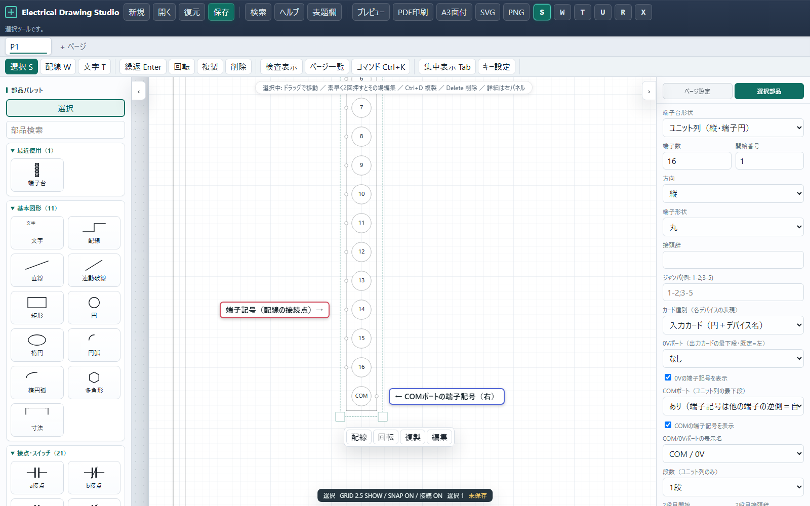{: .shot-full}

右パネルで編集できる項目は次のとおりです。

| 項目 | 内容 |
|---|---|
| 端子台形状 | 「ユニット列（縦・端子円）」（上下も直線の閉じた長方形）と「ピル形」から選びます |
| 端子数／開始番号 | 端子の数と、先頭の端子番号です |
| 方向 | 「横」「縦」。入出力端子列や縦方向のコネクタを作るときは「縦」を選びます |
| 端子形状 | 「丸」「角」 |
| 接頭辞 | 端子番号の前に付ける文字です（例: `X` で X1, X2…） |
| ジャンパ(例: 1-2;3-5) | 渡り線を引く端子の組を `;` 区切りで入力します |
| カード種別（各デバイスの表現） | 「入力カード（円＋デバイス名）」と「出力カード（a接点＋デバイス名・0Vポート付き）」 |
| 0Vポート（出力カードの最下段・既定=左） | 「なし」「あり（端子記号を左に）」「あり（端子記号を右に）」。「0Vの端子記号を表示」で記号だけを消せます |
| COMポート（ユニット列の最下段） | 「なし」「あり（端子記号は他の端子の逆側＝自動）」「あり（端子記号を左に）」「あり（端子記号を右に）」。「COMの端子記号を表示」で記号だけを消せます |
| COM/0Vポートの表示名 | 「COM / 0V」と「COM＋ / COM−」を切り替えます |
| 段数（ユニット列のみ） | 「2段（左右2列）」にすると左右2列の端子円になり、右列は「2段目開始」「2段目接頭辞」で番号を付けます。配線は左右どちらの端子円にも接続できます |
| 端子名（1行1点・空行は自動番号） | 端子ごとの表示名です。空行の端子は「接頭辞＋番号」で表示されます |
| 端子記号 | 「左（横向きは上）」「右（横向きは下）」で端子記号を一括表示し、「端子ごとの表示（チェック=表示）」で端子ごとにON/OFFします |

出力カードにすると各行をa接点で表し、最下段に0Vポートが付きます。

ユニット列は縦向き専用です。「方向」を「横」にするとピル形で表示され、右パネルには
「ユニット列は縦向きのみ対応のため、横向きではピル形で表示されます。カード種別・COM/0Vポート・段数は方向を「縦」にすると設定できます。」と表示されます。
このとき、カード種別・0Vポート・COMポート・COM/0Vポートの表示名・段数の欄は表示されません。

「端子の一括編集…」を押すと、端子名と左右の端子記号を表形式でまとめて編集できます。
見出しの「全ON」「全OFF」「反転」で、チェック列をまとめて変更できます。

> 💡 **ヒント:** パレットの「端子配線セット」を置くと、横配線（線番つき）と端子台をまとめて配置できます。
> 端子接続図を1ページまるごと作るときは、テンプレートの「端子接続図」（§19.1）または「端子CSV取込」（§10.6）が便利です。

### 10.3 端子箱

端子箱は、R/S/Tのような箱を縦に並べた部品です。右パネルで次の項目を設定できます。

| 項目 | 内容 |
|---|---|
| 箱の数 | 1以上の箱の数です |
| 1箱の高さ mm（空欄=全高を等分） | 1箱の高さです。入力すると、外形の高さは「1箱の高さ×箱の数」になります。空欄のときは、外形の高さを保ったまま箱の数で等分します |
| 箱の幅 mm | 箱全体の幅です |
| 引き出し線の長さ mm（0=線なし） | 左右の引き出し線の長さです。パレットから置いた端子箱は5mmです |
| 箱内文字（1行=1箱） | `R`、`S`、`T` のように1行に1箱ずつ入力すると、各箱の中央に表示されます |
| 箱内文字サイズ mm | 既定は2.2mm、0.1mm刻みです。DXFにも同じ位置と大きさで出力されます |
| 箱ごとの引き出し線（個別、チェック=線を出す） | 箱ごとに左右の引き出し線をON/OFFします |

箱の数や1箱の高さを変えても、第1接続点の位置は変わりません。

配線の接続点は次のとおりです。

- 引き出し線がある箱: 線の先端が接続点です（箱の横辺の中央も接続点として残ります）。
- 引き出し線がない箱、または長さが0mmの箱: 箱の横辺の中央が接続点です。

リサイズしても、箱の中央、引き出し線、接続点の位置関係は保たれます。
「端子の一括編集…」では、箱内文字と左右の引き出し線を表形式でまとめて変更できます。

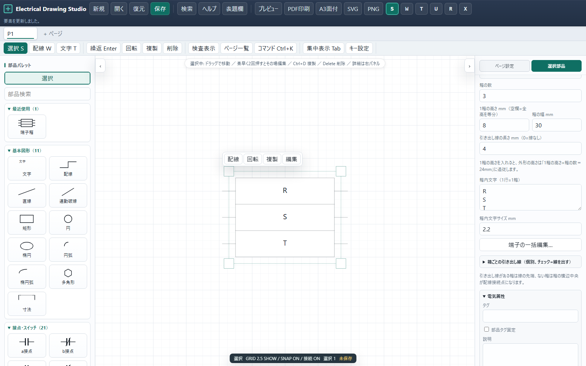{: .shot-full}

### 10.4 端子番号の振り直し

機能メニューの「端子番号の振り直し」で、端子・端子台・コネクタの番号をまとめて付け直します。

1. 振り直したい端子・端子台・コネクタを1つ選択します。何も選択していなければ、現在ページのすべての端子・端子台・コネクタが対象です。
2. 機能メニューから「端子番号の振り直し」を選びます。
3. 「端子開始番号」（既定1）を入力して「OK」を押します。
4. 「端子接頭辞」（既定は先頭の対象の接頭辞）を入力して「OK」を押します。どちらかで「キャンセル」を押すと中止します。

単体端子はラベルが「接頭辞＋番号」になり、端子台・コネクタは「開始番号」と「接頭辞」が設定されます。
複数の端子台が対象のときは、端子数の分だけ番号を続けて振ります（例: 3端子のTB1が11〜13、2端子のTB2が14〜15）。

> 💡 **ヒント:** 「端子名」を入力済みの端子は、端子名が番号より優先して表示されるため見た目は変わりません。
> このときステータス表示にその旨が出ます。番号で表示するには、端子名を空欄にしてください。

### 10.5 端子台エディタ

機能メニューの「端子台エディタ」で、全ページの端子台とコネクタを1つの表で確認・編集できます。

1. 表で、名称、端子数、開始、方向、形状、接頭辞、端子順（端子名をカンマ区切りで入力）、ジャンパ（例: `1-2;3-5`）、
   予備（例: `7,8`）、アクセサリ（例: エンド板）、区分（「両側」「盤内」「盤外」）を編集します。
2. 「適用」を押すと、表の内容が各端子台へ反映されます。
3. 端子ごとの詳しい情報を入力するときは、その行の右端「端子単位詳細」列の「詳細」を押します。
   「詳細」を押すと表の編集内容を反映してから「端子単位詳細: ＜名称＞」画面が開き、端子ごとの「表示」「型式」「盤内接続」「盤外接続」
   「最大線数」「ジャンパ」「予備」を編集できます。「適用」を押すと、1段目の「表示」が端子名になります。

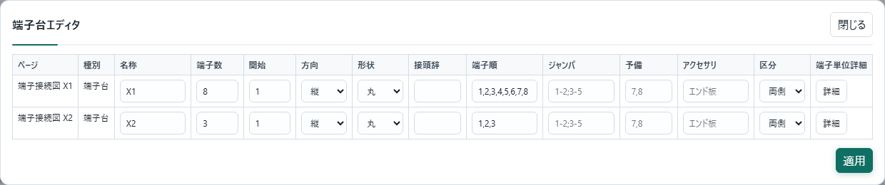{: .shot-wide}

### 10.6 端子CSV取込

CSV（またはTSV）ファイルから、端子接続図のページを自動で作ります。

1. 表計算ソフトなどで、1行に1端子ずつ並べたファイルを用意します（下の例を参照）。
2. 機能メニュー「取込・出力」グループの「端子CSV取込」を選び、ファイルを選択します。
3. 端子接続図のページが追加されます。端子名と線番が意図どおり対応しているか、上から1行ずつ確認してください。

```csv
端子台,端子,線番,信号,接続先,備考
X1,1,101,START,PB1,
X1,2,102,STOP,PB2,
X1,3,,RUN,MC1,
X2,1,201,LAMP,PL1,
```

**ファイルの形式**

- 文字コードは UTF-8（BOM付きも可）と Shift_JIS を自動で判別します。区切りはカンマかタブかを自動で判別します。
- 1行目のどれかの列名が下の表の名前に一致すると、1行目を列名として扱い、**列名が付いた列だけ**を読み込みます。
  列名の大文字・小文字、空白、`()` `_` `-` `/` `:` などの記号は区別しません。
- 1行目が列名でない場合は、1列目から順に 端子、線番、信号、接続先、備考 として読み込みます（端子台名は `X1`）。

| 項目 | 使える列名 |
|---|---|
| 端子台 | 端子台、端子台名、strip、terminalstrip、TB |
| 端子 | 端子、端子番号、端子名、端子No、番号、terminal、term、terminalno、no |
| 線番 | 線番、配線番号、線番号、wireno、wire、wire_no、wiring |
| 信号 | 信号、信号名、名称、用途、signal、name、description |
| 接続先 | 接続先、行先、相手先、機器、dest、destination、to、device |
| 備考 | 備考、メモ、note、memo、remarks |

空欄の扱いは次のとおりです。

- 「端子」が空欄の行は、端子台の開始番号からの自動番号で表示します。
- 「端子台」が空欄の行は、直前の行と同じ端子台とみなします。1行目から空欄、または列がない場合は `X1` です。
- 「線番」が空欄の行は、線番なしの配線になります（他の列の値で補うことはありません）。
- すべての列が空欄の行は読み飛ばします。

**作られるページ**

- 用紙は A4 縦、図枠は「基本: 右下表題欄」です。1ページに17行まで入り、超える分は自動で次のページへ分かれます。
- 端子台が1種類のときは、ページ名「端子接続図」、図名「端子接続図 1/2」のようになります。
- 端子台が複数あるときは、端子台ごとに別の端子台・別のページを作ります。ページ名は「端子接続図 X2」、
  図名は「端子接続図 X2 1/1」のように端子台名が入り、開始番号は端子台ごとに1から始まります。
  ステータス表示には「(端子台2台)」のように台数が表示されます。

ページの中身は、左から次の順に並びます（図10-4）。

1. 左右のレール（P1／N1。図面の目安として表示され、各行とはつながっていません）
2. 各行の左端の端子小円（現場側への引き出し口）
3. 線番付きの横配線（線番は終点寄せ）
4. ユニット列の端子台（端子円の中にCSVの端子名を表示）
5. 右側の説明（信号と接続先）

各行の配線は別々のネットになるため、「線番採番」を「未採番のみ」で実行してもCSVの線番はそのまま残り、
線番が空欄の行にだけ番号が付きます。備考は配線の属性メモに入ります。

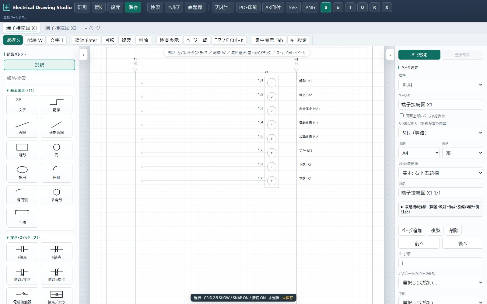{: .shot-full}

### 10.7 端子台プラン表

機能メニュー「帳票・確認」グループの「端子台プラン表」で、全ページの端子台／コネクタについて、
端子ごとの「線番」「接続先」「ジャンパ」を一覧できます。

表の列は「ページ」「端子台」「端子」「線番」「接続先」「ジャンパ」です。

- 線番と接続先は、端子につながっている配線から求めます。配線の端点が端子円の中心から2.5mm以内、
  または表示中の端子記号（辺上の白抜き小円）の近くにあれば、その端子の配線とみなします。1つの端点は最も近い端子だけに数えます。
- 接続先は、その配線の反対側の端点に最も近い部品などの名前です。
- 2段の端子台は、縦向きのユニット列で「2段（左右2列）」にしたときだけ、2段目の端子も行に含めます。

画面下のボタンで次の操作ができます。

- 「CSV出力」: 一覧を `terminal-plan.csv`（Excelでそのまま開けるUTF-8・BOM付き）として書き出します。
- 「表として挿入」: 一覧の先頭24行を、見出し「端子台／端子／線番／接続先／ジャンパ」の表として現在ページの左上へ挿入します。

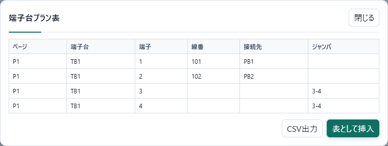{: .shot-wide}

## 11. PLC/I-O と機器箱

この章では、PLCの入出力（I/O）を表す部品と機器箱の編集方法、PLC I/O 接続図をCSVやテンプレートから作る方法を説明します。

### 11.1 部品編集

#### PLC/I-O

部品パレットの「PLC/I-O」は、右パネルの「PLC表示形式」で2つの表し方を切り替えます。

- 「格子ボックス」: パレットから置いたときの形です。ラベル「PLC」、8行（I00〜I03、O00〜O03）の箱で、各行の左辺が配線の接続点です。
- 「ユニット列（端子円・長方形）」: 端子台のユニット列と同じく、上下も直線の閉じた長方形に端子円を縦に並べた形です。
  切り替えると幅10mm、高さは「行数（COM・0Vを含む）×9.5mm」になります。

どちらの形式でも、次の項目を編集できます。

- 「I/O行数」
- 「I/O名（1行1点）」: 1行に1点ずつ、アドレスや信号名を入力します。

「ユニット列」では、さらに次の項目を設定できます。

| 項目 | 内容 |
|---|---|
| カード種別（各デバイスの表現） | 「入力カード（円＋デバイス名）」は中央の円の中にI/O名、「出力カード（a接点＋デバイス名・0Vポート付き）」はa接点とその上にI/O名を表示します |
| COM端子（ユニット列の最下段に追加） | 「なし」「左に配線接続（端子記号つき）」「右に配線接続（端子記号つき）」 |
| 0Vポート（出力カードの最下段・既定=左） | 「なし」「あり（端子記号を左に）」「あり（端子記号を右に）」。「0Vの端子記号を表示」で記号だけを消せます |
| COM/0Vポートの表示名 | 「COM / 0V」と「COM＋ / COM−」を切り替えます |
| 端子記号 | 「左（横向きは上）」「右（横向きは下）」で各行の脇に白抜き小円の端子記号を表示し、「端子ごとの表示（チェック=表示）」で行ごとにON/OFFします |

端子記号を表示した行は、本体の辺上の白抜き小円だけが配線の接続点です。端子記号を消した行は、中央の円が接続点になります。

#### 機器箱

部品パレットの「機器箱」は、左右に端子を持つ箱です。右パネルで次の項目を編集できます。

- 「左右ピン数」、「左端子文字（1行1点）」、「右端子文字（1行1点）」
- 「端子ピッチ mm（空=高さを等分）」と「上下マージン mm」: 指定すると、箱の高さが `2×上下マージン+(左右ピン数-1)×端子ピッチ` に自動で合います。
  両方を空欄にすると、現在の箱の高さを等分して端子を並べます。上下マージンだけを入力した場合は、端子ピッチが5mmになります。
- 「端子文字サイズ mm（ラベルは「文字スタイル」で変更）」
- 「端子記号」: 「文字に連動」「常に表示」「非表示」。「端子ごとの表示（個別）」で左右の端子を1つずつON/OFFできます。

中央の文字はラベルです。ラベルを空欄にすると中央文字も表示されません。端子文字の詳しい設定は§7.4の「機器箱の端子文字」も参照してください。

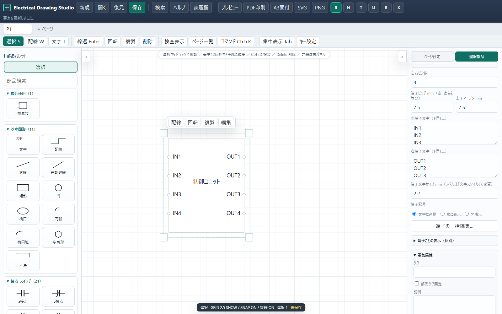{: .shot-full}

> 💡 **ヒント:** 機器箱・端子台・PLCのユニット列・端子箱は、「端子の一括編集…」で文字と左右の端子表示を表形式でまとめて変更できます。

### 11.2 PLC CSV取込

CSV（またはTSV）ファイルから、PLC I/O 接続図のページを自動で作ります。

1. 1行に1点ずつ、アドレスと信号などを並べたファイルを用意します（下の例を参照）。
2. 機能メニュー「取込・出力」グループの「PLC CSV取込」を選び、ファイルを選択します。
3. PLC I/O 接続図のページが追加されます。

```csv
アドレス,入出力,信号,線番,接続先,備考
X000,入力,起動,101,PB1,
X001,入力,停止,,PB2,
Y000,出力,運転,201,MC1,
Y001,出力,警報,,BZ1,
```

**ファイルの形式**

文字コード・区切り文字・列名の判定は、端子CSV取込（§10.6）と同じです。
1行目が列名でない場合は、1列目から順に アドレス、信号、線番、接続先、備考 として読み込みます。

| 項目 | 使える列名 |
|---|---|
| アドレス | アドレス、IO番号、入出力番号、点数、address、addr、io、i/o、point、plc |
| 入出力 | 入出力、種別、方向、direction、type、iotype、io_type、inout |
| 信号 | 信号、信号名、名称、用途、signal、name、description |
| 線番 | 線番、配線番号、線番号、wireno、wire、wire_no |
| 接続先 | 接続先、機器、相手先、device、dest、destination、to、from |
| 備考 | 備考、メモ、note、memo、remarks |

入力と出力は次の順に判定します。

1. 「入出力」列に値があれば、その値で判定します。`出力`、`OUT`、`output` のように「出力」や「out」を含むか、`O`・`Y`・`Q` で始まる値は出力、それ以外は入力です。
2. 「入出力」列がない、または空欄の行は、アドレスで判定します。先頭の `%` を除いて `O`・`Y`・`Q` で始まるアドレス（例: `Y000`、`%Q0.0`）は出力、それ以外（例: `X000`、`I00`）は入力です。

「線番」が空欄の行は、線番なしの配線になります。他の列の値で線番を補うことはありません。

**作られるページ**

- 用紙は A4 縦、図枠は「基本: 右下表題欄」、ページ名は「制御盤」、図名は「PLC I/O 接続図 1/1」のようになります。
- 1ページに17点まで入り、超える分は自動で次のページへ分かれます。
- 各行は、左端の端子小円 → 横配線（CSVに線番がある行だけ線番を終点寄せで表示）→ 右側のユニット列（端子円にアドレスを表示）の順に並びます。
  ユニット列のラベルは「PLC(1/1)」のようにページ番号付きになります。
- 右側には「入力 起動 PB1」のように、入力／出力・信号・接続先の説明が入ります。
- 配線の FROM/TO も自動で入ります。入力の行は FROM が接続先（空欄なら信号）、TO が「PLC(1/1):X000」のようなアドレスです。出力の行は逆になります。
- 左右のレール（P1／N1）は図面の目安として表示され、各行とはつながっていません。各行は別々のネットになるため、「線番採番」を「未採番のみ」で実行してもCSVの線番は残ります。

アドレスを線番の代わりに配線へ重ねて表示しないため、端子円内のアドレスと配線の文字が二重になることはありません。

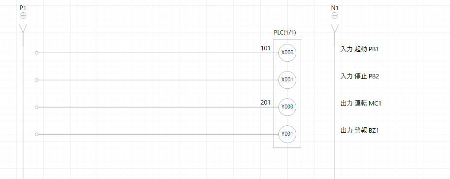{: .shot-full}

### 11.3 PLC入出力回路テンプレート

CSVを用意せず、画面上の設定だけで入力回路・出力回路のページを作れます。

1. 右パネルの「ページ設定」タブにある「テンプレートからページ追加」で「PLC入出力回路」を選びます。
2. 「PLC入出力回路ページ」画面の「モジュールプリセット」で、入力／出力と点数に近いもの（例: 「入力16点 X000」）を選びます。
3. 「種別」（「入力（接点→ユニット）」または「出力（ユニット→コイル）」）、「ユニット名」、「開始アドレス(16進連番)」、「点数（最大17）」を確認します。
4. 入力回路では「各行に接点を配置（入力時）」で「する」「しない」を選びます。
5. 「ページ追加」を押します。

よく使う設定は「現在値をプリセット保存」でプリセットとして保存でき、次回から「モジュールプリセット」で選べます。

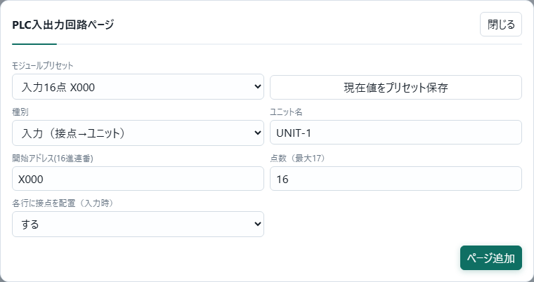{: .shot-wide}

生成されるページの構成は次のとおりです。

- **入力回路**: P1から各行へ黒丸で分岐し、各行の接点を通って右側の入力カードの端子（左辺の白抜き小円）へ配線します。
  入力カードのCOMは右辺からN1へ配線され、レール接続部に黒丸が付きます。
- **出力回路**: 左側の出力カードの端子（右辺の白抜き小円）から右側のコイルへ配線し、各コイルからN1へ黒丸で接続します。
  出力カードのCOMは左辺からP1、0Vは右辺からN1へ配線され、各レール接続部に黒丸が付きます。

アドレスは開始アドレスからの16進の連番（X000、X001…X00F、X010…）で端子円に表示されます。
アドレスを配線の線番として重ねて表示することはありません。ページ名は「制御盤」、図名は「入力回路(X000)」「出力回路(Y000)」のようになります。
生成後は、アドレスの並び、ページ名・図名・図番を確認し、接点やコイルのタグ、配線の線番を入力して仕上げます。

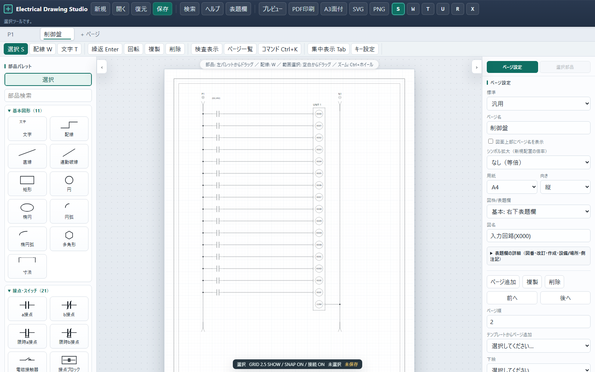{: .shot-full}

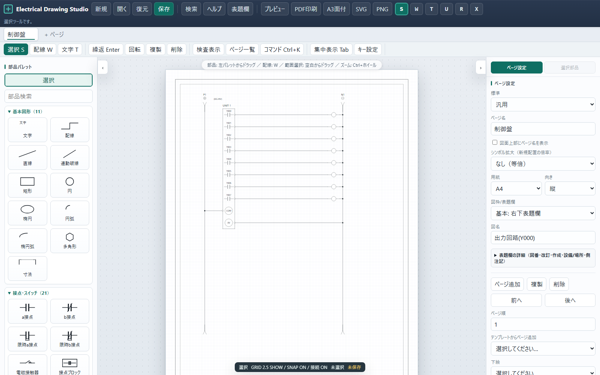{: .shot-full}

## 12. 自動処理

この章の機能は「手作業だと間違えやすい番号付けや確認」をツールに任せるためのものです。
「線番採番」「監査」は左パネルの「自動処理・ツール」欄にあるボタン、それ以外の自動処理は
同じ欄の機能メニュー（§3.4）から実行します。

作図が一段落したら、次の順で流すのがおすすめです。

1. 「部品タグ採番」（機能メニュー）……部品に PB01, CR01 などのタグを自動付与（§12.6）
2. 「線番採番」（左パネルのボタン）……配線に線番を自動付与（§12.1）
3. 「監査」（左パネルのボタン）……未接続・未採番・重複などの問題を一覧チェック（§12.8）

> 💡 **ヒント:** 自動処理は何度でも実行でき、1回の「元に戻す」（`Ctrl+Z`）で実行前へ戻せます。
> 手で入力したタグを変えたくない部品は、右パネルの「部品タグ固定」（§12.6）をONにしておきます。

線番採番・部品タグ採番・接続点生成では、ブラウザの確認画面で対象を選びます。
確認画面の「OK」と「キャンセル」はどちらも選択肢です。表示される
「OK: 全ページ / キャンセル: 現在ページのみ」のような説明を読んでから押してください。

### 12.1 線番

配線へ線番を自動で付けます。

1. 左パネル「自動処理・ツール」の「線番採番」を押します。
2. 「全ページに線番を付与しますか？」……全ページなら「OK」、開いているページだけなら「キャンセル」を押します。
3. 「既存の線番も上書きしますか？」……付け直すなら「OK」、まだ線番のないネットだけに付けるなら「キャンセル」を押します。
4. 「開始番号」を入力して「OK」を押します（既定は `1`）。ここで「キャンセル」を押すと採番を中止します。

ステータス表示に「6ネットへ線番を付与しました。」のように結果が表示されます。
線番の形は、左パネルの「採番の書式設定」を開いた中の「線番書式」で決めます。既定の `%S-%N` では、
1ページ目が `1-01`、`1-02`…になります。使える記号（`%S`・`%N`・`%R` など）は§9.3を参照してください。

自動線番は**ネット単位**です。端点の一致、T分岐（端点が他の配線の途中にある）、接続点で
つながった配線は同じ電位（ネット）とみなし、1ネットに1つの線番を割り当ててネット内の全配線へ
共有します。番号はページの上にあるネットから順に振られます。

この採番で線番が付いた配線は、ネット内で最も長い1本だけに線番を表示し、ほかは自動で線番非表示になります。
既に線番を表示している配線があればそれを表示のまま残し、右パネルで自分で非表示にした線番も再表示しません。

次の配線は線番が変わりません。

- 右パネルで「線番固定」をONにした配線（同じネットのほかの配線は、固定した線番にそろいます）
- 配線種別管理（§18.2）で「採番外」にした種別の配線
- 母線（P1・N1などの縦レール）

発信元/受信先の信号矢印（同じラベル）がネットに接している場合は、ページをまたいで同じ線番を共有します。
ページをまたぐ共有は、手順2で「全ページ」を選んだときに働きます。

### 12.2 接続点生成

配線の分岐点へ接続点（黒丸）を自動で置きます。

1. 機能メニューの「接続点生成」を選びます。
2. 「全ページで接続点を生成しますか？」……全ページなら「OK」、開いているページだけなら「キャンセル」を押します。

接続点が付くのは、**T分岐**（配線の端点が別の配線の途中に接している所）と、**3本以上の配線の端点が1点に集まる所**だけです。
単なる十字交差やL字の角などには付きません。付く場所・付かない場所の詳細と、手で置いた接続点の扱いは§9.6を参照してください。

### 12.3 ラング追加

機能メニューの「ラング追加」を選ぶと、現在ページへ横方向のラング（左右の母線をつなぐ横配線）を
1本追加します。ラングの線番には `R001`、`R002`…が入ります。

- **「設備ラダー」テンプレートのページ**: 左母線（P1）から右母線（N1）までのラングを、
  既存ラングの下へ15mm間隔で追加します（横向きの用紙では12.5mm間隔）。
- **「ラダー（汎用）」テンプレートのページ**: 既存ラングの下へ、行番号の文字（`011` など）付きで次のラングを追加します。
- **母線のないページ**: 左右の母線（L/N）を作ってから、1本目のラングを追加します。

母線の下端近くまでラングが埋まっている場合は「このページにはラングを追加する余白がありません。」と表示され、
何も追加しません。部品をまだ挿入していない空のラングは、線番採番や監査では母線どうしを
つなぐ配線としては扱われず、それぞれ独立した1本として扱われます。

### 12.4 行挿入/行削除（行シフト）

回路の途中に行を増やしたい・詰めたいときに使います。基準はラダー図枠の行番号（00〜20、行間隔9.5mm）です。

1. 機能メニューの「行挿入/行削除（行シフト）」を選びます（図12-1）。
2. 「操作」で「行を挿入」または「行を削除」を選びます。
3. 「対象行番号(00〜20)」と「行数」（1〜10）を入力し、「実行」を押します。

- **行を挿入**: 指定行の位置に空行を作ります（指定行から下の要素が行数ぶん下がります）。
- **行を削除**: 指定行を詰めます（下の要素が上がります）。削除する行の中だけで完結している配線と
  接続点は、行と一緒に削除されます。

縦の配線は行の境界をまたぐ部分だけが動くため、**縦の母線や縦配線は自動で伸び縮み**します。
ロック中の要素は動きません。結果はステータス表示に
「行10から1行削除しました(配線1本・接続点2個を削除、5要素を移動)。」のように表示され、
1回の「元に戻す」で戻せます。

行を削除するとき、次の場合は安全のため何も変更せず、理由をステータス表示に出します
（例:「削除対象の行に部品が 1 個あります。先に移動または削除してください。」）。

- 削除する行に部品（信号矢印や行の中の直線を含む）がある
- 削除する行の中で途切れて、行の外へ続く配線がある
- 削除する行にロック中の配線・接続点がある

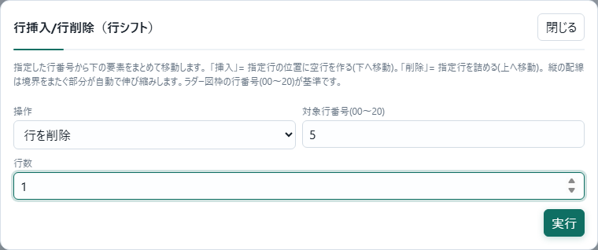{: .shot-wide}

### 12.5 端子番号

機能メニューの「端子番号の振り直し」で、端子・端子台・コネクタの番号をまとめて振り直します。
選択中の端子・端子台・コネクタ（何も選択していなければ現在ページのすべて）が対象で、
「端子開始番号」と「端子接頭辞」（例: `TB1-`）を順に入力します。複数の端子台は、端子数の分だけ番号を続けて振ります。
手順と、「端子名」を入力済みの端子の扱いは§10.4を参照してください。

### 12.6 部品タグ

部品に `PB01`、`CR01` のようなタグ（部品記号）を自動で付けます。付けたタグは部品のラベルとしても表示されます。

1. 機能メニューの「部品タグ採番」を選びます。
2. 「全ページの部品タグを付与しますか？」……全ページなら「OK」、開いているページだけなら「キャンセル」を押します。
3. 「既存タグ/ラベルも上書きしますか？」……付け直すなら「OK」、タグもラベルも空の部品だけに付けるなら「キャンセル」を押します。
4. 「開始番号」（既定 `1`）を入力して「OK」を押します。`10` を指定すると `PB10`、`PB11`…のように採番されます。「キャンセル」で中止します。

番号は接頭辞（PB、CRなど）ごとに数えます。ほかの部品が既に使っているタグ（部品タグ固定の部品、
対象外のページの部品、「未入力のみ」で残した部品のタグ）は飛ばすため、`PB01` が既にあれば
新しい押しボタンは `PB02` になり、重複したタグは作られません。

次の要素には番号を振りません。

- **接点類**（a接点・b接点・限時a接点・限時b接点・電磁接触器・接点ブロック・サーマルリレー）:
  接点は「どのコイルの接点か」を示すため、対応するコイル等と同じタグを手で入力します（22章）。
  「上書き」で採番したときは、コイルの新しいタグに合わせて同じタグの接点も全ページで付け替わり、
  ステータス表示に「(接点N個をコイルのタグに追従)」と表示されます。部品タグ固定の接点と、
  対応するコイルのない接点はそのままです。
- 右パネルで「**部品タグ固定**」をONにした部品
- 信号矢印、母線（P1/N1）の矢印、極性マーク、ポジション表示、文字、線など電気属性を持たない要素
  （信号矢印の参照名は書き換えません）
- 多極の機器を極ごとの記号で描いたときの2極目以降（1極目と同じタグを共有します）
- 「部品タグ規則」で接頭辞を空欄にした種別

#### タグの書式

タグの形は、左パネルの「採番の書式設定」を開いた中の「部品タグ書式」で決めます。既定値は `%F%N` です。

使用できる置換:

- `%F`: 部品種別ごとの接頭辞（「部品タグ規則」で設定）
- `%N`: 連番（2桁。`01`、`02`…）
- `%S`: シート番号
- `%P`: ページ名
- `%D`: 図番
- `%I`: 設備コード（ページの設備コード。空欄なら部品の設備）
- `%L`: 場所コード（ページの場所コード。空欄なら部品の場所）
- `%R`: 行番号（ラダー図枠の行00〜20。2桁）

例: `%F-%I-%L-%N` を指定し、ページの設備コードが `PNL`、場所コードが `FLD` の場合、
押しボタンは `PB-PNL-FLD-01` のように採番されます。
`%N` を含まない書式を入力した場合は、連番が失われないよう末尾に `%N` が補われます。

#### 部品タグ規則

機能メニューの「部品タグ規則」を選ぶと、`%F` に入る接頭辞を部品種別ごとに編集できます（図12-2）。
「接頭辞」欄を書き換えて表の下の「適用」を押すと確定し、「既定に戻す」で標準の接頭辞へ戻ります。
接頭辞を空欄にした部品種別は、自動タグ採番の対象外になります。主な既定値は次のとおりです。

- 押しボタン: `PB`、切替スイッチ: `SS`、リミットスイッチ: `LS`
- コイル: `CR`、遮断器: `CB`、ヒューズ: `F`
- ランプ: `PL`、ブザー: `BZ`
- トランス: `T`、モータ: `M`、ファン: `FAN`
- PLC/I-O: `PLC`

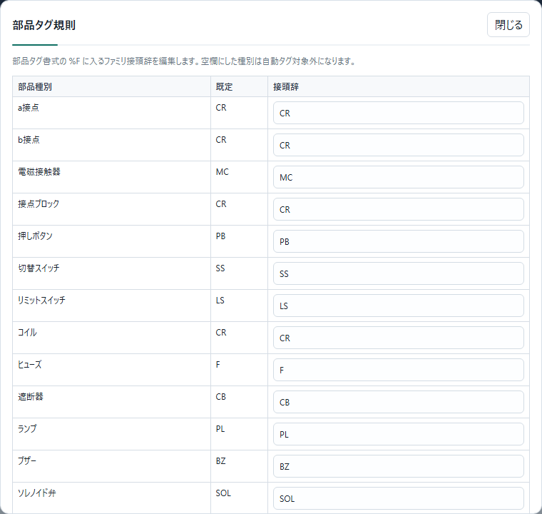{: .shot-wide}

> 💡 **クロスリファレンスジャンプ:** 同じタグのコイルと接点は、右パネルから相互に移動できます。
> - **接点を選択** → 「親コイルへ移動（頁+行）」ボタン
> - **コイルを選択** → 「接点へ移動」に接点のアドレス一覧（b接点は末尾に b。ボタンは最大12個）
>
> クリックするとページが切り替わり、対象が選択され、画面が要素の位置まで自動スクロールします。
> 監査・検索・各種一覧の「選択」ボタンも同じように自動スクロールします。

### 12.7 クロス参照

機能メニューの「クロスリファレンス」を選ぶと、線番・信号矢印・部品タグがどのページで使われているかを
ページ横断で一覧表示します（参照番号の仕組みは22章）。

- **コイル→接点(頁+行アドレス)**: コイルのタグごとに、コイル位置・接点数・接点位置（b接点は `(b)` 付き）を表示します。
- **全参照一覧**: キー・分類（線番／信号／部品）・参照数・参照先を表示します。信号矢印は
  「信号矢印/発信元」「信号矢印/受信先」「信号矢印/参照」のように種別付きで表示されます。
  「部品」に載るのは電気属性を持つ機器だけで、極性マーク（P1/N1）やポジション表示（切/入）は載りません。

一覧のボタンを押すと、該当ページへ移動し、その要素を選択します。

### 12.8 監査

図面の問題をまとめて検出します。

1. 左パネル「自動処理・ツール」の「監査」を押します。「図面監査」ダイアログが開きます（図12-3）。
2. 一覧の「重要度」（警告／注意／情報）と「内容」を確認します。
3. 各行の「選択」を押すと、ダイアログが閉じて該当ページへ移動し、対象が選択されます。
4. 修正したら、もう一度「監査」を押して確認します。

「対象」欄には部品のタグや種別名が表示されます。名前のない配線は「配線（始点 X40, Y247）」、
未接続の端点は「1-03（端点 X…, Y…）」のように位置付きで表示されます。座標は右パネルと同じく、
用紙の左下を原点にしたmmです。

ダイアログ上部の**検査ルール**のチェックで、次の8項目を個別にON/OFFできます。

| 検査ルール | 検出する内容 |
|---|---|
| 未採番配線 | 線番のない配線（母線と「採番外」の配線種別を除く） |
| ネット整合 | 同一ネット内の線番の混在、接続されていない別ネットにある同じ線番 |
| 空ラベル | ラベル（タグ）のない主要部品 |
| 用紙外 | 用紙からはみ出した要素 |
| 未接続端点 | どこにもつながっていない可能性がある配線の端点 |
| コイル/接点 | 接点のないコイル、コイルのない接点、a接点・b接点の使用数が上限（部品カタログの値。既定4）を超えたコイル |
| 信号矢印の相手 | 同じラベルの信号矢印が図面全体で1本しかない、発信（source）だけ・受信（destination）だけの組 |
| 盤配置 | 盤レイアウトに配置されていないコイル（盤フットプリントを使っている図面だけ） |

次の項目は常に検査します（チェックでは外せません）。

- 図名が未入力のページ
- 部品タグが未採番の部品（タグもラベルも空）。接点の場合は
  「接点のタグが未入力です（対応するコイル等と同じタグを入力してください）。」と表示されます
- 部品タグ固定なのにタグが空の部品
- 同一部品種別の部品タグ重複
- 参照名が空の信号矢印
- 同一ページ内の端子台名称の重複、不正な端子数、端子の範囲外を指すジャンパ

検査ルールのチェック状態は図面に保存され、標準パックの出力・取込（§24.19）にも含まれます。

件数を減らすことより、意図した未接続や例外まで機械的に直さないことが重要です。
意図どおりの項目は、そのルールのチェックを外して一覧から除けます。

> 💡 **ヒント:** リボンの「検査表示」（機能メニューの「図面上のエラー表示切替」）をONにすると、
> 指摘のある要素の近くに「!」が表示されます。「!」にマウスを重ねると指摘の内容が表示されます。

出図前は、監査結果に加えて次も目視確認してください。

- 図番・図名・改訂・日付と、ページ順が正しい
- 線番、部品タグ、端子名に空欄や重複がない
- 配線端が端子から離れておらず、つながっていない交差には接続点が付いていない
- 用紙外や表題欄へ部品・文字がはみ出していない
- 信号矢印の発信元／受信先とページ参照が対になっている
- 「保存」で再編集用JSONを残してからPDF等を出力した

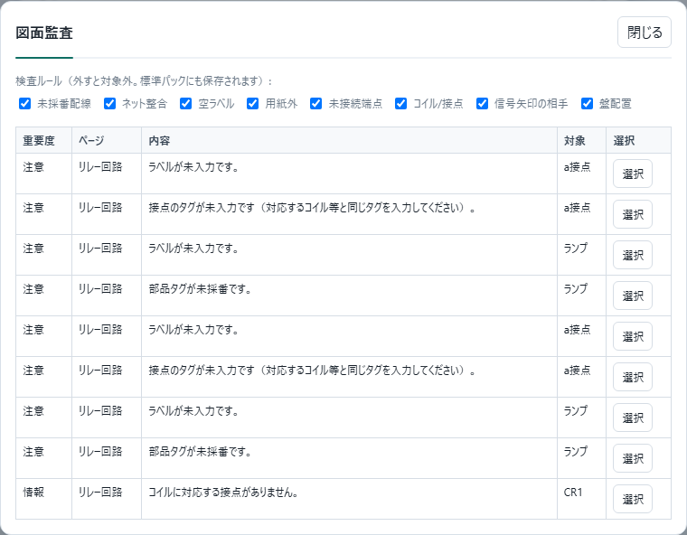{: .shot-wide}

## 13. 検索

上部の「検索」を押すと「図面検索」ダイアログが開き、全ページの文字を検索・一括置換できます。

> 💡 **ヒント:** リボンの「コマンド Ctrl+K」は部品や機能を名前で探して実行するコマンドパレットで、
> 図面内の文字は検索しません。図面内の文字を探すときは上部の「検索」を使います。

### 13.1 検索

1. 上部の「検索」を押します。
2. 「検索語」に文字を入力し、「検索」ボタンを押すか `Enter` キーを押します。
3. 結果の「選択」を押すと、ダイアログが閉じて該当ページへ移動し、その要素が選択されます。

- 大文字・小文字は区別しません（`cr2` でも `CR2` が見つかります）。前後の空白は無視します。
- 検索対象の文字欄は次の19項目です（一括置換も同じです）。
  タグ、ラベル、説明、設備、場所、メーカー、品番、定格、項目、文字、線番、接頭辞、表セル、
  ピン文字、右ピン文字、端子名、属性メモ、FROM、TO
- 検索では、部品の種別名（「コイル」「端子台」「配線」など）と、信号矢印の種別（発信元／受信先／参照）にも一致します。

結果一覧には「ページ」「種別」「内容」（その要素の文字欄の値。同じ値は1回だけ）が表示されます。
図13-1はタグ `CR2` の検索例です。種別が表示されるため、同じ文字がコイルと接点のどちらに
使われているかを確認してから「選択」を押せます。

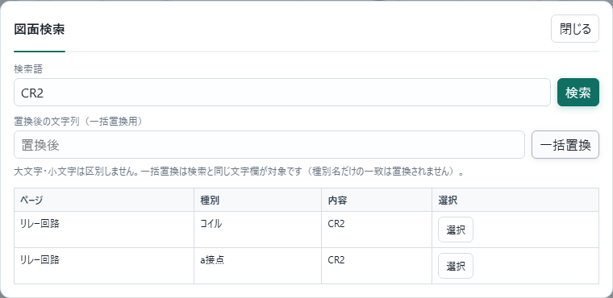{: .shot-wide}

### 13.2 一括置換

1. 「検索語」に置き換えたい文字を入力します。
2. 「置換後の文字列（一括置換用）」に新しい文字を入力し、「一括置換」を押します。
3. 「一括置換プレビュー」が開き、「ページ／種別／項目／変更前／変更後」の一覧で置換内容を確認できます（図13-2）。
4. 適用したい行だけにチェックを入れ（「全選択」「全解除」ボタンあり）、「選択した置換を実行」を押します。

- 置換されるのは一致した部分だけです。大文字・小文字を区別せずに探し、置換後の文字列は入力したとおりの表記で入ります。
- 「置換後の文字列」を空欄にすると、一致した部分を削除します。
- 種別名だけに一致した要素は置換されません。一致する文字欄がない場合は「置換対象が見つかりませんでした。」と表示されます。
- 置換しても値が変わらない行は一覧に出ません。対象が400件を超える場合は、先頭400件だけが表示・適用の対象になります。
- 適用は**1回の「元に戻す」（`Ctrl+Z`）でまとめて戻せます**。ダイアログを閉じれば図面は変わりません。

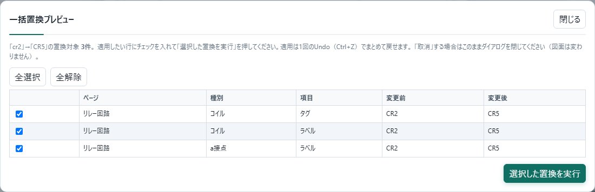{: .shot-wide}

## 14. 表題欄一括更新

上部の「表題欄」を押すと「表題欄一括更新」ダイアログが開き、複数ページの表題欄をまとめて更新できます（図14-1）。
1ページずつ右パネルで表題欄を直す方法は§5.3を参照してください。

1. 上部の「表題欄」を押します。
2. 上段に、プロジェクト共通の値（図名・設備・図番・改訂・作成・日付）を入力します。
   機能メニュー「改訂履歴」で改訂を登録している場合、「改訂」には最新の改訂記号が入ります。日付が未入力の場合は今日の日付が入ります。
3. 「表題欄マッピング」で、表題欄の各項目へ流し込む値（参照元）を確認します。
4. 「現在ページへ適用」（開いているページだけ）または「全ページへ適用」を押します。

参照元の選択肢:

- 「プロジェクト: 図名」〜「プロジェクト: 日付」: 上段に入力した値
- 「ページ名」: 各ページのタブの名前
- 「シート番号」: ページ順の番号（`1`、`2`…）
- 「シート/総数」: `1 / 5` の形式
- 「空欄にする」: その項目を空欄にします
- 「既存値を保持」: その項目は変更しません

「空欄の項目だけ更新」にチェックを入れると、既に値が入っている項目は変更しません。
適用したマッピングはプロジェクトに保存され、次に開いたときも同じ設定で表示されます（「新規」でも引き継がれます）。

> ⚠️ **注意:**
> - 既定のマッピングでは、図名も「プロジェクト: 図名」になっているため、「全ページへ適用」で全ページの図名が同じ値に置き換わります。
>   テンプレートで追加したページのように図名がページごとに違う場合は、図名の参照元を「既存値を保持」
>   （またはページ名）にしてから適用してください。
> - 上段を空欄にした項目は、各ページの値を変更しません。値を消したいときは、その項目の参照元を「空欄にする」にします。

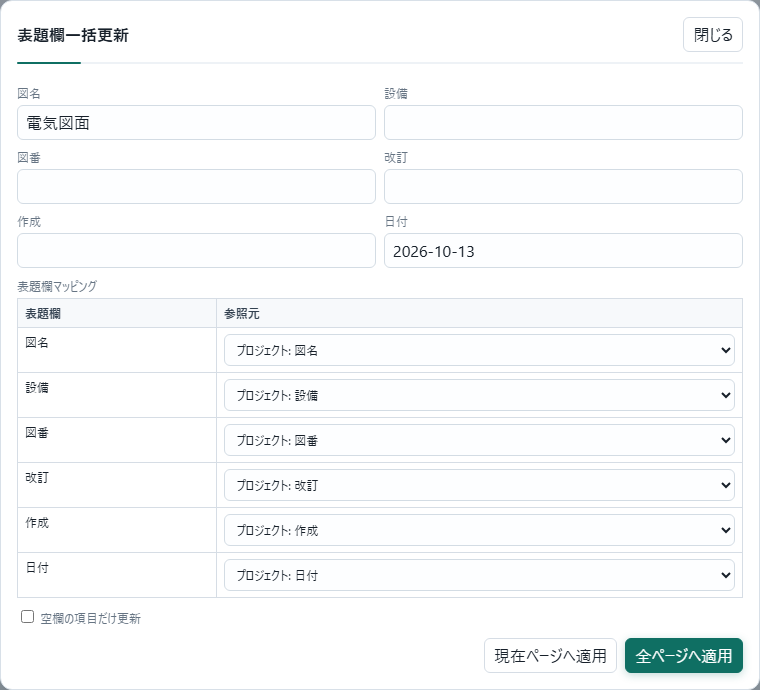{: .shot-wide}

## 15. ユーザー部品

よく使う図形や回路を「ユーザー部品」として登録し、パレットから繰り返し配置できます。

### 15.1 登録

1. 登録したい図形や記号を選択します。複数の要素をまとめて登録する場合は、Shift+クリックで複数選択します。
2. 右パネル下部の「ユーザー部品に登録」を押します。複数選択しているときは「回路として登録」を押します。
3. 「ユーザー部品名」を入力して「OK」を押します。

登録した部品や回路は、左パネルの部品パレットの「ユーザー部品」に追加され、通常の部品と同じように
ドラッグまたはクリックで配置できます。複数選択で登録すると、選択中の配線、接点、コイル、文字などを
まとめた回路になります。配線を接続したい回路には、端子や接点を含めて登録してください（接続点として働きます）。

### 15.2 管理

機能メニューの「ユーザー部品管理」で、登録済みユーザー部品をプレビュー付きで一覧表示します。

- 「編集」: 直線・矩形・円・文字・接続点などの図形だけで作った部品は、シンボルビルダーで形を修正できます
  （回路として登録した部品には表示されません）。
- 「改名」: 部品名を変更します。
- 「削除」: 確認なしで削除します（「元に戻す」で戻せます）。

ユーザー部品は図面のJSONと標準パックに保存され、「新規」を押しても残ります。

## 16. 保存と読込

保存方法は目的によって使い分けます。まずこの表で全体像をつかんでください。

| 方法 | 操作 | 用途 | 消えるリスク |
|---|---|---|---|
| JSON保存 | 上部「保存」（`Ctrl+S`） | **正式な保存**。再編集・受け渡し用 | ファイルを消さない限り残る |
| 自動バックアップ | （自動）／上部「復元」 | 保存し忘れ・誤操作からの復帰 | ブラウザのデータ消去で消える |
| プロジェクト管理 | 機能メニュー | 複数図面の切替・下書きの保管 | ブラウザのデータ消去で消える |
| PDF/SVG/PNG/DXF | 上部・機能メニュー | 提出・印刷・他CADへの受け渡し | 再編集には使えない(※DXFは取込可) |

> ⚠️ **注意:** 再編集したい図面は必ず **JSON形式** で保存してください。
> PDFやPNGからは図面を復元できません。

### 16.1 JSON保存

上部の「保存」を押すか `Ctrl+S` を押すと、図面全体を JSON ファイルとしてダウンロードします。
ファイル名は `electrical-drawing-日時.json`（例: `electrical-drawing-2026-10-12T05-30-00-000Z.json`。
時刻は世界標準時）で、保存するたびに別のファイルになります。

JSON にはページ、図形、属性、ユーザー部品、部品カタログ、標準設定（採番書式・部品タグ規則・配線種別・
レイヤ・監査ルールなど）が含まれます。

保存後は、ブラウザのダウンロード一覧または保存先フォルダでファイルが存在することを確認してください。
`制御盤_revA.json`、`制御盤_revB.json` のように版名を付けて保管すると、比較（§16.5）や復旧が容易です。
他の人へ渡すときは、編集用のJSONと確認用のPDFを同じ版名でそろえると取り違えを防げます。

図面を変更してからJSON保存していない状態で、ブラウザの再読み込み、タブを閉じる操作、別ページへの移動を
行うと、ブラウザ標準の確認画面が表示されます。「キャンセル」「このページに留まる」などを選ぶと
再読み込みを中止し、編集中の図面へ戻れます。表示文言とボタン名は使用するブラウザによって異なります。
JSON保存後は未保存の変更がないため確認は表示されません。

### 16.2 JSON読込

上部の「開く」を押し、保存済み JSON ファイルを選択します。読み込んだ図面は再編集できます。
読み込むと、それまでの図面は置き換わり、元に戻す（Undo）の履歴も新しく始まります。

JSONのページ・要素・設定・表題欄レイアウトなどは、画面へ反映する前にまとめて検査されます。
破損ファイルや形式不正が見つかった場合は現在の図面とUndo履歴を変更せず、ステータス表示に
理由を出します。読込後の描画に失敗した場合も、読込前の状態へ戻ります。

#### 形式の版数と自動移行

保存データには**形式の版数**（`schemaVersion`）が記録されます。現在の形式は **schemaVersion 11** です。
古いJSONは読み込み時に**自動で現行形式へ変換**されるため、以前に保存したファイルもそのまま開けます。
逆に、**より新しい版のアプリで保存されたファイルは、内容を失ったまま上書きしないよう読込を中止**し、
新しい版のアプリで開くよう案内します。

変換では、記号の寸法や接続ピンの位置が現行と異なる要素を現行の形へ直し、旧接続ピンで終端していた
配線と接続点も新しいピン位置へ自動で追従させます。回転済みの要素は回転角を保ったまま変換されます。
同じデータへ繰り返し変換を行っても、座標が重ねて移動することはありません。
変換後は「監査」（§12.8）の未接続端点で、配線のつながりを確認してください。主な変換内容は次のとおりです。

- **schemaVersion 2以前→3**: 2.5mmグリッドへ正規化した固定形状シンボルを新しい寸法へ移行します。
  機器箱（28×16→30×25mm）と端子箱（22×18→22.5×15mm）も対象で、各端子へ接続していた配線・接続点が新しい端子位置へ追従します。
- **3→4**: アーチ形CPを左右12.5mmの寸法へ直し、右側（縦向きでは下側）の配線端・接続点・機械連動線を
  新しい接続ピン・アーチ頂点へ追従させます。端子台/PLCユニット列は、周囲の配線端と端子円から意図された
  端子中心を判定し、幅10mm・中央接続の形へ変換します（2段端子台は接続位置を保持）。
  生成器が重ねていた小端子は、全端子が既定形・既定位置でそろう場合だけ取り除き、手作業の端子や不完全な組合せは残します。
- **4→5**: ブザーのデザイン名をJIS番号に対応した`jis0806`へ変え、接続済みの配線端を2.5mmピッチの端子へ追従させます。
  右寄せ・中央寄せの文字は、現在の配置基準に合わせて位置を直します。
- **5→6**: 回転灯・ベルをランプまたは音響信号装置へ置き換え、3極主接点を現行の記号へ移行します。
- **6→7**: 見本形・テンプレート専用の遮断器、変圧器、コンセント、接地、モータ、切替スイッチ、整流器を
  現行のJIS形または一般形へ変換します。変圧器の上下4接続点、コンセントまたはプラグ／ソケット接点の端子を含め、
  旧接続点で終端していた配線・接続点も対応先へ追従します。
- **7→8**: 白円＋水平2線のコンセント、おす形接点 S00032、めす形接点 S00031 を、それぞれ同じ外観を保つ
  別デザイン名へ移します（新しく配置するコンセント／プラグは一般家庭用2Pの外観です）。寸法・接続点・配線位置は変わりません。
- **8→9**: 光電スイッチの`general`（一般形・箱＋入射光）を`diffuse`（拡散反射形）へ置き換え、
  押しボタンのJIS形`jis`／`jisNc`の外形を10×7mmへ広げます。接続点の座標は変わりません。
- **9→10**: 光電スイッチの3線式・4線式の端子ピッチを5mmから2.5mmへ詰め、本体高さを
  3線式15→10mm、4線式20→12.5mmへ縮めます。第1端子（上端）の位置は変わらず、
  2番目以降の端子へ接続していた配線・接続点は新しい端子位置へ追従します。ライトカーテンの多端子形は5mmピッチのままです。
- **10→11**: ブザーのホーン形・スピーカー形（幅12mmのもの）を幅12.5mmへ広げ、右側の接続ピンを2.5mmグリッドへ合わせます。
  右ピンへ接続していた配線端・接続点は新しい位置へ追従します。左ピンの位置と、幅を変えて使っていたブザーは変わりません。

### 16.3 自動バックアップ復元

編集操作のたびに、図面をこのブラウザの中へ自動保存します（自動バックアップ）。
さらに、少し前の状態を「世代」として最大3つ残しています。

- **最新（直前の操作まで）**: 最後に編集した時点の状態です。
- **世代1〜3（少し前）**: 編集を続けている間、約5分おきに1つ前の「最新」を世代1へ移し、
  古い世代を順に繰り下げます（世代3より古いものは消えます）。

アプリを開いた・再読み込みした直後や、「新規」「開く」、プロジェクト管理からの読込、
バックアップからの復元を行った直後は、自動バックアップを書き換えません。そのため、閉じてしまった図面も、
次に何か編集するまでは「最新」に残っています。その後最初に編集した時点で、前の「最新」は
経過時間に関係なく世代1へ移されます。

1. 上部の「復元」を押すと「ブラウザ内バックアップの復元」ダイアログが開きます（図16-1）。
2. 戻したい行の「この状態へ復元」を押します。「保存日時」は、その世代を残した時刻です。
3. 確認画面で「OK」を押すと、現在の画面内容が置き換わります。必要なら先にJSON保存してください。

> 💡 **ヒント:** アプリを開き直したら、何か編集する前に「復元」を押すのが確実です。
> 開き直した後に編集してしまった場合も、閉じる前の図面は「世代1」に残っています。

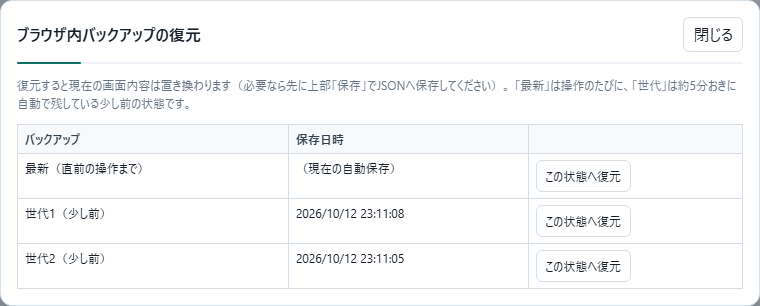{: .shot-wide}

> ⚠️ **注意:** 下絵画像を多用するなどで図面が大きくなり、ブラウザ内へ保存しきれなくなると、
> ステータス表示に「自動バックアップを保存できません」と一度だけ警告が出ます。
> この状態では自動バックアップに頼れないため、上部「保存」からJSONファイルとして保存してください。

### 16.4 プロジェクト管理（ブラウザ内保存）

機能メニューの「プロジェクト管理（ブラウザ内保存）」で、複数の図面をこのブラウザへ
名前付きで保存し、切り替えできます（図16-2）。

- 「現在の図面を新規保存」: 「保存名」を付けてブラウザ内へ保存します。
- 「読込」: 保存済みプロジェクトを開きます。確認画面で「OK」を押すと現在の内容は置き換わるため、必要なら先にJSON保存してください。
- 「上書き」: 選んだプロジェクトを現在の図面で上書きします（確認あり）。
- 「改名」: プロジェクト名を変更します。
- 「削除」: 確認後に削除します。削除は元に戻せません。

ブラウザのデータ消去で失われるため、恒久保存には JSON 保存を併用してください。

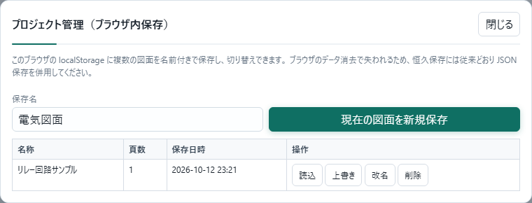{: .shot-wide}

### 16.5 図面差分（版比較）

以前保存したJSON（旧版）と現在の図面を比べ、どこが変わったかを確認できます。

1. 機能メニューの「**図面差分（旧版JSONと比較）**」を選び、比較したい**旧版のJSONファイル**を選びます。
2. 「図面差分（旧版との比較）」ダイアログに、ページごとの**追加／変更／削除**の件数が表示されます。
   ページごと追加・削除された場合は「（ページ追加）」「（ページ削除）」、名前が変わったページは「（旧名: …）」と表示されます。
3. 「表示」を押すと、ダイアログの下に現在の図面のプレビューが表示され、差分の要素が枠で示されます（図16-3）。
   - **緑の枠** = 追加された要素
   - **橙の枠** = 変更された要素（位置・寸法・ラベル・タグなど）
   - **赤の枠＋うすい赤の図形** = 削除された要素（旧版の姿をうすく表示）

改訂前後の検図、「どこを直したか」の確認、他の人が編集した図面の変更点チェックに使えます。
判定は要素ごとのID基準なので、単に移動しただけの要素も「変更」として検出されます。
同じ図面から保存した版どうし（「保存」で書き出したJSONと、それを開いて編集した図面）を比べてください。
別に作り直した図面は、内容が同じでもすべて「追加」「削除」になります。
比較の対象は図面上の要素で、表題欄（図番・改訂など）や用紙設定の変更は件数に含まれません。

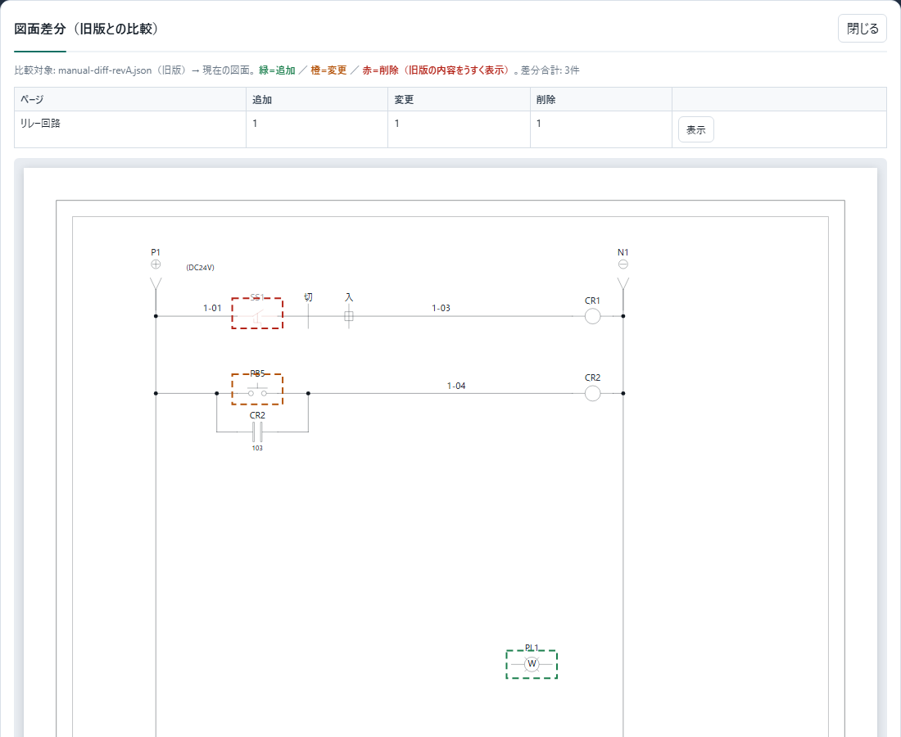{: .shot-wide}

### 16.6 履歴タイムライン

機能メニューの「履歴タイムライン（操作をさかのぼる）」では、操作名と時刻が付いた履歴を最大60件確認できます（図16-4）。
戻したい行の「この時点へ」を押すと、その操作直後の状態までまとめて戻ります。
戻った直後であれば、`Ctrl+Y` または新しい側の行の「この時点へ」でやり直せます。
右パネルで同じ部品の同じ項目を4秒以内に連続変更した場合は履歴1件へまとめられ、
数値スピナーを連打してもUndo 1回で編集開始前へ戻ります。別項目の変更、4秒以上の間隔、
Undo/Redo直後の編集は新しい履歴になります。「新規」「開く」、プロジェクトの読込、バックアップの復元を
行うと、履歴はそこから新しく始まります。

下絵画像を含む図面では、Undo履歴内の画像本体を操作回数分複製せず共有して保持します。
そのため、下絵の位置・不透明度などを繰り返し調整しても履歴メモリが画像容量×操作回数に
膨らみません。JSON保存と自動バックアップには画像本体が含まれるため、再読込後も復元できます。

> ⚠️ **注意:** 過去へ戻った後に新しい編集を始めると、それより新しい履歴は破棄されます。
> 不安な場合は先にJSON保存してください。

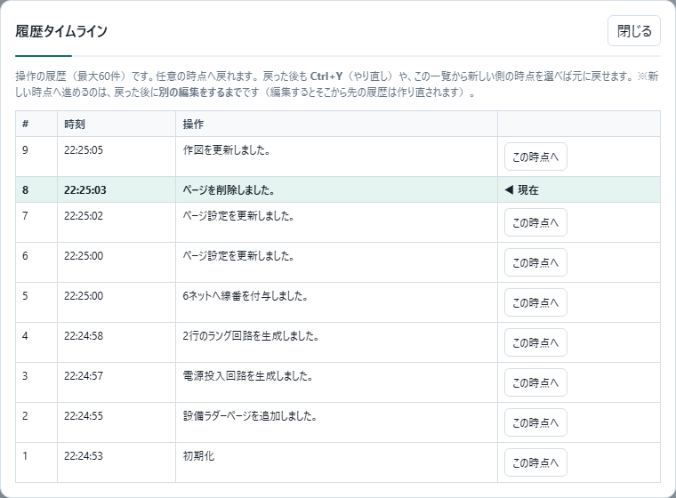{: .shot-wide}

### 16.7 新規作成

上部の「新規」を押し、確認画面で「OK」を押すと、新しい図面で始めます。新しい図面は
A4縦・「基本: 右下表題欄」の図枠のページ「P1」1枚で、図名は「電気図面」、日付は今日です。
それまでの図面は保存されないため、必要なら先にJSON保存してください。

新規で初期状態に戻るもの:

- ページ（「P1」1ページだけになります）
- プロジェクト情報（図名「電気図面」、図番・改訂・作成・設備は空欄、日付は今日）
- 改訂履歴
- ケーブル・芯線の一覧
- 元に戻す（Undo）の履歴

新規でも引き継ぐもの（図面をまたいで使う設定と資産）:

- ユーザー部品・ユーザー回路、部品カタログ、PLCモジュールDB、フットプリント検索DB
- 配線種別、レイヤ、採番書式、部品タグ規則、監査ルール、帳票の列構成
- 表示・スナップ・ズーム、ショートカット、お気に入り、パネルの開閉
- 標準パック、表題欄レイアウト、表題欄マッピング

> 💡 **ヒント:** 「新規」を押しただけでは自動バックアップは書き換わりません。誤って新規を押した場合は、
> 何も編集せずに上部「復元」で「最新」を選ぶと、元の図面へ戻れます（§16.3）。

## 17. 出力

用途に合う形式を選んでください。

| 目的 | 推奨形式 | 注意点 |
|---|---|---|
| 後からこのツールで編集する | JSON | 正式な編集データ。PDFとは別に必ず保存 |
| 提出・承認・紙印刷 | PDF | 全ページを1ファイル化。先にプレビューで確認 |
| 1ページを文書へ貼る | SVG／PNG | SVGは拡大に強く、PNGは一般的な画像用途向け |
| CADで線や文字を再利用する | DXF | 下絵画像は含まれない。受け側CADで線種・文字を確認 |
| 部品・配線・端子を表計算で扱う | CSV | 図形そのものではなく帳票データ |

### 17.1 印刷プレビュー

上部の「**プレビュー**」を押すと、印刷やPDF出力と**同じ内容**（グリッド・選択枠なし）を
画面内で確認できます（図17-1）。

- 全ページが縦に並び、各ページの下に「ページ番号 / 総数・ページ名・用紙寸法」が表示されます。
- 「倍率」は「幅に合わせる」「75%」「100%」「150%」「200%」から選べます。
- 「**このまま印刷**」を押すと、そのままブラウザの印刷ダイアログへ進みます（§17.2と同じ印刷です）。
- 印刷前に「線番の付け忘れ」「図枠からのはみ出し」「ページ順」を確認する習慣をつけると
  印刷のやり直しが減ります。

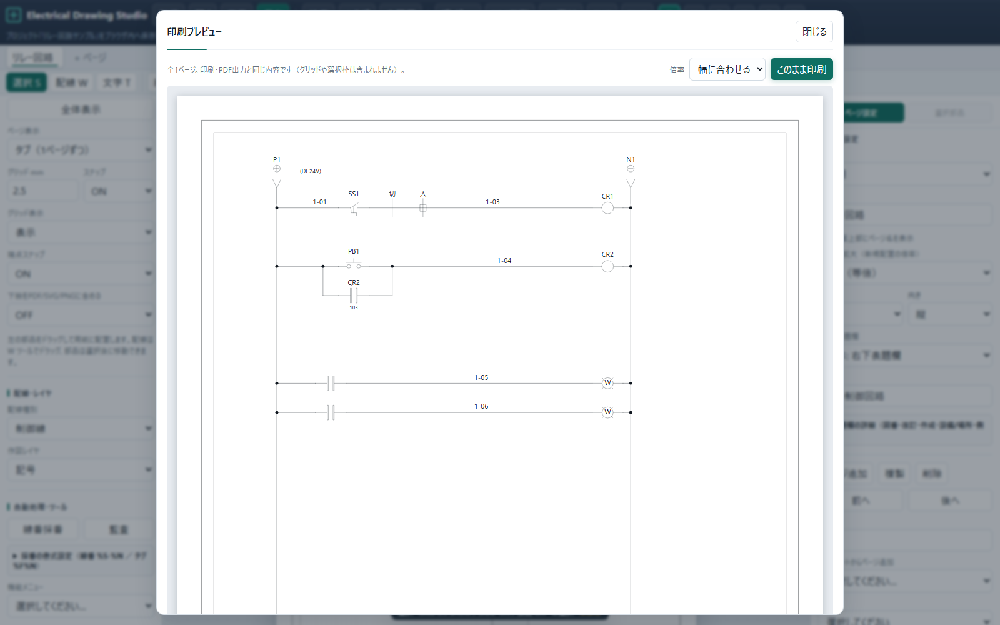{: .shot-full}

### 17.2 PDF印刷

図面をPDFファイルにする手順です。

1. 上部の「PDF印刷」を押します。ブラウザの印刷ダイアログが開きます。
2. 「送信先（プリンター）」で **「PDFに保存」** を選びます。
3. 用紙サイズが図面と同じ（通常はA4）になっていることを確認します。
4. 「保存」を押し、保存先を選びます。

全ページが1つのPDFになり、各ページはそのページの用紙サイズと向き（A4/A3・縦/横）で出力されます。
印刷されるのは図面のシートだけで、画面のボタン、ステータス表示、ダイアログなどは印刷されません。
作図補助グリッド、選択枠、下絵（左パネル「下絵をPDF/SVG/PNGに含める」がOFFのとき）も印刷されません。
ブラウザのメニューや `Ctrl+P` から印刷した場合も、同じ内容が印刷されます。

> 💡 **ヒント:** 実際のプリンターを選べばそのまま紙に印刷できます。
> 「背景のグラフィック」設定は不要です（図枠・記号はすべて印刷対象として出力されます）。

### 17.3 A3面付

上部の「A3面付」を押すと、A4のページを2ページずつA3用紙へ**等倍（100%）**で並べて印刷します。
A4はA3のちょうど半分なので、文字や線が縮小されません。

- A4縦のページが2枚続くとき: A3横の用紙に左右に並べます。
- A4横のページが2枚続くとき: A3縦の用紙に上下に並べます。
- 次のページと向きが違うA4ページや、最後に1枚だけ残ったページ: A3用紙1枚の左半分（または上半分）に単独で置きます。
- A3のページ: 縮小せず、そのままA3用紙1枚に印刷します。

ページ順はそのまま保たれます。印刷ダイアログでは、用紙サイズが「A3」になっていることを確認してください。

### 17.4 SVG

上部の「SVG」を押すと、現在ページを `ページ名.svg` として出力します。拡大しても線や文字がぼやけない形式です。
SVGファイルには線の色・太さの書式も含まれるため、ブラウザや他のソフトで開いても画面と同じ線で表示されます。

### 17.5 PNG

上部の「PNG」を押すと、現在ページを `ページ名.png` として出力します。解像度は1mmあたり4ピクセル
（A4縦で840×1188ピクセル）で、背景は白です。

### 17.6 DXF

機能メニューの「DXF出力（現在ページ）」で、現在ページを `ページ名.dxf` として出力します。
「DXF出力（全ページ）」は、全ページを `連番_ページ名.dxf`（例: `1_P1.dxf`）として順に書き出します
（ブラウザが複数ファイルのダウンロード許可を求めた場合は許可してください）。

配線ギャップはDXF上では線分を分割して表現します。下絵画像はDXFには含めません。
雲マークと円弧はARCエンティティとして出力されます（楕円・楕円弧は折れ線近似）。

破線・一点鎖線・二点鎖線・細点線は、DXFでは線種（DASHED/CENTER/PHANTOM/DOTTED）として
出力されます（LTYPEテーブル同梱）。

### 17.7 帳票CSV

機能メニューの「帳票CSV出力」で、図面内の部品、配線、端子の情報を `electrical-report.csv` として出力します。

- 1行目は列名（`record, page, sheet, type, id, tag, name, description, installation, location, manufacturer, catalog, rating, item, x, y, x2, y2, detail`）です。
  `record` 列で部品（`component`）・配線（`wire`）・端子（`terminal`）を区別します。
- 部品のタグ、説明、設備、場所、メーカー、品番、定格、項目は独立した列として出力されます。
- 配線の `detail` 列には、FROM/TO（推定値または手動入力値）、手動FROM/TO（`sequence=manual`）、
  線番固定、線番非表示、配線ギャップ（`gap=true`、`gapCount=数`）などの情報が入ります。

CSVへ書き出す前に内容を画面で確かめるときは、機能メニュー「帳票・確認」の「図面要素一覧」を使います。
帳票CSVと同じ部品・配線・端子の行が「種別」「ページ」「名称」「詳細」の表で一覧表示され
（「種別」には `coil` のような内部の種別名が出ます）、各行の「選択」を押すと、その要素のページへ移動して選択できます。

このツールが書き出すCSVは、すべてBOM付きUTF-8です。Excelで開いても文字化けしません。
帳票CSVのほかに、次のCSVを出力できます。

| CSV | 出力する場所 | ファイル名 |
|---|---|---|
| 部品集計表 | 機能メニュー「部品集計表(BOM)」の「CSV出力」 | `electrical-bom.csv` |
| ネットリスト | 機能メニュー「ネットリスト（ページ間統合）」の「CSV出力」 | `netlist.csv` |
| 端子台プラン表 | 機能メニュー「端子台プラン表」の「CSV出力」 | `terminal-plan.csv` |
| From-To一覧 | 機能メニュー「配線順序(FROM/TO)」の「From-To一覧CSV（全ページ）」 | `wire-from-to.csv` |
| 部品カタログ | 機能メニュー「部品カタログ」の「CSV出力」 | `catalog.csv` |

### 17.8 帳票表挿入

機能メニューの「帳票表挿入」で、帳票を現在ページへ表部品として挿入できます（図17-2）。

1. 「帳票種別」を「全要素」「部品」「配線」「端子」から選びます。
2. 「最大行数」（3〜30。既定12）と、表の見出しになる「表題」を入力します。
3. 必要なら「設備フィルタ」「場所フィルタ」を入力します。入力した値と完全に一致する行だけが挿入されます。
4. 「列構成」のチェックで挿入する列を選びます（例: 部品帳票に メーカー・定格・設備・場所 を追加）。
5. 「現在ページへ挿入」を押します。

最大行数を超える行は挿入されません。そのときはステータス表示に「対象N行のうち先頭M行」と入りきらなかった行数が出るので、
最大行数を増やすか、フィルタで絞り込んで複数の表に分けてください。
選んだ列構成はプロジェクトへ保存され、次回以降と標準パックにも引き継がれます。

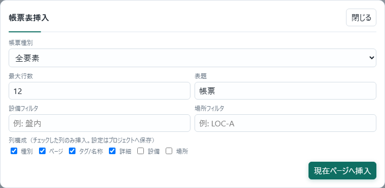{: .shot-wide}

挿入した表は通常の表部品として移動、編集、印刷、保存できます。

## 18. 標準設定

右パネル「ページ設定」の「標準」で、図面の標準を選びます。選択肢は「汎用」「トヨタ標準（仮）」と、
取り込んだ標準パックです。「汎用」と「トヨタ標準（仮）」は同じ設定内容で、どちらもグリッド2.5mm、
線番書式 `%S-%N`、部品タグ書式 `%F%N` を設定します。

> ⚠️ **注意:** 標準を切り替えると、グリッド間隔・線番書式・部品タグ書式がその標準の値に置き換わります。
> 標準パックを選んだ場合は、パックに含まれる部品タグ規則・配線種別・レイヤ・監査ルール・帳票の列構成なども置き換わり、
> 現在ページの図枠もパックに記録された図枠の種類に切り替わります。
> 自分で変えた書式を残したい場合は、先に「標準パック出力」で書き出しておいてください。

社内のルールは「標準パック」として持ち運べます。機能メニューの「標準パック出力」で、書式・部品タグ規則・
配線種別・レイヤ・監査ルールなどの設定一式を `standard-pack.json` として書き出し、別の図面やPCで
「標準パック取込」を行うと、そのパックが適用されて「標準」の選択肢に追加されます。
パックに含まれる項目と、取り込むときの扱いは§24.19で説明します。

### 18.1 レイヤ管理

機能メニューの「レイヤ管理」では、レイヤごとに表示とロックを切り替え、レイヤ名と線色を編集します（図18-1）。
既定のレイヤは「図枠」（ロック済み）「配線」「記号」「注記」「配置」の5つです。

1. 機能メニューの「レイヤ管理」を選びます。
2. 「表示」「ロック」のチェック、「レイヤ名」、「線色」を変更します。
3. 「適用」を押します。

- 完成済みの図枠や補助線を誤って動かしたくない場合は、対象レイヤの「ロック」をONにします。
  ロック中のレイヤの要素は移動・編集できません。
- 一時的に画面から隠したい要素は、その要素が所属するレイヤの「表示」をOFFにします。
  表示をOFFにしたレイヤの要素は、印刷・PDF・SVG・PNGにも出ません。
- 「線色」を変えると、そのレイヤに所属する要素のうち、線色が標準の黒（右パネル「線色」の左端の色）のままの要素が
  レイヤの線色で描かれます。画面、印刷、PDF、SVG、PNGのすべてに反映されます。
  右パネルで緑・赤など別の線色を選んだ要素は、その色のままです。
- 「図枠」の線色は、図枠と表題欄の罫線の色です。
- 線色は線にだけ使われ、文字の色は変わりません。DXF出力には色を付けません。
- 既定の線色は、「図枠」が図枠の罫線の色、ほかのレイヤが標準の黒です。既定のままなら図面の見た目は変わりません。
- レイヤの線色で描かれている要素を選択すると、右パネルの「線色」の下に
  「標準の黒の線は、レイヤ「記号」の線色で描きます（レイヤ管理）。」のように表示されます。

新しく描く要素のレイヤは、左パネルの「作図レイヤ」で選びます。要素の所属レイヤは、右パネルの「所属レイヤ」で変更できます。

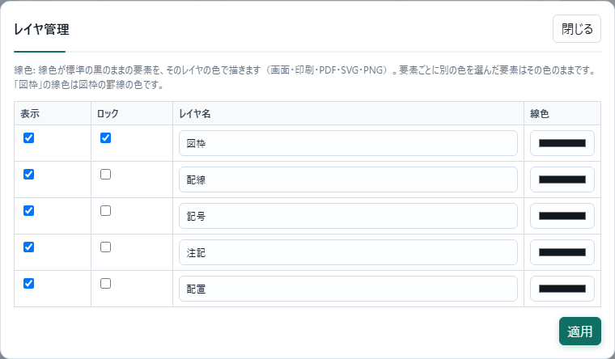{: .shot-wide}

### 18.2 配線種別管理

機能メニューの「配線種別管理」では、制御線・動力線・安全線・盤外/参考線などの配線種別ごとに、
「名称」「色」「線幅」「破線」「採番外」を編集できます（図18-2）。

1. 機能メニューの「配線種別管理」を選びます。
2. 各行の値を変更します。「破線」は線と空きの長さをmmで指定します（例: `3 2`。空欄は実線）。
   「採番外」にチェックを入れた種別の配線は、線番採番（§12.1）と監査の「未採番配線」の対象から外れます。
3. 「適用」を押します。

種別を増やすときは「種別追加」を押し、「配線種別ID（半角英数字）」と「配線種別名」を入力します。
表で編集中の値は種別を追加しても消えず、「適用」で確定します。新しく引く配線の種別は、
左パネルの「配線種別」で選びます（§9.2）。社内ルールを作る場合は種別を追加し、標準パックで共有します。

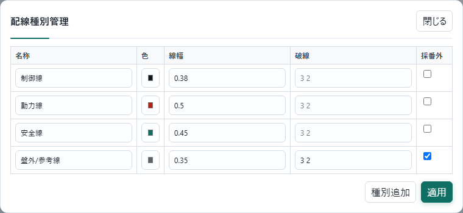{: .shot-wide}

## 19. よくある操作

この章では、よく作る図面を短い手順で作る方法をまとめます。各機能の詳しい説明は、手順の中に示した節を参照してください。

> 💡 **ヒント:** 「テンプレートからページ追加」は、右パネルの「ページ設定」タブにあります。部品を選択していると
> 右パネルが「選択部品」タブに切り替わるため、図面の空白をクリックして選択を解除するか、
> 「ページ設定」タブを押してから操作してください。

### 19.1 端子接続図を作る

**テンプレートから作る**

1. 右パネルの「ページ設定」タブにある「テンプレートからページ追加」で「端子接続図」を選びます。
   設定画面は開かず、すぐにページが追加されます。
2. 左右のレール（P1/N1）、16行分の配線、端子台 `TB1`（端子1〜16）が入ったページになります。
   各行は左端の端子小円から始まり、線番 `W01`〜`W16` の配線で端子台の端子へつながります。
   N1の右側にある `SIG01`〜`SIG16` は信号名の文字です。各行は別々の信号として扱われ、レールには接続されていません。
3. 端子台 `TB1` をクリックして選択し、右パネルの「端子数」「開始番号」で端子の数と先頭の番号を変更します（図19-1）。
4. 配線をクリックして選択し、右パネルの「線番」を実際の線番に書き換えます。行ごとのメモは、
   「スタイル・メモ（レイヤ／線色／属性メモ）」を開いて「属性メモ」へ入力します。
5. 信号名の文字を選択し、右パネルの「文字」を実際の信号名・接続先に書き換えます。
6. 必要に応じて、機能メニューの「端子番号の振り直し」（§10.4）、左パネルの「線番採番」（§12.1）と「監査」（§12.8）を実行して仕上げます。

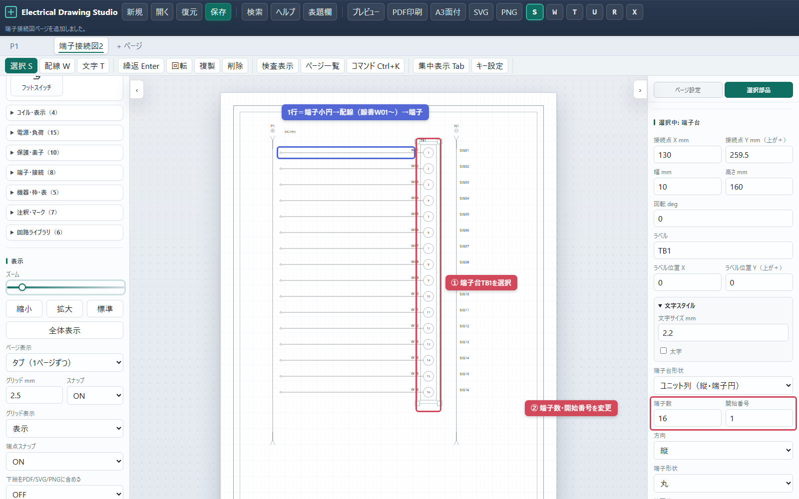{: .shot-full}

> ⚠️ **注意:** 「端子数」を変えても、配線と信号名の行は増減しません。端子を減らしたときは不要な行の配線と文字を削除し、
> 増やしたときは既存の行を複製して追加してください。

**CSVから作る**

端子の一覧がCSV（またはTSV）ファイルにある場合は、機能メニューの「端子CSV取込」でファイルを選びます。
1行が1端子になり、1ページに17行まで入ります。17行を超える分は次のページへ続きます。

次のようなCSVを読み込めます。

```csv
端子,線番,信号,接続先,備考
1,W101,START PB,PLC I00,
2,W102,STOP PB,PLC I01,
3,W103,MOTOR RUN,KM1 A1,
```

この例では、端子台 `X1` の端子1〜3へ、線番 `W101`〜`W103` の配線と、「START PB PLC I00」のような信号名・接続先の文字が並びます。
見出し行へ「端子台」列を加えると、端子台ごとに別のページへ分けて作ります。列名の別名や、見出し行がない場合の列の順番は §10.6 を参照してください。

### 19.2 PLC I/O 図を作る

**テンプレートから作る**

1. 「テンプレートからページ追加」で「PLC入出力回路」を選びます。
2. 設定画面の「種別」で、入力回路なら「入力（接点→ユニット）」、出力回路なら「出力（ユニット→コイル）」を選びます。
3. 「ユニット名」「開始アドレス(16進連番)」「点数（最大17）」を入力し、「ページ追加」を押します。
   「モジュールプリセット」で「入力16点 X000」などを選ぶと、各欄がまとめて入ります。
4. 入力回路ではP1レール→接点→配線→ユニット列、出力回路ではユニット列→配線→コイル→N1レールのページが追加されます。
   アドレスは開始アドレスからの16進連番（`X000`〜`X00F` など）です。
5. 接点やコイルのタグ、配線の線番、説明の文字を実際の内容に書き換えます。

設定画面の各項目とプリセットの登録方法は §11.3 を参照してください。

**CSVから作る**

I/O一覧がCSV（またはTSV）ファイルにある場合は、機能メニューの「PLC CSV取込」でファイルを選びます。
1行が1点になり、1ページに17点まで入ります。

次のようなCSVを読み込めます。

```csv
アドレス,入出力,信号,線番,接続先,備考
I00,入力,起動PB,W100,PB1,
O00,出力,運転ランプ,W200,PL1,
```

「入出力」列に「入力」または「出力」を書くと、その区分で配線のFROM/TOと説明の文字を作ります。
「入出力」列が空欄の行は、アドレスが `O`・`Y`・`Q` で始まる点を出力、それ以外を入力として扱います。詳しくは §11.2 を参照してください。

### 19.3 ラダー回路図を作る

1. 「テンプレートからページ追加」で「設備ラダー」を選び、設定画面の「ページ追加」を押します。
   既定値（左レール `P1`、右レール `N1`、電源注記 `(DC24V)`）のままで、左右の縦レール（母線）が入ったページが追加されます。
2. 行番号に合わせて作図する場合は、「ページ設定」タブの「図枠/表題欄」で「ラダー: 行番号+機器符号表」を選びます（§21.1）。
   この図枠では、部品や配線を行の近くに置くと、行の高さ（9.5mmピッチ）へ吸着します。
3. 機能メニューの「ラング追加」を実行すると、P1からN1まで横線（ラング）が1本引かれます。
   続けて実行するたびに、15mm下へ次の横線が追加されます。
4. 左パネルから接点、コイル、ランプなどを横線の上へ置きます。配線の上に置いた部品は、配線が自動で分割されて
   部品の端子へつながります（図19-2、§6.1）。
5. 必要に応じて、線番、部品タグ、電気属性を編集します。

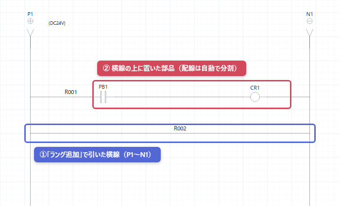{: .shot-wide}

> 💡 **ヒント:** ラダー図枠の行に合わせて1行分の回路をまとめて作るときは、機能メニューの
> 「ラング回路（接点+コイル/ランプ）」で開始行と行数を指定します（§21.2）。
> 「ラング追加」の横線は15mm間隔なので、ラダー図枠の行（9.5mm間隔）とは位置が一致しません。

左右母線とラング番号の付いた汎用の形式で描く場合は、テンプレートで「ラダー（汎用）」を選びます。
左右母線 `L`／`N` と、番号 `001`〜`010` の付いた10本のラングが入ったページ（図枠は「詳細: 右下+改訂欄」）が追加され、
「ラング追加」で `011` 以降を追加できます。部品をまだ置いていないラングは仮の線として扱われ、監査で指摘されません。

### 19.4 目次を作る

1. 「テンプレートからページ追加」で「目次」を選びます。
   基本図枠に見出し「図面目次」と、`No.`／`図番`／`図名`／`備考` の見出し行を持つ目次表（16行×4列）が配置されます。
2. 目次表をクリックして選択します。
3. 右パネルの「セル文字（タブ/カンマ区切り）」に、1行に1ページ分を入力します。列はタブまたはカンマで区切ります（図19-3）。

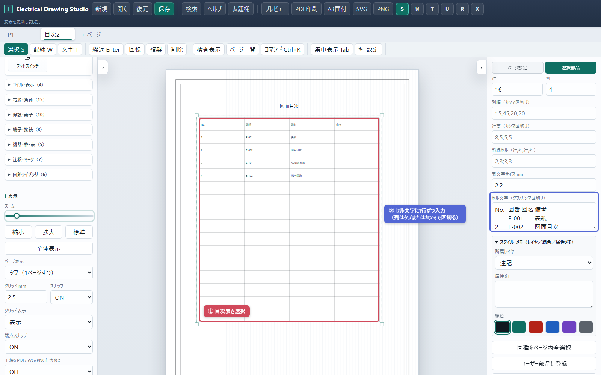{: .shot-full}

全ページの一覧を自動で作る場合は、機能メニューの「目次生成（全ページ一覧）」を使います。
全ページの No.／図番／図名／ページ名を並べた目次ページが追加されます（§24.19）。行の追加や列幅の変更など、表の詳しい編集は8章を参照してください。

## 20. トラブル対応

### 20.1 保存した図面を再編集したい

図面は上部の「保存」でJSONファイルとして保存し、次回は「開く」で読み込みます（§16.1、§16.2）。

PDF、PNG、SVG、DXF は出力用で、読み込んで元の図面として再編集することはできません（DXFは機能メニューの
「DXF取込」で線や文字として取り込めますが、部品・配線・属性の情報は戻りません。§20.5）。再編集用には必ずJSONを保存してください。
保存し忘れた場合は、上部の「復元」でブラウザ内の自動バックアップから戻せることがあります（§16.3）。

### 20.2 図形が動かない

要素、または要素が属するレイヤがロックされている可能性があります。次の手順で確認します。

1. 動かない要素をクリックして選択します。
2. 右パネルのボタンが「ロック解除」になっている場合は、押してロックを外します。
   複数の要素を選択しているときは「一括ロック解除」を押します（§7.11）。
3. ボタンが「レイヤロック中」になっていて押せない場合は、レイヤがロックされています。
   機能メニューの「レイヤ管理」で、そのレイヤの「ロック」のチェックを外します（§18.1）。

下絵画像は、ロック中は通常のクリックで選択できません。「ページ設定」タブの「下絵」で「下絵を選択（ロック中も可）」を選んでから、
「ロック解除」を押してください（§4.7）。

### 20.3 印刷にグリッドが出ない

正常です。グリッド（方眼）は作図補助用で、PDF印刷、A3面付、SVG、PNG、DXF の出力には含まれません。

画面上のグリッドも隠したい場合は、左パネルの「グリッド表示」を「非表示」にします。スナップは引き続き働きます。

### 20.4 PDFに保存したい

1. 上部の「PDF印刷」を押します。
2. ブラウザの印刷画面が開いたら、送信先（プリンター）で「PDFに保存」を選び、「保存」を押します。

全ページが1ページずつPDFになります。印刷前の見た目は「プレビュー」で確認できます（§17.1）。
A4のページを2ページずつA3へまとめる場合は「A3面付」を使います（§17.3）。

### 20.5 PDFスキャンを読み込んで自動変換できるか

スキャンしたPDFや画像を、部品や配線へ自動で変換する機能はありません。

スキャンした図面は下絵として用紙へ配置し、その上から同じ図面を作図してください（§4.7）。
下絵に使える形式は PNG、JPEG、WebP、SVG です。PDFの場合は、ページを画像に変換してから読み込みます。
CADで作られたDXFファイルがある場合は、機能メニューの「DXF取込」で線・円・円弧・文字として取り込み、トレースの下書きに使えます。

## 21. ラダー様式とシンボル

この章では、工場設備の電気図面で広く使われる様式（行番号付きのラダー図・機器符号表・頁+行の相互参照）で
作図するための機能をまとめます。21.1でラダー図枠、21.2で回路ページのテンプレートと一括生成、21.3以降でシンボルの様式を説明します。

### 21.1 図枠「ラダー」

ページの図枠を「ラダー: 行番号+機器符号表」にすると、行番号・クロスリファレンス表・機器符号表・表題欄を備えた
ラダー図用の図枠になります。テンプレートで追加したページも含めて、新しいページは基本図枠（右下表題欄）で作られます。
ラダー図枠は、次の手順でページごとに切り替えます。

1. 対象のページを開き、右パネルの「ページ設定」タブを表示します。
2. 「図枠/表題欄」で「ラダー: 行番号+機器符号表」を選びます（図21-1）。

図枠はいつでも切り替えられます。切り替えても、配置済みの部品や配線は動きません。

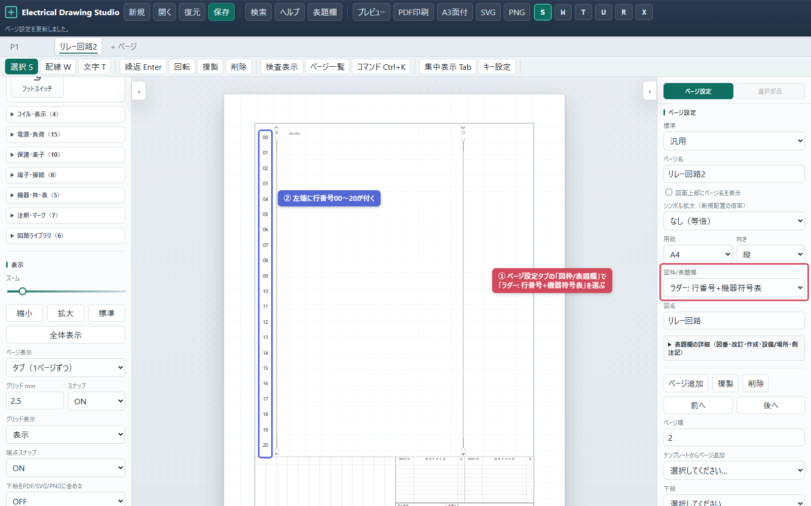{: .shot-full}

ラダー図枠の各欄は次のとおりです（図21-2）。

1. **行番号**: 左端に `00`〜`20` の行番号（9.5mmピッチ）が付きます。スナップがONのとき、部品の配置・移動や配線の作図で
   行の近くを指定すると、行の高さへ吸着します。指定した行から下をまとめて下げる・詰めるには「行挿入/行削除」を使います（§12.4）。
2. **クロスリファレンス表**（左下・13列）: ページ上のコイルごとにタグを見出しにして、同じタグの接点が使われている位置
   （頁+行、例 `204`）を自動で記入します。b接点の位置には下線が付きます（22章）。
3. **機器符号表**（右下の上段）: ページ上のコイル・接点のタグと、その「説明」を「機器符号」「機器符号内容」欄へ自動で記入します（最大20件）。
   コイルが別のページにある接点は、「頁」欄にコイルのページ番号が入ります。
4. **表題欄**（右下の下段）: 図名・図番・頁などを表示します。各欄に表示する値は、下の表のとおりです。
5. **側注記**: 「表題欄の詳細」の「側注記（左余白の縦書き）」に入力すると、左余白へ縦書きで表示されます。
6. **組織名**: 図枠の下の右端に、上部の「表題欄」ボタンで入力した「作成」（プロジェクトの値）を表示します。
   「ページ設定」タブの「作成」（ページごとの値）では変わりません。図枠の下には、ほかに「出力日」（ページの日付）と
   「更新日」（表題欄一括更新の日付）が表示されます。

| 表題欄の欄 | 表示する値 | 入力する場所 |
|---|---|---|
| 客先機番 | 設備コード | 「ページ設定」タブの「表題欄の詳細」→「設備コード」 |
| 装置区分 | 設備 | 上部の「表題欄」ボタン（表題欄一括更新）→「設備」（14章） |
| 内容 | 図名 | 「ページ設定」タブの「図名」 |
| 頁 | ページ番号 | 自動 |
| 図番 | 図番 | 「ページ設定」タブの「表題欄の詳細」→「図番」 |
| 日付 | 日付 | 「ページ設定」タブの「表題欄の詳細」→「日付」 |

{: .shot-full}

### 21.2 追加テンプレート

「ページ設定」タブの「テンプレートからページ追加」（§4.6）で、見本図面の構成を再現した回路ページを1ページ追加できます。
設定画面が開くテンプレートは、値を確認して「ページ追加」を押します。

- 設備ラダー: P1/N1 レール（複数レール可）、⊕⊖極性マーク、フォーク矢印つきのラダーページ。
- AC電源回路（受電・分岐）: AC200V三相/AC100V単相の受電、ELB、表示灯、CP分岐、
  送り回路、電線サイズ表とSCCR注記を配置します。
- AC電源回路（モータ）: サーボアンプ（1軸/2軸）またはインバータのモータ回路を配置します。
- DC電源回路: CP、スイッチング電源とN1/P0/P24/N24/Gの送り回路を配置します。
- PLC電源回路: PLCベース、スロット構成と入出力COM/制御電源/運転準備/動力供給を配置します。
- セーフティリレー回路: 2チャンネル非常停止入力、安全出力、モニタリレーと電源を配置します。
- PLC入出力回路: 開始アドレスから16進連番（例 X000→X00F / Y000→Y007）で一括生成します。
  入力（接点→ユニット）と出力（ユニット→コイル）を「種別」で切り替えます（§11.3）。
- 端子接続図: レール、端子小円から始まる横配線、ユニット列の端子台を並べた端子接続図（§19.1）。

設備ラダーで左レールを複数置く場合は、「左レール名（カンマ区切り・1つ目を左端に右へ順に配置）」へ `P1,P2,P3` のように入力します。
1つ目が左端（32.5mm）になり、2つ目以降は5mm間隔で右へ並びます。電源注記は最後の左レールの右側に置かれます。

テンプレートの共通事項は次のとおりです。

- 追加されるページは基本図枠（右下表題欄）です。行番号付きにする場合は「図枠/表題欄」で「ラダー: 行番号+機器符号表」を選びます（§21.1）。
- 電気接続ピン、配線端・屈曲点、端子円中心、主要な箱の辺を**2.5mm方眼へ厳密に整列**して配置します。
- パレットと同じ記号定義（JIS形・旧JIS形・一般形）を使います。そのため、配置後に右パネルでシンボルデザインを切り替えたり、
  配線を引き直したりできます。AC電源回路の盤内・操作盤コンセントは、縦スロット2本の家庭用2P外観と、
  L/Nを個別に配線できる2接続点で表します。
- 遮断器、サーキットプロテクタ、漏電遮断器のような多極の機器は、1極ずつの記号を機械連動の破線で結んで描きます。
  サーマル素子も1極ずつの記号で描きます。2極目以降は1極目と同じタグを共有し、ラベルは1極目だけに表示します。
  部品タグ採番、タグ重複の監査、部品集計表(BOM)では1台として扱います。
- 遮断器の定格（`10A`、`2A` など）は、記号の✕の上に小さく表示します。部品を選択し、右パネルの「定格表示(トリップ素子上)」で変更できます。

#### AC電源回路（受電・分岐）

設定画面では、電源電圧、接地/入力/送りレール名、漏電遮断器のタグと型式、
表示灯・盤内照明・ファン・REC送り・コンセント・GOT送りの有無、および変圧器容量を指定します。
電圧をAC100Vへ変えると、既定の `R,S,T` / `R01,S01,T01` は `R,N` / `R01,N01` に、
ELBは2極型式に切り替わり、変圧器は「なし」で選べなくなります。200Vへ戻すと既定値も戻ります。
既定値以外へ手入力したレール名や型式は、電圧を切り替えても上書きされません。

{: .shot-wide}

AC200V三相の既定値では、`G+R/S/T` の入力、`PL0`、3極 `ELB0`、メインアースブロック、
`R01/S01/T01` の送りレールに続き、次の分岐を1ページへ配置します。

- `CP0 → SS0（切/入）→ FL1` の盤内照明、および `CP01 → FAN1`。
- `CP1` からDC電源用RECへの送り。
- `CP2 → Tr1`（100VA/500VA/なし）で200Vから100Vへ降圧し、`CP3 → SC1` へ送る盤内コンセント。
- `CP4 → CP11 → SC2` の操作盤コンセント、および `CP12` からGOT電源への送り。
- 線番・サイズ・色の電線サイズ表とSCCR注記。

2線分岐の上下間隔は10mmです。既定配置のY座標は、表示灯37.5/47.5、盤内照明85/95、
ファン112.5/122.5、REC送り140/150、変圧器・SC1 170/180、SC2 187.5/197.5、
GOT送り207.5/217.5mmで、上下とも方眼線上にあります。

{: .shot-full}

AC100V単相では `G+R/N` から `R01/N01` へ直接分岐し、降圧用変圧器を配置しません。
接地レール名を空欄にした場合は、Gレール、接地送り、および電線サイズ表のG行をまとめて省略します。

{: .shot-full}

#### AC電源回路（モータ）

「駆動方式」でサーボアンプまたはインバータを選びます。項目名に「（サーボ時）」「（インバータ時）」が付いた欄は、
その駆動方式のときだけ使われます。方式を切り替えると、既定のままの相レール・MC接点タグ・モータ先頭タグ・モータ型式が、
それぞれ `R1,S1,T1` / `MS1M` / `SM1` / `0.2kW 三菱電機 HG-KR23BK`（サーボ）と
`R01,S01,T01` / `MC2M1` / `M1` / `0.4kW 三相誘導電動機`（インバータ）の組に切り替わります。手入力した値は保持されます。

{: .shot-panel}

サーボ方式では、3極CB、MC接点、サーボアンプ、U/V/W/PE端子とモータ、エンコーダ送り、
P24/N24ブレーキ回路、N1/P3M制御信号とブレーキリレーを生成します。モータ先頭タグの末尾が数字なら
軸ごとに連番（例: `AX9` → `AX9`,`AX10`）になり、数字がなければ末尾に1から番号を付けます（例: `AX` → `AX1`,`AX2`）。

{: .shot-full}

1軸を選ぶと、2軸目のモータ、エンコーダ送り、ブレーキ回路、`MBR-B`端子と第2ブレーキリレーを省略します。

{: .shot-full}

インバータ方式では、3極遮断器、インバータ、MC接点、2素子形サーマル、端子、接地付きモータ、
ブレーキ/整流回路（0〜4回路）、CC-Linkツイストペア（`DA/DB/DG/SLD`）を配置します。
入力したモータ型式・容量はモータの説明属性にも保存されます。

{: .shot-full}

> 💡 見本図面の `OL1A/OL1B/OL2` のような熱動過負荷記号は、線上の `⊓` を
> **サーマル素子**、`○✕○` を **サーマルリレー**として作図します。インバータ方式では
> モータ分岐の相1・相3へサーマル素子を自動配置します。

#### DC電源回路

入力レール名、接地レール名、スイッチング電源のタグ/型式、ブレーキ電源分岐と接地送りの有無を
指定します。既定では2極 `CP1` から `REC1` のL/Nへ入力し、-VをN1、+VをP0へ送ります。
さらに `CP8` からP24/N24を分岐し、Gを接地記号付きで送ります。送り矢印の手前まで配線が連続するため、
別ページの同名信号とネットリスト上でも接続されます。
CP1とREC1の入力行は45/55mmです。

{: .shot-wide}

{: .shot-full}

#### PLC電源回路

PLCベース名、カンマ区切りのスロット構成、運転準備/動力供給の接点タグ列を指定します。
`CP4 → P0A` とN1/GをPLCベースのDC+/DC-/接地へ接続し、N1（入出力COM）、
`CP5 → P1`（制御電源）、`CP6 + 接点列 → P3`（運転準備）、
`CP7 + 接点列 → P3M`（動力供給）を生成します。スロットは1〜8件、各接点列は最大4件、接点タグは
12文字以内です。範囲を超えた場合はページを追加せず、設定画面を開いたまま上部ツールバーのステータス表示に理由を出します。
接点タグ欄の空項目や末尾の余分なカンマは無視されます。スロット境界は60mmの領域を
2.5mm単位で配分し、型式名は区画内へ縦書き配置するため、7スロットなど等分できない件数でもグリッドから外れません。
分岐行は160/170/180/190mmへ10mm間隔で配置します。

{: .shot-wide}

{: .shot-full}

#### セーフティリレー回路

ユニットタグ、モニタリレータグ、2個の非常停止PB名称を指定します。既定ではPCR2E形ユニット、
縦連結2接点の非常停止PBを使うチャンネル1/2ループ、B-A短絡（オートリセット）、
13-14/23-24の安全出力、41-42からモニタリレーCR11へ至る回路、A1-A2電源を生成します。
非常停止PBは一般形の縦連結2接点で、接点間隔を10mmに設定します。配置後も、PBを選択して
右パネルの「接点間隔 mm」で変更できます。チャンネルの配線どうしが交差する箇所は、片方の配線だけを途切れさせた
非接続の表示（配線ギャップ、§9.4）になります。

{: .shot-wide}

{: .shot-full}

#### 一括生成

機能メニューの「一括生成」グループからは、次の回路や図形を現在のページへ追加できます。
多くの項目は、設定画面で値を指定して「生成」を押します。生成した要素はまとめて選択された状態になるため、
そのままドラッグして位置を調整できます。位置を指定する欄のYは、右パネルの座標と同じく用紙の下端から測った値で、
上が＋です（「開始Y mm（上が＋）」など。X は用紙の左端から測ります）。「開始行」はラダー図枠の行番号で、座標ではありません。

- ラング回路（接点+コイル/ランプ）: 「開始行(00-20)」から「行数」分、左レール → 直列接点（「直列接点数」0〜4個）
  → コイルまたはランプ（「終端部品」）→ 右レールの行を生成します。接点やコイルのタグは生成後に入力します。
- 非常停止チェーン: 非常停止PBを直列にし、各局右側の境界端子、局間線番、線番付き送り矢印、
  同じPBの別接点から局内ループで接続する赤表示灯行、N1レール側の接続点、点線局枠を生成します。
- 電源投入回路（自己保持）: 「開始行(00-20)」（17まで）の行に切替スイッチ+入/切ポジション→コイルの行を、
  2行下に準備PB→コイルの行と、その下へ自己保持接点の並列行を生成します。
- ブレーキ/整流回路: 「開始行(00-20)」（19まで）から2行ごとに、接点 → 整流器 → コイルの行を「回路数」（1〜4）分生成します。
- 縦配線列・横配線行: 本数、ピッチ、範囲、線番を指定して、複数の配線をまとめて引きます（§9.1）。
- ツイストペア: 2〜8本の導体、チェブロン、撚り交差、楕円束、シールド破線を生成します。
  信号名はチェブロン左へ右寄せで置かれ、左側レールと重なりにくくなっています。
  「開始Y mm（上が＋）」は1本目の導体の位置で、2本目以降は導体ピッチごとに下へ並びます。
  全長は20mm以上、導体ピッチは既定5mmです。スナップON時は開始X/Y、全長、導体ピッチを
  現在のグリッドへ自動で揃えます。
- モータ分岐回路: 3極遮断器 → MC接点 → サーマル素子 → モータ+接地を生成します。遮断器・サーマル素子・接地は
  チェックで省略できます。「1相目Y mm（上が＋）」は1相目の配線の位置で、2相目・3相目は5mm間隔で下へ並びます。
  全長は70mm以上で、スナップON時は開始位置と全長もグリッドへ揃えます。
- PLCユニット: 16進連番を10mmピッチで並べた1〜19点のユニット列を生成します。
  位置は「端子中心X mm」で指定し、上下の位置は固定です。19点でも下端は用紙の上端から222.5mmとなり、
  ラダー図枠の機器符号表帯（上端から224mm以降）へ入りません。
- 盤レイアウト連携: タグ付き部品を盤レイアウト用のフットプリントとして挿入し、回路図と盤の属性を相互に反映します（§24.4）。
- DINレール／配線ダクト: 盤レイアウト用のDINレールまたは配線ダクトの外形を生成します（§24.6）。
- ユーザー回路を挿入: 「選択範囲をユーザー回路登録」で登録した回路を配置します（§24.8）。

ラング回路、非常停止チェーン、電源投入回路、ブレーキ/整流回路は、現在のページの縦レールの位置を
自動で測って接続します。レールがないページでは左32.5mmのP1と右147.5mmのN1を自動で追加してから接続し、
片側だけある場合は不足する側を補います。既定と異なる位置にあるレールにも、その位置で接続します。
ラング回路・電源投入回路・ブレーキ/整流回路は「開始行」で指定したラダー図枠の行（9.5mmピッチ）に、
非常停止チェーンは行02から下へ配置します。

非常停止チェーンの局間線番は、末尾区間を基準名として手前へ `A`、`B`…を付けます。
たとえば3局のチェーン0は左から `Si0B → Si0A → Si0` となります。

{: .shot-wide}

{: .shot-full}

### 21.3 シンボル様式

部品パレットの記号は、**JIS C 0617（電気用図記号）**の形を中心に、旧JIS（JIS C 0301）の形、電気回路図で一般に使われる形、
見本PDFの図面を実測して再現した形をそろえています。画面表示・SVG・DXF・配線の接続点は同じ記号定義から作られるため、
どの出力でも記号の形と接続位置が一致します。

#### デザイン名の読み方

右パネルで選ぶデザイン（§21.4）の名前は、**「名称（出典・形の特徴）」**の形式です。
たとえば「メーク接点（JIS 07-02-01・斜め線のみ）」は、JIS C 0617の図記号番号07-02-01のメーク接点で、
斜め線だけで描く形であることを表します。出典は次のいずれかです。

| 出典の表記 | 意味 |
|---|---|
| `JIS NN-NN-NN` | JIS C 0617の図記号番号。規格図と照合した記号だけに番号を付けています。「JIS 07-07-02系」のように「系」が付くものは、その番号の記号をもとにしたb接点形・連結形です |
| 見本形 | 見本PDFの図面を実測して再現した形（JIS C 0617に番号がない様式） |
| 旧JIS | JIS C 0301の表記 |
| IEC | IEC由来で、JIS番号を特定していない形 |
| 一般形 | 電気回路図で一般に使われる形 |
| 実務形 | 規格にない、実務で慣用される略画 |

番号のない選択肢は、規格図と照合していない形か、規格にない形です。出典が明らかな記号は、
「AND（&）」のように特徴だけを書いています。壁付コンセントの「国交省標準図」は、公共建築設備工事の標準図の表記です。

#### 接続点と大きさ

- 記号の接続点は、原則として**2.5mmグリッドの倍数**の位置にあります。非常停止ボタンの縦連結接点だけは、
  ラダー図の行に合わせて接点間隔の既定値を9.5mmにしています（§21.5）。
- 形の決まった記号は、角ハンドルでも右パネルの「幅」「高さ」でも大きさを変えられません（「幅」「高さ」は表示だけです）。
  大きく描きたいときは、配置前にページ設定の「シンボル拡大（新規配置の倍率）」を選びます（§5.4）。
  ホーン・スピーカー形のブザーは幅と高さを変更できます。
- 回転しても、選択枠・範囲選択・スナップの位置は回転後の記号に合います。スナップがONのときに90°単位で回転すると、
  接続点がグリッドに載るよう、記号が最大1.25mm移動します。

#### 図記号一覧の見かた

§21.4の記号一覧の図（図21-20〜図21-36）は、アプリで実際に描いた記号を並べたものです。

- 各セルの下の名前は、右パネルの選択肢名そのものです。左上の灰色の札は部品名（パレットの表示名）です。
- **赤い点（●）**は配線の接続点です。
- **★既定**は、パレットから置いたときに選ばれるデザインです。
- 背景の格子は2.5mm間隔です。

#### 収録範囲

シーケンス図・動力回路図・盤内配線図でよく使う、JIS C 0617系の接点、操作スイッチ、保護器具、変成器、回転機、
表示・警報、受動素子・半導体、接地、論理ゲート、限定図記号を収録しています。建築電気設備用の記号は一般的な壁付・天井コンセント
だけを収録し、通信用・特殊半導体など用途の異なる記号はパレットに含めていません。必要な記号は
シンボルビルダーで作図し、ユーザー部品として登録してください（15章）。

> ⚠️ **注意（可動接点の向き）:** 限時接点（JIS 07-05-01〜04）、位置スイッチ（JIS 07-08-01／07-08-02）、
> 押しボタンのJIS形（JIS 07-07-02〜05）、近接検出装置（JIS 07-20-02）、光電検出装置、ライトカーテンの接点表現は、
> 縦向きの規格図を反時計回りに90度回した向きで描きます（メーク接点は右の支点から左下へ開きます）。
> a接点・b接点の`iec`、電磁接触器、切替スイッチのJIS形、遮断器は左の支点から開く向きで描くため、
> 同じ図面の中で可動線の向きがそろわない場合があります。

#### 保存済み図面の読み込み

現在の選択肢にないデザインを含む図面は、読み込み時に近い現行デザインへ置き換えます。
置き換えで接続点の位置が変わる場合は、配線端と接続点も追従させます。

| 保存されていたデザイン | 読み込み後 |
|---|---|
| 選択肢にない遮断器・変圧器・コンセント・接地のデザイン | 現行のJIS形または一般形。円＋アーク形の遮断器（`standard`／`arc`）はそのまま |
| 白円＋水平2線のコンセント（schemaVersion 7以前） | 見た目を保ったまま「配電盤一般形（既存図面互換・円＋水平2線）」として表示（この選択肢はその部品にだけ表示されます） |
| 白円＋垂直2線のコンセント（`round`） | 天井2Pコンセント `ceiling` |
| 接地付きコンセント／箱形コンセント | 保護接点付き電力用コンセント（JIS 11-13-04）／めす形接点2極（JIS 03-03-01） |
| schemaVersion 7の `plugPin`／`socketPin` | JIS接点形の別キー（家庭用外観形には変わりません） |
| 非常停止ボタンのひねり解除環形 | キノコ＋b接点（一般形）`standard`、10×7mm |
| 端子ピッチ5mmの光電スイッチ3線式・4線式 | 端子ピッチ2.5mm。2番目以降の端子につないだ配線も追従 |
| 幅12mmのホーン・スピーカー形ブザー | 幅12.5mm。右側の接続点につないだ配線も追従 |
| デザイン未設定のトランジスタ・論理ゲート | NPNトランジスタ（JIS 05-05-02）・AND（&） |

### 21.4 シンボルデザインの切替

多くの部品は、同じ部品のまま**別デザインの記号**へ切り替えられます。切り替えても部品のタグ・属性・配線はそのままです。
選べるデザインは47部品・259種類です（「シンボルデザイン」欄が43部品238種類、抵抗・ランプ・ブザー・端子の形状欄が21種類）。

#### デザインを切り替える

1. 図面上の部品をクリックして選択します。右パネルが「選択部品」タブに切り替わります。
2. 右パネルの**「シンボルデザイン（規格・様式切替）」**で、使うデザインを選びます。
   抵抗・ランプ・ブザー・端子は、同じ位置にある**「抵抗形状」「ランプ形状」「ブザー形状」「端子形状」**で選びます。
3. 記号の左右を入れ替えたいときは、すぐ下の**「左右反転」**にチェックを入れます（後述）。

`Q`キーで開くクイックプロパティでも、「シンボルデザイン」欄のある部品はデザインを選べます。
デザインを持つ部品をパレットから置くと、ステータス表示に
「（部品名）を配置しました。右パネルの「（欄名）」で形状を切り替えられます。」と表示されます。

{: .shot-full}

#### 配線と接続ピン

デザインを切り替えるときは、**第1接続ピンの絶対位置を保持**します。第1ピンにつないだ配線はずれません。
ピンの数と間隔が同じデザインどうしでは、ほかのピンの位置もそのままです。

デザインによっては、本体の大きさやピンの数が変わります。

- **大きさが変わる例:** 押しボタンのJIS形（10×7mm）・照光式（10×9mm）・パーム（10×6.5mm）、
  切替スイッチの操作位置表示つき（幅30mm、3位置は40mm）、光電スイッチの多端子形（21×10mm／21×12.5mm）。
- **ピンが増える例:** 切替接点（3点）、ブリッジ接続の整流器（4点）、サイリスタ・トライアック（ゲート1点）、
  ポテンショメータ（3点）、継電器コイルの結合表示（4点）、非常停止の縦連結（4点／6点）、
  光電スイッチ・ライトカーテンの多端子形、コンセントの複線用（2点／3点）。
- **ピンが減る・配置が変わる例:** 変圧器の巻線形（4点）⇔円形（2点）・3巻き、回転機の3相（4点）→2相（3点）、
  変流器の円（4点）→零相変流器（2点）、論理ゲートのNOT（2点）。

第1ピン以外につないでいた配線は、切り替えたあとに「監査」（§12.8）で未接続の端がないか確認してください。

#### 同じ種類の部品をまとめて切り替える

1. 切り替えたい種類の部品を1つ選択します。
2. 右パネルの**「同種をページ内全選択」**を押します（図面上の右クリックメニューにも同じ項目があります）。
   現在のページにある同じ種類の部品がすべて選択されます。
3. 右パネルの**「シンボルデザイン一括変更（同種部品）」**で、デザインを選びます。

選択中の部品がすべて同じデザイン一覧を持つときだけ、一括変更欄が表示されます。Shiftクリックで集めた複数選択でも使えます。
押しボタンと非常停止ボタンは別の種類として扱います。抵抗・ランプ・ブザー・端子の形状は一括変更できません。
一括変更でも、各部品の第1ピンの位置は保持されます。

{: .shot-full}

#### 左右反転

「左右反転」は、記号と接続点だけを左右に映します。部品のラベルや端子名（`+V`、`0V`など）は正立のままです。
180度回転では文字まで上下逆になり端子の並び順も反転するため、向きだけを変えたいときは左右反転を使います。

- 右パネルのデザイン欄の下にある**「左右反転」**チェック、右パネル下部の**「左右ミラー」**ボタン、
  図面上の右クリックメニューの**「左右ミラー」**のどれでも同じ設定が切り替わります（§24.19）。
- 「左右反転」チェックは、左右に映すと形が変わるデザインを選んでいるときだけ表示されます。
  筒形表示灯、ホーン・スピーカー形のブザー、端子などには表示されません。
- 光電スイッチやライトカーテンの多端子形で、端子側と光軸側を入れ替えるときに使います（図21-18）。

#### 接点・電磁接触器・コイル・保護器具

| 部品（パレット名） | デザイン（右パネルの表示名と内部値） |
|---|---|
| a接点 | 縦バー（旧JIS・一般形） `standard` ★既定 / 円端子＋開き線（旧JIS・一般形） `jis` / メーク接点（JIS 07-02-01・斜め線のみ） `iec` / 切替接点（c接点・1入2出） `changeover` / 電磁接触器の主メーク接点（JIS 07-13-02・半円） `contactor` |
| b接点 | 縦バー＋斜線（旧JIS・一般形） `standard` ★既定 / 円端子＋閉じ線（旧JIS・一般形） `jis` / ブレーク接点（JIS 07-02-03・斜め線＋止め） `iec` |
| 限時a接点 | オンディレー（旧JIS・∩＋縦バー） `standard` ★既定 / オフディレー（旧JIS・∪＋縦バー） `off` / メーク接点・限時閉路（JIS 07-05-01・二重線＋下ふくらみの半円） `iec` / メーク接点・限時開路（JIS 07-05-02・二重線＋上ふくらみの半円） `iecOff` |
| 限時b接点 | オンディレー（旧JIS・∩＋縦バー） `standard` ★既定 / オフディレー（旧JIS・∪＋縦バー） `off` / ブレーク接点・限時開路（JIS 07-05-03・二重線＋下ふくらみの半円） `iec` / ブレーク接点・限時閉路（JIS 07-05-04・二重線＋上ふくらみの半円） `iecOff` |
| 電磁接触器 | 電磁接触器の主メーク接点（JIS 07-13-02・半円） `standard` ★既定 / 電磁接触器のブレーク接点（JIS 07-13-02系・半円＋止め） `nc` |
| コイル | 円（旧JIS・一般形） `standard` ★既定 / 作動装置・継電器コイル（JIS 07-15-01・箱形） `box` / 作動装置・継電器コイル・結合表示（JIS 07-15-02・箱2連＋接続点4） `jisCoupled` / 熱動継電器で構成される作動装置（JIS 07-15-21・箱＋迂回） `jisThermal` / 電気式継電器で構成される作動装置（JIS 07-15-22・箱＋矢じり） `jisElectric` / 交流コイル（円＋〜） `ac` / ラッチコイル（箱＋斜線） `latch` / 限時コイル（円＋T） `timer` / カウンタコイル（円＋C） `counter` / フリッカコイル（円＋F） `flicker` / 盤間中継（一般形・小四角2連） `interface` |
| ヒューズ | ヒューズ（JIS 07-21-01・箱＋貫通線） `standard` ★既定 / ヒューズ（IEC・箱のみ） `blank` / ヒューズ（旧JIS・S字） `wave` |
| 遮断器 | 遮断器（JIS 07-13-05・✕＋下開き斜め線） `iec` ★既定 / 遮断器（見本形・円＋アーク＋トリップ） `standard` / 遮断器（見本形・円＋アーク） `arc` |
| 断路器 | 断路器（JIS 07-13-06・止め棒＋斜め線） `standard` ★既定 / 負荷開閉器（JIS 07-13-08・小円） `loadBreak` |
| サーマルリレー | ○✕○（旧JIS・一般形） `standard` ★既定 / 箱形（一般形・内部⊓） `box` / b接点＋熱動素子（JIS 07-02-03・斜め線） `iecNc` / a接点＋熱動素子（JIS 07-02-01・斜め線） `iecNo` / b接点＋熱動素子（旧JIS・円端子） `jisNc` / a接点＋熱動素子（旧JIS・円端子） `jisNo` / b接点＋熱動素子（旧JIS・縦バー） `barNc` / a接点＋熱動素子（旧JIS・縦バー） `barNo` / 切替接点（1c・1入2出） `changeover` / ✕のみ（一般形） `xOnly` |

{: .shot-full}

**電磁接触器**は既定タグ`MC`の独立した部品で、同じタグのコイルと相互参照します。`nc`はb接点として扱われ、
コイル側の接点一覧では参照番号の末尾に`b`が付きます。接触器機能の半円は固定接点側の導線に載せ、可動接点が開く側へふくらませます。

**継電器コイルの結合表示**（`jisCoupled`）は、キープリレーのセット／リセットコイルのように連動する2巻線を1部品で表します。
10×10.4mmで、左右2点を上下2段に持ち、接続点は`(0,2.7)`／`(10,2.7)`／`(0,7.7)`／`(10,7.7)`です。
箱形コイルから切り替えると、第1ピンを保ったまま2点が加わります。熱動式（`jisThermal`）と電気式（`jisElectric`）は、
箱形コイルと同じ10×4.4mm・左右2接続点です。

**遮断器**の既定はJIS 07-13-05形で、可動斜線は固定接点側へ**下に開き**、固定接点の先端に✕を描きます。
見本形の「円＋アーク＋トリップ」「円＋アーク」も、外形12.5×5mm・左右接続点間隔12.5mmが共通なので、
配線を残したまま様式だけを切り替えられます。右パネルの「定格表示(トリップ素子上)」に入力した文字（例: `10A`）は、
JIS形では✕の上、見本形では記号の右上に小さく表示されます。

**断路器**（JIS 07-13-06）は固定接点の先端に導線と直交する止め棒を、**負荷開閉器**（JIS 07-13-08）は
固定接点側の導線の延長上に小円を描きます。負荷開閉器には止め棒を付けません。どちらも規格図にない接点の円端子は描きません。

{: .shot-wide}

**限時接点（JIS 07-05-01〜04）**の限時記号は、次の規則で描きます。

1. 可動線から半円へ伸びる線は**二重線**です。
2. 二重線は、ちょうつがいではなく**可動線の中央**から出ます。
3. 二重線は、可動線ではなく接点の**導線と直角**です。
4. 二重線の先端は弦を描かず、**半円の頂点**まで届きます。

メーク接点は右の支点から左下へ開き、限時記号も接点線の下に置きます。ブレーク接点は右の支点から左上へ閉じ、
止め棒は左側の導線の端に立ち、可動線と止め棒は接点線の上にあります。限時記号だけを下に置き、
二重線は接点線の切れ目を通って可動線の中央へ届きます。メーク接点・限時閉路（07-05-01）とブレーク接点・限時開路（07-05-03）は
下ふくらみ、メーク接点・限時開路（07-05-02）とブレーク接点・限時閉路（07-05-04）は上ふくらみです。
接続点はどのデザインも左右2点・間隔10mmです。

{: .shot-full}

#### 操作スイッチ・検出スイッチ

| 部品（パレット名） | デザイン（右パネルの表示名と内部値） |
|---|---|
| 押しボタン | 押しa接点（旧JIS・一般形） `standard` ★既定 / 押しb接点（旧JIS・一般形） `nc` / 押しボタン・a接点（JIS 07-07-02） `jis` / 押しボタン・b接点（JIS 07-07-02系） `jisNc` / 引きボタン・a接点（JIS 07-07-03・自動復帰） `jisPull` / ひねりスイッチ・a接点（JIS 07-07-04・非自動復帰） `jisTwist` / 確実動作の押しボタン・a接点（JIS 07-07-05・自動復帰） `jisPositive` / 照光式押しボタン（一般形・ランプ内蔵） `illuminated` / パーム押しボタン（一般形・大形キノコ） `palm` / 引きボタン（一般形） `pull` / ひねりボタン（一般形） `twist` |
| 切替スイッチ | 2位置・a接点（JIS 02-13-04・回転操作） `jis` ★既定 / 2位置・b接点（JIS 02-13-04・回転操作） `jisNc` / 2位置・a接点＋操作位置表示（JIS 02-13-04・切／入） `jisOnOff` / 2位置・b接点＋操作位置表示（JIS 02-13-04・切／入） `jisNcOnOff` / 3位置（一般形） `three` / 3位置＋操作位置表示（一般形・入1／切／入2） `threeOnOff` / 鍵付き（一般形） `key` / 鍵付き＋操作位置表示（一般形・切／入） `keyOnOff` |
| リミットスイッチ | 箱形アクチュエータ・a接点（一般形） `standard` ★既定 / 箱形アクチュエータ・b接点（一般形・下側） `nc` / 位置スイッチ・メーク接点（JIS 07-08-01） `jisNo` / 位置スイッチ・ブレーク接点（JIS 07-08-02） `jisNc` / ローラーレバー・a接点（一般形） `roller` / ローラーレバー・b接点（一般形） `rollerNc` |
| 近接スイッチ | 近接検出装置（JIS 07-20-02・近接操作＋a接点） `jisNo` ★既定 / 近接センサ（JIS 07-19-01・ひし形＋内部2線） `detector` |
| 圧力スイッチ | a接点＋ダイヤフラム（一般形） `standard` ★既定 / b接点＋ダイヤフラム（一般形） `nc` |
| フロートスイッチ | a接点＋フロート（実務形） `standard` ★既定 / b接点＋フロート（実務形） `nc` |
| 温度スイッチ | a接点（実務形・t°） `standard` ★既定 / b接点（実務形・t°） `nc` |
| フロースイッチ | a接点＋流路パドル（実務形） `standard` ★既定 / b接点＋流路パドル（実務形） `nc` |
| フットスイッチ | a接点＋踏板（JIS 02-13-10・足踏み操作） `standard` ★既定 / b接点＋踏板（JIS 02-13-10・足踏み操作） `nc` |
| 光電スイッチ | 透過形（投光・受光対向） `throughBeam` ★既定 / 投光器単体 `transmitter` / 受光器単体 `receiver` / 回帰反射形 `retro` / 拡散反射形 `diffuse` / 距離設定形（BGS・焦点収束） `convergent` / ファイバ式 `fiber` / 溝形・フォーク式 `fork` / マーク・カラー検出形 `colorMark` / 3線式（+V／0V／出力）・配線図形 `wired3` / 4線式（+V／0V／NO・NC出力）・配線図形 `wired4` / 光電検出装置・メーク接点（接点表現） `detectorNo` / 光電検出装置・ブレーク接点（接点表現） `detectorNc` |
| ライトカーテン（光電管） | 投光・受光一体表現 `pair` ★既定 / 投光器単体 `emitter` / 受光器単体 `receiver` / 安全ライトカーテン（OSSD） `safety` / 光電管・多光軸形 `tube` / 投光器・3線式（+24V／0V／テスト） `wired3` / 受光器・4線式（+24V／0V／OSSD1／OSSD2） `wired4` / 接点表現（OSSD2出力を2接点で表す） `contacts` |
| マットスイッチ | 感圧マット一般形 `standard` ★既定 / a接点付感圧マット `no` / b接点付感圧マット `nc` / 安全マット2チャンネル `safety` |
| リードスイッチ | リードa接点（線のみ） `no` ★既定 / リードb接点（線のみ） `nc` / リードa接点（縦バー2本） `barNo` / リードb接点（縦バー2本＋斜線） `barNc` / リード切替接点 `changeover` / 磁石併記形 `magnet` / シリンダ取付形 `cylinder` |

{: .shot-full}

**押しボタン**の一般形（`standard`／`nc`）は、上部キャップの横棒を付けず、押し棒と接点だけで表します。
押しb接点、温度・フロー・フットスイッチのb接点は、端子線の下側に接触するバーで閉じた接点を表します。

押しボタンのJIS形5種（JIS 07-07-02のa接点・b接点、07-07-03〜05）は10×7mmで、接続点は左右`(0,3.5)`／`(10,3.5)`です。
縦向きの規格図を反時計回りに90度回した向きで描き、a接点・b接点とも、可動線、止め棒、操作部（押しボタンはT字）を接点線の下側に置きます。
引きボタンは両端が同じ向きへ折れたコの字、ひねりスイッチは両端が逆向きへ折れたS字、
確実動作形はT字に「スイッチの確実動作」（JIS 07-01-09）の円＋矢印を添えた形です。

**位置スイッチ**は規格図の向きを区別します。07-08-01のメーク接点は右の支点から左下へ開き、三角形は接点線の下です。
07-08-02のブレーク接点は左の支点から右上へ立ち、三角形は接点線の上にあります。
押しボタンのb接点とは向きが異なるため、同じ側へそろえないでください。

{: .shot-full}

**切替スイッチ**のJIS形に付く回転操作（JIS 02-13-04）は、横棒の両端を互いに反対方向へ折ったS字のクランクで表し、
a接点・b接点とも**接点線の下**に描きます。棒と折れ脚の比は1:0.5で、可動接点とは接点の開き間隔を通る破線でつなぐため、
導線と交差しません。

**操作位置表示つき**のデザインは、本体の右側に位置ごとの縦線を10mm間隔で並べ、線の上に
`切`／`入`または`入1`／`切`／`入2`を表示します。縦線に重なる小さな長方形は、その位置で接点が閉じることを示します。
2位置a接点形と鍵付きは「入」、2位置b接点形は「切」、3位置形は「入1」と「入2」で閉じます。
位置表示は見た目だけが右へ伸び、接続点は表示なしと同じ左右10mm間隔です。幅は2位置・鍵付きが30mm、3位置が40mmです。
位置名は記号の固定文字です。別の名称にするときは、表示なしの形に文字部品を重ねます。

{: .shot-full}

**近接スイッチ**の`jisNo`は、a接点と近接効果による操作（JIS 02-13-06）を組み合わせた**近接検出装置**（JIS 07-20-02）です。
`detector`は接点を持たず、導体に直列に入る2端子の**近接センサ**（JIS 07-19-01）です。
部品検索では`近接`、`プロキシミティ`、`PXS`、`07-20-02`などで探せます。

**熱電対**（JIS 08-06-01）は、縦向きの規格図を反時計回りに90度回した形で、左側から入る2本の脚を右端の黒い測温接点で結びます。
接続点は左側2点`(0,1.5)`／`(0,6.5)`で間隔5mm、＋／−は記号の固定表示です。デザインの切り替えはなく、
配線の上に置いても配線を分割しません。部品検索では`熱電対`、`サーモカップル`、`TC`、`08-06-01`で探せます。

{: .shot-full}

**光電スイッチ・マットスイッチ・リードスイッチ**の2端子の形は、15×8.4mm・左右接続点間隔15mmで、一般的な接点部品と同程度の大きさです。
ライトカーテンの2端子の形は25×22mmです。

光電スイッチとライトカーテンの**多端子形**は、電源線と出力線を別々に配線するための形です。端子は本体の片側に並び、
端子名は枠内の固定文字です。

| デザイン | 端子（上から） | 端子ピッチ・大きさ |
|---|---|---|
| 光電スイッチ・3線式 `wired3` | `+V`／`0V`／`OUT`（左側） | 2.5mm、21×10mm |
| 光電スイッチ・4線式 `wired4` | `+V`／`0V`／`NO`／`NC`（左側） | 2.5mm、21×12.5mm |
| ライトカーテン投光器・3線式 `wired3` | `+24V`／`0V`／`TEST`（左側） | 5mm、21×20mm |
| ライトカーテン受光器・4線式 `wired4` | `+24V`／`0V`／`OSSD1`／`OSSD2`（右側） | 5mm、21×20mm |

2端子の形から多端子形へ切り替えると、第1ピンを保ったまま接続点が3点または4点に増えます。
投光器（端子が左、光軸が右）と受光器（光軸が左、端子が右）を左右に並べると、光軸が向かい合う1組になります。
端子側と光軸側を入れ替えたいときは、回転ではなく「左右反転」を使います（図21-18）。

ラダー図の中に光電スイッチを1接点として置くときは`detectorNo`／`detectorNc`、安全回路図でOSSD1とOSSD2を
別々の安全リレー入力へ接続するときはライトカーテンの`contacts`（左右2点を上下2段、計4接続点）を使います。
JIS C 0617には光電スイッチそのものの図記号がないため、これらは規格番号のない形で、デザイン名にもJIS番号を付けていません。
部品検索では`3線式`、`4線式`、`+V`、`OSSD`、`投光器`、`受光器`などでも探せます。

#### 非常停止ボタン

パレットの「非常停止ボタン」は、押しボタンの非常停止形として置かれます。部品検索に「非常停止」と入力すると直接選べます。
新規配置の大きさは10×7mmで、接続点は左右`(0,4.4)`／`(10,4.4)`です。

| 値 | 表示名（右パネル） | 用途・特徴 |
|---|---|---|
| `standard` | キノコ＋b接点（一般形） ★既定 | 半円のキノコ形操作部と、押し込むと開くb接点 |
| `jis` | 非常停止スイッチ（JIS 07-07-06・キノコ＋b接点） | キノコ形操作部、機械連動の破線、止め棒に接する斜めの可動線のb接点 |
| `multi2` | 縦連結2接点（一般形・連動） | 一般形を2段連結。左右計4ピン |
| `multi3` | 縦連結3接点（一般形・連動） | 一般形を3段連結。左右計6ピン |
| `jisMulti2` | 縦連結2接点（JIS 07-07-06系・連動） | JIS形を2段連結。機械連動の破線つき。左右計4ピン |
| `jisMulti3` | 縦連結3接点（JIS 07-07-06系・連動） | JIS形を3段連結。機械連動の破線つき。左右計6ピン |
| `bar` | バー押込式（一般形） | バー形の操作部を持つ形 |

縦連結形は、1つのキノコ形操作部で同時に動く複数の接点を1つのシンボルで表します。接点間隔の既定値は9.5mm（ラダー図の行ピッチ）で、
配置後に右パネルの「接点間隔 mm」で変更できます。セーフティリレー回路のページを自動生成したときは10mmに設定されます。

非常停止ボタンはキノコ形に固定されるため、通常の押しボタンへ戻す「PB形状」欄は表示されません。

{: .shot-full}

{: .shot-full}

#### 変成器・受動部品・半導体・表示

| 部品（パレット名） | デザイン（右パネルの表示名と内部値） |
|---|---|
| トランス | 2巻き変圧器・円形（JIS 06-09-01） `circles` / 2巻き変圧器・円形＋磁心（JIS 06-09-01） `circlesCore` / 遮蔽変圧器・円形（JIS 06-10-01） `circlesShielded` / 2巻き変圧器・巻線形（JIS 06-09-02） `coils` ★既定 / 2巻き変圧器・巻線形＋磁心（JIS 06-09-02） `coilsCore` / 遮蔽変圧器・巻線形（JIS 06-10-02） `coilsShielded` / 3巻き変圧器・円形（JIS 06-09-04） `circles3` / 3巻き変圧器・巻線形（JIS 06-09-05） `coils3` / 計器用変圧器（JIS 06-13-01・円形） `instrument` |
| リアクトル | コイル（JIS 04-03-01・コブ3個） `standard` ★既定 / 磁心入りインダクタ（JIS 04-03-03・磁心線1本） `core` / 気隙入りインダクタ（JIS 04-03-04） `gapCore` / リアクトル（JIS 06-09-08・円形） `reactor` / 鉄心入りリアクトル（旧JIS・2本線） `coreOld` / リアクトル（IEC・箱形） `box` |
| 変流器(CT) | 変流器（JIS 06-09-10・円） `standard` ★既定 / 零相変流器（実務形・二重円） `zct` / 変流器（旧JIS・貫通線＋コブ2） `coil` |
| 抵抗（「抵抗形状」欄） | 抵抗器（JIS 04-01-01・箱） `box` ★既定 / バリスタ（斜線） `varistor` / 可変抵抗器（JIS 04-01-03・貫通矢印） `variable` / サーミスタ（θ） `thermistor` / 光導電抵抗器（JIS 05-06-01） `photo` / 抵抗器（旧JIS・ジグザグ） `zigzag` / ポテンショメータ（3端子） `potentiometer` |
| コンデンサ | コンデンサ（平行板） `standard` ★既定 / 有極コンデンサ（＋と曲板） `polarized` / 可変コンデンサ（貫通矢印） `variable` |
| ヒータ | ヒータ（一般形・箱＋斜線） `standard` ★既定 / ヒータ（JIS 04-01-01・抵抗器形の箱） `plain` |
| バッテリ | 電池（2セル・長短2組） `standard` ★既定 / 電池（単セル・長短1組） `single` |
| 避雷器 | 避雷器（一般形・箱＋矢印） `standard` ★既定 / 避雷器（一般形・ギャップ＝対向三角） `gap` |
| ダイオード | 半導体ダイオード（JIS 05-03-01・三角＋バー） `standard` ★既定 / 発光ダイオード（JIS 05-03-02・LED） `led` / フォトダイオード（JIS 05-06-02） `photo` / 光起電力素子（JIS 05-06-03） `photovoltaic` / 一方向性降伏ダイオード（JIS 05-03-07・ツェナー） `zener` / 双方向性降伏ダイオード（JIS 05-03-06） `zenerBi` / 逆阻止3端子サイリスタ（JIS 05-04-06・ゲート線） `thyristor` / ブリッジ接続の整流器（JIS 06-14-04・◇4端子） `bridge` / 双方向性3端子サイリスタ（JIS 05-04-11・トライアック） `triac` |
| トランジスタ | NPNトランジスタ（JIS 05-05-02・外囲みの円あり） `npn` ★既定 / PNPトランジスタ（JIS 05-05-01・外囲みの円あり） `pnp` / NPNトランジスタ（円なし） `npnPlain` / PNPトランジスタ（円なし） `pnpPlain` / Nチャンネル接合形FET（JIS 05-05-09・矢は内向き） `jfetN` / Pチャンネル接合形FET（JIS 05-05-10・矢は外向き） `jfetP` / フォトトランジスタ（JIS 05-06-04） `photo` |
| 論理ゲート | AND（&） `and` ★既定 / OR（≥1） `or` / NOT（1＋否定丸） `not` / NAND（&＋否定丸） `nand` / NOR（≥1＋否定丸） `nor` / XOR（=1） `xor` |
| ランプ（「ランプ形状」欄） | 丸形パイロット（見本形） `pilot` ★既定 / ランプ（JIS 08-10-01・円＋✕） `cross` / 筒形表示灯（実務形） `cylinder` / 蛍光灯・盤内照明（見本形・箱形） `fluor` |
| ブザー（「ブザー形状」欄） | 音響信号装置・一般（JIS 08-10-06・半円） `jis0806` / ブザー（JIS 08-10-10・反転半円） `jis0810` / サイレン（JIS 08-10-09・三角形） `siren` / ホーン（実務形・ラッパ形） `horn` ★既定 / スピーカー（実務形） `speaker` / 発音強調（実務形・半円＋音波） `sound` / 電子ブザー（実務形・箱＋半円） `piezo` |
| 計器(V/A) | 指示計（JIS 08-01-01・円） `standard` ★既定 / 電圧計（JIS 08-02-01・円＋V） `voltJis` / 電流計（JIS 08-02-02・円＋A） `ampereJis` / 指示計（角形） `box` / 積算計（二重円） `double` / 指示計（実務形・円＋目盛弧＋針） `needle` |

{: .shot-full}

**トランス**の既定は巻線形（JIS 06-09-02、15×10mm）で、凸側を向かい合わせた2巻線に4接続点`(2.5,0)`／`(12.5,0)`／`(2.5,10)`／`(12.5,10)`を持ちます。
円形（JIS 06-09-01）は縦に重なる2円の上下に1本ずつリードを持ち、上下2接続点の間隔は17.5mmです。
3巻き変圧器は、円形（JIS 06-09-04）が上1・下2の3接続点、巻線形（JIS 06-09-05）が上2・下4の6接続点です。
磁心は1本の実線、遮蔽は破線で表します。

{: .shot-full}

- **リアクトル**（JIS 06-09-08）は、約270°の開いた円弧と、その開口をふさぐ直線で描きます。磁心入り（JIS 04-03-03）は磁心線1本、
  鉄心入り（旧JIS）は2本線です。
- **変流器**（JIS 06-09-10）は円の4方向に接続点を持ち、導体数を示す斜線2本を二次側のリード上に描きます。零相変流器は左右2接続点です。
- **抵抗**のバリスタは、斜線の下端を折った足の側に`U`を、サーミスタは`θ`を添えます。ポテンショメータは上側に3点目の接続点（摺動子）を持ちます。

{: .shot-full}

- **サイリスタ・トライアック**は、ゲート線の先端が3点目の接続点です。**ブリッジ接続の整流器**は◇の4頂点が接続点です。
- **トランジスタ**の既定はNPN（外囲みの円あり）です。接合形FETは、Nチャンネルのゲート矢印が内向き、Pチャンネルが外向きです。
- **論理ゲート**の既定はANDです。NOTだけは入力1点・出力1点の2接続点です。

{: .shot-full}

- **ランプ**の既定は丸形パイロット（見本形）です。筒形表示灯は10×10mmです。
- **ブザー**の既定はホーン（実務形）で、12.5×6mm、左右の接続点間隔は12.5mmです。
  JIS 08-10-06は上ふくらみの半円で端子線が弦から下り、JIS 08-10-10は下ふくらみの弧で端子線が弧から下ります。
  サイレン（JIS 08-10-09）は直角部を上にした直角二等辺三角形です。この3種は10×6mmで、
  下向きの端子線（x=3.75mm／6.25mm、ピッチ2.5mm）の下端が配線の接続点です。
- **計器**の電圧計・電流計は、量記号`V`／`A`が図記号の一部になった`voltJis`／`ampereJis`を選びます。
  円と接続点は指示計（JIS 08-01-01）と同じです。部品のラベルは円の外（上）に表示されます。

> 💡 **ヒント:** 発電機は専用の「発電機」部品（円内に`G`、10×10mm、左右接続点間隔10mm）を使います。デザインの切り替えはありません。
> 保護継電器（OC／GRなど）は、計器記号に機能文字を添えて作図するのがJIS流です。

#### 回転機・電源・接地・コンセント・限定図記号

| 部品（パレット名） | デザイン（右パネルの表示名と内部値） |
|---|---|
| モータ | 回転機・3相＋接地（JIS 06-04-01・円＋接続点4） `standard` ★既定 / 回転機・2相＋接地（JIS 06-04-01・円＋接続点3） `twoPhase` |
| 電源 | 直流電源（＋／－） `standard` ★既定 / AC/DC変換器 `acdc` / DC/AC変換器（インバータ） `dcac` / DC/DC変換器 `dcdc` / 交流電源（円＋〜） `ac` |
| 接地 | 接地・一般（JIS 02-15-01・横棒3本） `bars` ★既定 / 保護接地（JIS 02-15-03・円囲み） `circle` / 保護等電位結合（JIS 02-15-05・下向き三角） `protectiveBond` / 機能接地（JIS 02-15-06・弧囲み） `functional` / 機能等電位接続（JIS 02-15-07・櫛形） `chassis` |
| センサ | 汎用センサ `standard` ★既定 / 誘導形近接センサ `inductive` / 光電センサ `photo` / 静電容量形近接センサ `capacitive` / 磁気・リードセンサ `magnetic` / 超音波センサ `ultrasonic` / レーザセンサ `laser` / ホールセンサ `hall` |
| ソレノイド弁 | 単ソレノイド弁 `standard` ★既定 / 両ソレノイド方向切替弁 `double` |
| 端子（「端子形状」欄） | 丸 `circle` ★既定 / 二重円（貫通） `double` / 角 `square` |
| 電流種別（JIS 限定図記号） | 直流（実線＋破線） `dc` ★既定 / 交流（正弦波） `ac` / 交直流（正弦波＋実線・破線） `acdc` / 三相交流（3＋正弦波） `threePhase` |
| 操作機構（JIS 限定図記号） | 手動操作・一般（JIS 02-13-01） `manual` ★既定 / スイッチの確実動作（JIS 07-01-09・円＋矢印） `positive` / 押し動作（JIS 02-13-05） `push` / 引き動作（JIS 02-13-03） `pull` / 回転操作（JIS 02-13-04） `rotate` / キー操作（実務形） `key` / ローラ操作（実務形） `roller` / 足踏み操作（JIS 02-13-10） `foot` / 非常停止（JIS 02-13-08） `emergency` / 電磁効果による操作（JIS 02-13-23） `electromagnetic` / 近接効果による操作（JIS 02-13-06） `proximity` / 接触操作（JIS 02-13-07） `touch` / 電動機操作（JIS 02-13-26） `motor` / 熱操作（実務形・⊓） `thermal` |

コンセント／プラグ（20種）は、用途別に次のとおりです。

| 用途 | デザイン（右パネルの表示名と内部値） |
|---|---|
| 配線図用（単線） | 一般家庭用2Pコンセント（単線用・縦スロット2本） `standard` ★既定 / 壁付2Pコンセント（国交省標準図・壁側黒塗り＋水平2線） `wall` / 天井2Pコンセント（一般形・円＋垂直2線） `ceiling` / 電力用コンセント（JIS 11-13-01・S00457） `powerJis` / 保護接点付き電力用コンセント（JIS 11-13-04・S00460） `powerEarthJis` |
| 一般家庭用の外観（複線） | 一般家庭用2Pプラグ（平刃2本・L/N別接続） `plugPin` / 一般家庭用接地2Pプラグ（平刃2本＋接地ピン・L/N/PE別接続） `plugPin3` / 一般家庭用2Pコンセント（縦スロット2本・L/N別接続） `socketPin` / 一般家庭用接地2Pコンセント（縦スロット2本＋接地穴・L/N/PE別接続） `socketPin3` |
| 回路図用の接点（JIS C 0617） | おす形接点・一般（JIS 03-03-02・S00032・黒塗り長方形） `plugContactJis1` / めす形接点・一般（JIS 03-03-01・S00031・開いた半円） `socketContactJis1` / おす形接点2極（JIS 03-03-02・S00032） `plugContactJis2` / おす形接点3極（JIS 03-03-02・S00032） `plugContactJis3` / めす形接点2極（JIS 03-03-01・S00031） `socketContactJis2` / めす形接点3極（JIS 03-03-01・S00031） `socketContactJis3` / プラグ及びソケット（JIS 03-03-05・S00033） `plugSocket` / 多極プラグ及びソケット・単線表示（JIS 03-03-08） `plugSocketMulti` / 接続リンク・閉（JIS 03-03-17・試験用端子） `connectionLink` |
| 盤内コンセント（見本形） | 盤内コンセント・箱形2口（見本形・受電2接続点） `boxDouble` / 盤内コンセント・箱形2口＋接地端子（見本形・接地は反対側の3接続点） `boxDoubleEarth` |

{: .shot-full}

- 新規配置の既定は、一般家庭の受口を正面から見た**器具面＋縦スロット2本**の2P形（`standard`、10×7.5mm、左1接続点）です。
  建築配線図の壁付形（`wall`、円の壁側を黒塗り）と天井形（`ceiling`、白円に垂直2線）は、設置方法を区別するため別のデザインです。
  電力用コンセント（JIS 11-13-01）と保護接点付き（JIS 11-13-04）は上1接続点です。
- 一般家庭用プラグ（`plugPin`）は、コード側の胴体から**平刃2本**が出る側面の外観、コンセント（`socketPin`）は器具面に
  **縦スロット2本**を並べた正面の外観です。どちらもLとNを別々に配線でき（2接続点・5mm間隔）、接地2P形（`plugPin3`／`socketPin3`）は
  中央下の丸い接地ピン／穴とPEの接続点が加わります（3接続点・2.5mm間隔）。「2P」は1口に刃／スロットが2本ある意味で、
  上下2組のダブルコンセントではありません。
- 回路図でプラグ・ソケットを抽象的な接点として描くときは、JIS C 0617の接点形を使います。おす形接点（JIS 03-03-02）は引出線の先端の
  **黒塗り長方形**（幅:高さ＝約1.9:1）、めす形接点（JIS 03-03-01）は引出線の先端を頂点とする**右に開いた半円**です。
  一般形は左1接続点で、2極・3極は各極が独立した接続点を持ち、極の形は極ピッチに合わせて大きさが決まります。
- 1対で表すときはプラグ及びソケット（JIS 03-03-05）、極数だけを示す単線表示は多極プラグ及びソケット（JIS 03-03-08）、
  試験用の開閉端子は接続リンク・閉（JIS 03-03-17）を使います。`plugSocketMulti`を選ぶと右パネルに
  「極数（単線表示に添える数字）」が表示されます。空欄のときは数字を描きません。

{: .shot-wide}

- **盤内コンセント**の箱形2口（`boxDouble`）は、左辺に10mm間隔の受電2接続点を持ちます。接地端子つき（`boxDoubleEarth`、12.5×14mm）は
  右辺`(12.5,7)`に接地の3点目を持ちます。接地端子の小円は**中心が箱の右外形線上**にあり、外形線は円の手前で切れて円内に残りません。
  接地導体は円の外周から、受電側と反対の右へ出ます。
- **回転機**の既定は3相＋接地（`standard`、16×16mm、接続点4）です。単相負荷や2相だけを使う機器は2相＋接地（`twoPhase`、接続点3）を選びます。
  相端子のピッチは5mmで、2相形の相端子は円の縦中心について対称です。テンプレートや一括生成で置く回転機は3相形です。

{: .shot-full}

- **接地**の円囲みは保護接地（JIS 02-15-03）、接地棒を上から覆う∩状の弧囲みは機能接地（JIS 02-15-06）、下向き三角は
  保護等電位結合（JIS 02-15-05）です。どのデザインも上端中央の1点が接続点です。
- **電源**のAC/DC・DC/DC・DC/AC変換器は、20×20mmの正方形の対角線を境に、**左上に入力側、右下に出力側**の電流種別記号
  （交流＝正弦波、直流＝実線＋破線）を置きます。左右の接続点間隔は35mmです。交流電源（`ac`）は10×10mmの円に`〜`を描きます。

{: .shot-full}

**限定図記号**は、主記号に重ねる注記用の部品です。電流種別は下端中央、操作機構は操作軸の下端が接続点です。
キー、ローラ、熱は実務で使われる略画で、JIS番号の付いた記号ではありません。手動・押し・引き・回転・足踏みの形は次のとおりです。

| 操作 | JIS番号 | 形状 |
|---|---|---|
| 手動操作・一般（`manual`） | 02-13-01 | 操作軸の上に**折れのない横棒**だけを置きます。 |
| 押し動作（`push`） | 02-13-05 | 横棒の両端を操作軸と同じ側（下）へ折った**⊓形**です。 |
| 引き動作（`pull`） | 02-13-03 | 横棒の両端を操作軸と反対側（上）へ折った**⊔形**です。 |
| 回転操作（`rotate`） | 02-13-04 | 横棒の左端（操作軸側）を下、右端を上へ折った**S字クランク**です。棒5.0mmに対して両端の脚は2.5mm（比1:0.5）です。 |
| 足踏み操作（`foot`） | 02-13-10 | 短い足と長い足が鈍角で交わる**チェックマーク形**です。操作軸は長い足の途中から出ます。 |

### 21.5 配線接続点とグリッド

部品を配置すると、**最初の接続ピンがクリックした位置のグリッド（ラダー図枠のページでは行）に正確に一致**するよう、
部品の位置が自動で調整されます。ピンが部品枠の中心にない押しボタンや箱物でも、配線の高さはずれません。
端子台とコネクタは先頭端子の接続点が基準です。部品を移動するときの行スナップも同じ基準で働きます。

#### 基本ルール

- X座標: 配線の端点、部品の第1ピン、タップの縦線、箱の辺を2.5mmグリッドへ配置します。
- Y座標: スナップがONで、図枠が「ラダー: 行番号+機器符号表」のページでは、パレットからの配置や移動で
  行の高さ `27 + 9.5×行番号` mm の近く（約2mm以内）へ置くと、その行へ吸着します。それ以外では2.5mmグリッドへ載ります。
  テンプレートからのページ生成では行番号を目安の表示にとどめ、接続点と配線を2.5mmグリッドへ配置します。
- 端子小円: 円の**中心**をグリッド点へ置き、配線を円の中心まで届かせてから白抜き円で覆います。
  円の手前で配線が止まる微小な隙間はできません。
- ツイストペア: スナップON時は開始X/Y・全長・導体ピッチを現在のグリッドへ揃え、
  チェブロン端点、撚り交差線、シールド破線、楕円束の中心もグリッドへ合わせます。
  交差線は束マークから2.5mm内側、シールドは導体の上下2.5mm、楕円束は幅4mmです。

#### 主な記号の接続寸法

接続ピンの間隔は、原則として2.5mmの倍数です。主な記号の接続寸法は次のとおりです。

| 記号 | 接続寸法 |
|---|---|
| a/b接点、電磁接触器、限時接点、近接スイッチ、サーマルリレー、サーマル素子 | 左右ピン間隔10mm |
| 押しボタン（JIS形） | 左右ピン間隔10mm。外形10×7mmで、操作部は接点線の下側 |
| 非常停止（パレットの既定形） | 左右ピン間隔10mm。外形10×7mmで、接続点は上端から4.4mm |
| 切替スイッチ（操作位置表示つき） | 左右ピン間隔10mm。位置表示は右へ伸びるだけで接続ピンは増えない（幅は2位置・鍵付き30mm、3位置40mm） |
| 遮断器 | JIS 07-13-05形、円＋アーク＋トリップ、円＋アークとも左右接続点間隔12.5mm |
| 接点ブロック | 左右ピン間隔15mm |
| 変圧器（2巻き・円形 JIS 06-09-01） | 上下2接続点、ピン間隔17.5mm。円の中心間隔4.2mm、上下リード各3.25mm |
| 変圧器（2巻き・巻線形 JIS 06-09-02） | 4接続点 `(2.5,0)`、`(12.5,0)`、`(2.5,10)`、`(12.5,10)`。縦横とも10mm間隔 |
| 変圧器（3巻き・円形／巻線形） | JIS 06-09-04は上1・下2の3接続点、JIS 06-09-05は上2・下4の6接続点 |
| モータ（回転機） | 相端子ピッチ5mm。3相形は相3＋接地1の4接続点で、接地ピンは第1ピンからX/Yとも12.5mm。2相形は相2＋接地1の3接続点で、相端子は本体円の縦中心について対称、接地ピンは第1ピンからX 12.5mm・Y 10mm |
| 発電機 | 既定10×10mm、左右接続点間隔10mm |
| ブザー | 既定のホーン（実務形）とスピーカー形は12.5×6mmで、左右接続点間隔12.5mm。JIS 08-10-06 / 08-10-10とサイレンは10×6mmで、下向き端子線の2接続点（x=3.75／6.25mm、ピッチ2.5mm） |
| ファン | 既定15×15mm、左右接続ピン間隔15mm |
| ソレノイド弁、センサ、電源 | 幅25mm / 25mm / 35mm |
| 機器箱、端子箱 | 機器箱は既定30×25mm。端子箱は幅・区画高さ・引き出し線長さを数値指定 |
| コンセント（配線図用） | 一般家庭用2Pの既定形・壁付形・天井形は左1接続点。JIS S00457 / S00460 は上1接続点。既定形は10×7.5mmの器具面に縦スロット2本を描く |
| 一般家庭用プラグ・コンセント（複線用） | 2Pは独立したL/Nの2接続点（5mm間隔）、接地2PはL/N/PEの3接続点（2.5mm間隔）。雄は平刃2本、雌は縦スロット2本、接地極は丸ピン／穴で描く |
| 盤内コンセント（箱形2口） | 受電2接続点は左辺で10mm間隔。接地端子つきは12.5×14mmで、右辺`(12.5,7)`に接地の3点目を持つ |
| おす・めす形接点（JIS回路図用） | 一般形は左1接続点（おす形10×2.6mm、めす形10×5mm）。2極／3極の接続点は家庭用外観形と同じ配置。おす形 S00032 は黒塗り長方形（幅:高さ＝約1.9:1）、めす形 S00031 は右に開く半円弧で、どちらも極ピッチに合わせて大きさを決める |
| 操作機構・保護等電位結合・接合形FET | 操作機構は下端中央1接続点、保護等電位結合は上端中央1接続点。接合形FETはゲート・ドレイン・ソースの3接続点 |
| 継電器コイル・結合表示 JIS 07-15-02 | 10×10.4mm。左右2点を上下2段に持ち、接続点は`(0,2.7)`／`(10,2.7)`／`(0,7.7)`／`(10,7.7)` |
| 熱電対 JIS 08-06-01 | 左側2接続点`(0,1.5)`／`(0,6.5)`、間隔5mm。右端の黒丸は測温接点 |
| 光電スイッチ・ライトカーテンの多端子形 | 本体片側に整列。光電スイッチは2.5mmピッチ（3線式3点／4線式4点）、ライトカーテンは5mmピッチ（投光器は左3点、受光器は右4点）。接点表現は左右2点またはOSSD2回路の4点 |
| 非常停止の縦連結2・3接点 | 接点間隔の既定値9.5mm。右パネルの「接点間隔 mm」で変更できる。セーフティテンプレートは10mm |

JIS接点形の作画寸法は、おす形2極が4.6×2.4mm、おす形3極が2.3×1.2mm、めす形2極が半径2.0mm、
めす形3極が半径1.1mmです。プラグ及びソケット対は、おす形部分を3.6×1.7mmとし、長方形の左辺を
めす形の弧の中心から始めます。

非常停止の連結接点は、同じシンボルのまま右パネルの「接点間隔 mm」で間隔を変えます。
セーフティテンプレートでは10mmに設定するため、機械連動線の弧頂点など電気接続ではない描画点を除き、
全接続点が2.5mm方眼へ載ります。

古い形式で保存したJSONを開くと、接続点の位置も現行の寸法へ自動で変換されます（§16.2）。
変換後は図面監査（§12.8）で、未接続の端点がないか確認してください。

#### テンプレートの基準位置

テンプレートと一括生成も同じ規則で配置します。代表的な基準値は次のとおりです。

| 対象 | 基準位置・ピッチ（mm） |
|---|---|
| 設備ラダー | 左レール32.5（複数時は+5ずつ右へ）、右レール147.5、母線端30/217.5、矢印基点35/212.5 |
| PLC入出力回路 | レールP1/N1はX=32.5/147.5、先頭行37.5・行ピッチ10。入力は接点40、ユニット列125〜135（端子記号は左辺125）。出力はユニット列47.5〜57.5、コイル135 |
| ラング回路 | 終端コイル135、接点位置 `45 + 17.5×k`（k=0,1,…） |
| 非常停止チェーン | 1〜3局は `52.5 + 27.5×局番号`、4局は37.5開始・27.5ピッチ、局右端子中心は局位置+15 |
| ラダー（汎用） | A4縦は左右母線35/175、開始55、ラングピッチ15。A4横は左母線42.5・右母線は用紙幅−57.5、開始45、ラングピッチ12.5 |
| インターロック | 枠37.5/105/117.5/175、下端217.5、境界端子中心102.5、信号Y=`45 + 17.5×行番号` |
| AC電源回路（受電・分岐） | G/相レールX=30/35/40/45、母線下端217.5、2線分岐ピッチ10 |
| AC電源回路（モータ・サーボ） | G/相レールX=30/35/40/45、CB55、MC85、アンプ左右105/140。L11/L12タップ交差には非接続ギャップ |
| AC電源回路（モータ・インバータ） | タップ70/72.5、MC120、サーマル130、端子中心147.5、モータ第1ピン155 |
| DC電源回路 | G/入力レールX=30/35/40、REC左右105/130、入力Y=45/55、送り矢印終端172.5 |
| PLC電源回路 | G/N1/P0レールX=30/35/40、PLCベース左右75/150、分岐Y=160/170/180/190 |
| セーフティリレー | 非常停止入力Y=45/55/65/75、出力Y=140/150、モニタY=170 |
| ツイストペア | 既定導体ピッチ5、チェブロン長5 |
| モータ分岐 | 既定全長95、主要機器の送り+5/+22.5/+17.5 |

{: .shot-wide}

{: .shot-wide}

AC電源回路（受電・分岐）では、G/相レールを5mmピッチで並べ、ELBと各2極CPを機械連動線で接続します。
AC電源回路（モータ・インバータ）では3相のピッチも5mmです。ブレーキ接点は45/55mm起点の10mmピッチで、
コイル行は接点行の5mm上に置きます。MC接点の右ピンとサーマルの左ピンはX=130mmで直結します。
多極の遮断器の機械連動破線は、先頭の極から最後の極までの可動部を結びます。
整流器箱と次のブレーキ回路の配線が重ならないよう、上下に2.5mmの余白を取ります。

## 22. クロスリファレンス（自動参照番号）

リレー回路では「コイル CR1 を励磁すると、別の場所にある CR1 の接点が動く」というように、
**同じ機器のコイルと接点が図面のあちこちに分かれて**描かれます。
クロスリファレンスは「その接点の親コイルはどのページの何行目にあるか」を
自動で表示し合う仕組みです。図面を追いかける手間が大きく減ります。

使い方は、**コイル（親）と接点（子）に同じタグ**（例: `CR1`）を付けるだけです。

1. コイルと接点を選択し、右パネル「電気属性」の「タグ」に同じ文字を入力します。
   「部品タグ採番」（§12.6）で付けたコイルのタグに、接点のタグを合わせても構いません。
2. 接点の下に、親コイルの位置を表す参照番号（例: `205`）が自動で表示されます。
3. 図面全体の対応を確かめるときは、機能メニュー「帳票・確認」の「クロスリファレンス」を開きます（図22-1）。

参照番号と関連する機能は次のとおりです。

- 参照アドレスは「頁番号＋行番号2桁」です（例: 頁2 行05 → `205`）。頁番号は表題欄の頁番号
  （未入力のときはページの並び順）、行番号は部品の高さに最も近いラダー図枠の行（`27 + 9.5×行番号` mm）です。
- 接点の参照番号は、右パネルの「参照番号(空欄=コイルから自動)」に入力すると手動で上書きできます。
- 部品を選択すると、右パネルに移動用のボタンが出ます。接点では「親コイルへ移動（205）」、
  コイルでは「接点へ移動」の下に接点ごとのアドレスボタン（b接点は「b」付き）が並びます。
  右クリックメニューからも移動でき、`Alt+←` で移動前の位置へ戻れます。
- 図枠が「ラダー: 行番号+機器符号表」のページでは、左下の表にコイルごとの接点位置（b接点は下線つき）、
  右下の表に機器タグの一覧が自動で記入されます。
- 線番書式では `%R`（行番号2桁）が使えます。例: `%S%R` → `205`。部品タグ書式で使う場合、
  `%N`（連番）を省くと末尾に連番が自動で付きます（例: `%F%S%R` → `CR20501`）。
- 図面監査（§12.8）のルール「コイル/接点」がONのとき、接点のないコイル（情報）、コイルのない接点
  （注意。サーマルリレーだけのタグは除きます）、a接点・b接点の使用数が上限を超えたコイル（警告）を指摘します。
  上限は部品カタログ（23章）の「a上限」「b上限」で、品番が未登録なら4です。

「クロスリファレンス」ダイアログの上の表「コイル→接点(頁+行アドレス)」には、タグごとにコイル位置、接点数、
接点位置が並びます。接点位置はボタンになっていて（b接点は `(b)` 付き）、押すとダイアログを閉じてその接点へ
移動します。「コイルへ」はコイルへ移動します。下の表「全参照一覧」には、部品タグ・線番・信号矢印の名前ごとに、
参照数と参照先（「ページ名:種別」のボタン）が並びます。

図22-1では、`CR1` のコイル（102）に対してa接点が102と105、b接点が105にあり、`CR2` のコイル（105）に対して
a接点が108にあることが分かります。接点数が想定と合わないときや、同じ機器が別のタグで「全参照一覧」に
現れるときは、タグの付け間違いを疑います。

{: .shot-wide}

## 23. 部品カタログとBOM

購入品のメーカー・品番などを「部品カタログ」に登録しておくと、部品を選ぶたびに一覧から入力でき、
部品集計表（BOM）も正しくまとまります。部品カタログはプロジェクト（JSON）に保存され、「新規」でも消えません。
標準パック（§24.19）を使うと、別のプロジェクトへ持ち運べます。

### 23.1 部品カタログを登録する

1. 機能メニュー「一覧・管理」の「部品カタログ」を開きます。
2. 「行追加」で行を増やし、種別・メーカー・品番・説明・定格・a上限・b上限を入力します。
3. 「適用」を押して確定します。不要な行は、その行の「削除」で消せます。

| 列 | 内容 |
|---|---|
| 種別 | 部品タグの接頭辞（`CR`、`MC` など。部品タグ書式の `%F` と同じ）です。「カタログから選択」の絞り込みに使います。空欄の品目はどの部品でも選べます |
| メーカー／品番／説明／定格 | 部品へ写す値です。品番は、CSV取込・カタログ差分更新・標準パック取込で同じ品目を見分けるキーになります |
| a上限／b上限 | そのリレーで使えるa接点・b接点の数です。図面監査で、コイルごとの接点の使用数と比べます |

ダイアログ下部のボタンは次のとおりです。

- 「サンプル追加」: 汎用の品目サンプル8件（補助リレー、タイマリレー、サーキットプロテクタ、管ヒューズ、
  LED表示灯、押しボタンスイッチ、電磁弁、三相誘導モータ）を追加します。同じ品番の品目がすでにあれば追加しません。
- 「CSV取込」: CSV/TSVファイルを取り込みます。1行目の見出しは `family,manufacturer,catalog,description,rating,maxNO,maxNC`
  のほか、日本語の「種別/メーカー/品番/説明/定格/a上限/b上限」も使えます。品番が一致する行は上書きし、
  それ以外は追加します。
- 「CSV出力」: 登録内容を `catalog.csv` に書き出します（UTF-8・BOM付きで、Excelでそのまま開けます）。

### 23.2 部品にカタログを適用する

1. 部品を選択し、右パネル「電気属性」の「カタログから選択」を押します。
2. 「カタログ選択」の一覧で、使う品目の「選択」を押します。

メーカーと品番は上書きされます。説明と定格は、部品側が空欄のときだけ入ります。一覧には、種別が部品の
タグ接頭辞と一致する品目と、種別が空欄の品目が表示されます。後からカタログを変更したときは、
「カタログ差分更新」（§24.13）で使用中の部品へまとめて反映できます。

### 23.3 部品集計表（BOM）

1. 機能メニュー「帳票・確認」の「部品集計表(BOM)」を開きます。
2. 種別・メーカー・品番・説明・定格・数量・タグの一覧を確認します（図23-1）。
3. 提出用には「CSV出力」、図面へ載せるには「表として挿入」を押します。

集計と出力の内容は次のとおりです。

- 全ページの電気部品（タグ接頭辞を持つ種別）を、メーカー×品番×部品種別で数量集計します。
  多極の遮断器やサーマル素子のように、複数の極で1台を表す機器は1台として数えます。
- 「CSV出力」は `electrical-bom.csv` を書き出します（列: type、manufacturer、catalog、description、rating、qty、tags。UTF-8・BOM付き）。
- 「表として挿入」は、現在ページへ「部品集計表」の表を挿入します。列は種別・メーカー・品番・定格・数量の5列で、
  先頭の20行までです。

BOMを正しく集計するには、同じ購入品へ同じメーカー名・品番を入力します。メーカーと品番が空欄の部品は、
種別ごとに1行へまとまります。

{: .shot-wide}

## 24. その他の追加機能

この章では、機能メニューから使う管理・生成機能と、作図を速くする操作をまとめます。機能メニューは左パネル下部の
「機能メニュー」で、項目は「自動処理」「一括生成」「一覧・管理」「帳票・確認」「取込・出力」の5グループに
分かれています。各節の冒頭に、開く場所を示します。どの項目も、`Ctrl+K` のコマンドパレット（§24.18）で
名前を入力して実行できます。

> 💡 **ヒント:** 一括生成・挿入のダイアログで入力する「Y mm（上が＋）」「開始Y mm（上が＋）」などのYは、
> 右パネルの座標と同じく用紙の下端から測った位置（mm）で、上が＋です。「X」「左X」などのXは用紙の左端から測ります。
> 右パネルに表示された部品や配線の座標をそのまま入れると、その位置に合わせて生成・挿入されます。

### 24.1 ケーブル・芯線エディタ

開く場所: 機能メニュー「一覧・管理」→「ケーブル・芯線エディタ」

ケーブルタグと芯番号の組を1行として、芯の色、線径、状態（使用／予備）、From、To、シールドの有無を管理します。
「芯追加」で行を増やし、行の「削除」で消し、「適用」で保存します。ケーブルタグと芯番号が同じ行が重複した場合は、
上の行だけが残ります。

図面上のケーブルマーカー（パレットの「ケーブル」）は、「適用」のときに、ケーブルタグと芯番号が一致する行の内容で
更新されます（芯番号が空欄のマーカーは、同じケーブルタグの最初の行）。マーカーにはケーブルタグと
「芯番号/芯色/線径」が2段で表示されます。マーカー単体の値は、選択して右パネルの「ケーブルタグ」「芯番号」
「芯色」「線径」でも変えられます。ケーブル展開（§24.17）が中央に置く「1-4」のような全体マーカーは、
芯の行には含まれません。

### 24.2 設置場所・接続ビュー

開く場所: 機能メニュー「一覧・管理」→「設置場所・接続ビュー」

タグ付きの電気部品を全ページから集め、設備・場所・タグの順に並べて、部品種別、ページ、接続している線番を
表示します。部品に設備・場所が未入力のときはそのページの「設備コード」「場所コード」（表題欄の詳細）を使い、
それもなければ「未設定」と表示します。線番がまだない配線は「未採番」と表示されます。

「表示」を押すと、対象ページへ移動して部品を選択し、部品が見える位置までスクロールします。
元の位置へは `Alt+←` で戻れます。

### 24.3 端子台エディタの追加項目

開く場所: 機能メニュー「一覧・管理」→「端子台エディタ」（基本の使い方は§10.5）

端子台エディタには、全ページの端子台とコネクタが1行ずつ並びます。§10.5で挙げた列のうち、次の列の内容を補足します。
「適用」で全行の変更を反映します。

| 列 | 内容 |
|---|---|
| 端子順 | 端子名をカンマ区切りで入力します（例: `1,2,3`、`R,S,T`）。左から順に図面上の端子名になります。空欄のときは接頭辞＋開始番号からの連番です |
| ジャンパ | 渡りを `1-2;3-5` の形式で入力します。図面に渡り弧を描きます |
| 予備／アクセサリ／区分 | 予備端子（例: `7,8`）、エンド板などの付属品、盤内／盤外／両側の接続区分を記録します。図面の表示は変わりません |
| 端子単位詳細 | 「詳細」で、その端子台の端子単位詳細（§24.14）を開きます |

### 24.4 盤レイアウト連携（盤フットプリントとの同期）

開く場所: 機能メニュー「一括生成」→「盤レイアウト連携」

回路図の部品から盤の配置図用の外形（盤フットプリント）を作り、回路図と盤の間でメーカー・品番などを
受け渡します。ダイアログには、タグ付きの電気部品の一覧（タグ・種別・ページ・設備・場所）と、
「盤→回路図」「回路図→盤」「挿入」の3つのボタンがあります。タグ付きの部品がない場合は案内だけが
表示されるので、先に部品タグを付けます（§12.6）。

1. 盤の配置図を描くページ（右パネル「テンプレートからページ追加」の「機器配置」など）を開きます。
2. 「盤レイアウト連携」で、配置したい部品にチェックを入れて「挿入」を押します。
   チェックした部品ごとに、盤フットプリント（矩形＋タグ）が現在ページへ4列で並びます。
   外形の大きさはフットプリント検索DB（§24.15）の一致行、なければ部品種別ごとの既定寸法です。
   部品に入力済みのメーカー・品番・説明・設備・場所も写されます。
3. 並んだフットプリントを、盤の配置どおりに移動します。

フットプリントを選択すると、右パネルの「盤フットプリント」欄に「回路図タグ参照」「盤図形名（タグの下に表示）」
「メーカー」「品番」「説明」「設備」「場所」が表示され、ここで変更できます。
「回路図タグ参照」が、回路図の部品と対応付けるためのタグです。
「盤図形名（タグの下に表示）」には、挿入時にフットプリント検索DB（§24.15）の一致行の盤図形名が入り、
外形の中のタグの下に2行目として表示されます（DXF出力にも出ます）。

- 「回路図→盤」: 対応する回路図部品の値で、全ページの盤フットプリントのラベル・回路図タグ参照・メーカー・
  品番・説明・設備・場所を上書きします（部品側が空欄の項目は空欄になります）。外形の大きさは変わりません。
- 「盤→回路図」: 盤フットプリントに入力されているメーカー・品番・説明・設備・場所を、対応する回路図部品へ
  書き戻します。盤側が空欄の項目は、回路図側の値を残します。
- 対応付けの相手は、回路図タグ参照と同じタグを持つ電気部品です。コイルと接点が同じタグのときは、
  コイルなど親の部品を優先します。
- 盤フットプリントの盤図形名は盤側だけの情報で、「回路図→盤」「盤→回路図」では受け渡しません。
- 複数の盤フットプリントの設備・場所をまとめて変える場合は、「選択要素の一括編集」（§24.9）を使います。

> 💡 **ヒント:** 「プロジェクト一括更新」（§24.10）の「盤フットプリント同期」は「回路図→盤」と同じ処理です。

### 24.5 PLCモジュールDB

開く場所: 機能メニュー「一覧・管理」→「PLCモジュールDB」

よく使うPLCユニットを登録しておくと、PLC入出力回路テンプレートで選ぶだけで種別・開始アドレス・点数が入ります。

1. 「追加」で行を増やし、名称、メーカー、型式、I/O（入力／出力）、開始（開始アドレス。例: `X000`）、点数、
   電源端子を入力して「適用」を押します。名称が空欄の行は保存されません。
2. 右パネル「テンプレートからページ追加」で「PLC入出力回路」を選び、「モジュールプリセット」から登録した
   名称を選びます。種別・ユニット名（名称）・開始アドレス・点数が入力されます。

登録した内容の扱いは次のとおりです。

- アドレスは開始アドレスから16進数の連番になります（例: `X000`〜`X00F`、その次は`X010`）。
- テンプレートが1ページに描けるのは17点までです。点数に18以上を登録しても、テンプレートでは17点になります。
- メーカー・型式・電源端子は記録用で、図面には描かれません。
- テンプレートのダイアログで「現在値をプリセット保存」を押して保存したプリセットも、この一覧に入ります。

### 24.6 DINレール／配線ダクト

開く場所: 機能メニュー「一括生成」→「DINレール／配線ダクト」

1. 「種類」で「DINレール」か「配線ダクト」を選びます。
2. 「長さ mm」と、外形の左上の位置「X」「Y mm（上が＋）」を入力して「生成」を押します。
   Yは右パネルの「位置 Y mm（上が＋）」と同じく用紙の下端から測った値で、外形の上辺の高さです。
   スナップON時は上辺をグリッドへ揃えます。

生成される外形は次のとおりです。

- DINレール: 高さ7.5mmの外形に、端から5mm・10mm間隔で取付穴を描きます。レールと取付穴は1つのグループで、
  クリックするとまとめて選択・移動できます。長さを変えるときは作り直してください（外形の幅だけを変えても
  取付穴は増減しません）。
- 配線ダクト: 高さ20mmの破線の外形です。通常の矩形と同じく移動・寸法変更・複製できます。

### 24.7 線番の任意配置と引き出し線

線番は、周辺の部品の外形と重なっても自動では移動しません。配線上の「線番位置」（中央／始点寄せ／終点寄せ）に
そのまま表示し、引き出し線も付きません。引き出し線を付けて離れた位置に表示するには、次のようにします。

1. 配線を選択します。
2. 右パネルの「引き出し線を使用」をONにします。
3. 「線番調整X」「線番調整Y」に、表示位置のずらし量（mm。Yは上が＋）を入力します。

この設定はSVG表示とDXF出力の両方へ反映されます。

### 24.8 ユーザー回路登録

よく使う回路のまとまりを登録し、別の場所やページへ挿入できます。登録した回路はプロジェクト（JSON）に保存され、
「新規」でも消えません。

1. 登録したい要素（部品・配線・文字など）を範囲選択します。
2. 機能メニュー「一覧・管理」→「選択範囲をユーザー回路登録」を選び、表示される入力欄に名前を入れてOKを押します。
3. 挿入するときは、機能メニュー「一括生成」→「ユーザー回路を挿入」を選びます。「回路」で登録名を選び、
   回路の左上を置く位置「X」「Y mm（上が＋）」を入力して「挿入」を押します。Yは右パネルの「位置 Y mm（上が＋）」と
   同じく用紙の下端から測った値で、挿入する回路全体の上端の高さです。スナップON時は上端をグリッドへ揃えます。

挿入される内容は次のとおりです。

- 挿入した要素は新しいIDの複製で、元の回路とは独立しています。グループにしていた要素は、
  挿入した回路の中だけで新しいグループになります。
- タグや線番は登録時のまま入るので、必要に応じて書き換えてください。
- 不要になった登録は、挿入画面で選んで「削除」を押します。

### 24.9 高速作画支援

- **連続配置**: 初期状態では、部品を配置しても同じ部品の配置ツールが続きます。`Esc`で終了します。
  1回ごとに選択ツールへ戻したいときは、機能メニュー「一覧・管理」→「お気に入り設定」の
  「部品を配置後も同じ部品を連続配置する」をOFFにして「適用」を押します。配線は1本引くと選択ツールへ戻ります。
- **直前操作の繰り返し**: 選択ツール中に`Enter`または`Space`（またはクイックリボンの「繰返 Enter」）を押すと、
  直前に使った作図ツール（部品・配線・文字など）をもう一度選んだ状態にするか、直前の複製（`Ctrl+D`）や
  機能メニューの操作を再実行します。部品はその後、用紙をクリックして配置します。
- **お気に入り**: パレットタイル右上の☆を押すと、その部品や回路をパレット先頭の「★ お気に入り」へ固定します。
  もう一度押すと外れます。機能メニュー「一覧・管理」→「お気に入り設定」では一覧からまとめて選べます。
- **配線上への部品挿入**: 接点、端子、ヒューズなどを既存の配線の上へ置くと、配線を部品の左右の接続点で
  自動的に分割します。
- **重なり選択**: 選択ツールで`Alt`を押しながら同じ場所をクリックするたびに、重なった部品・配線・文字を
  前面から順に選択します。
- **一括編集**: 要素を選択して、機能メニュー「一覧・管理」→「選択要素の一括編集」を選ぶと、
  タグ／線番、説明、メーカー、品番、設備、場所を表でまとめて書き換えられます（部品はタグとラベルの両方が変わります）。
  「適用」で反映します。
- **クイックプロパティ**: 要素を選択して`Q`（またはミニツールバーの「編集」）を押すと、タグ／ラベル／線番、回転、
  シンボルデザイン、レイヤ、説明を小さな画面で変更できます。「詳細（右パネルへ）」で右パネルの「選択部品」タブを開きます。
- **等間隔複製のプレビュー**: 右パネルの「等間隔複製」で「複製数」「間隔X mm」「間隔Y mm」（既定9.5）を変えると、
  元と複製（+1、+2…）の並び方がダイアログ内の図に表示されます。
- **接続点スマート整列**: 2個以上の部品を選び、機能メニュー「一覧・管理」→「接続点スマート整列」を選ぶと、
  各部品の第1接続点の高さを最初に選んだ部品へ揃えます（上下方向だけ移動します。ロック中の要素と線は対象外です）。
- **ナビゲーション履歴**: 検索・監査・クロスリファレンス・設置場所・接続ビューの一覧や、右パネルの
  「親コイルへ移動」などで移動したあと、`Alt+←`／`Alt+→`で移動前後の位置へ戻る／進むことができます。
- **自動保存と復旧**: 図面を編集するたびにブラウザ内へ最新の状態を保存し、約5分ごとに3世代まで残します。
  上部の「復元」から日時を選んで戻せます（§16.3）。

#### スマート複製

要素を選んで`Ctrl+D`（またはクイックリボンの「複製」）を押すと、右下へ5mmずらした複製を作り、
タグ・ラベル・線番・ケーブルタグ・芯番号・PLCのI/O名の末尾の番号を1つ進めます（`MC9`→`MC10`、`1-9`→`1-10`、
PLCアドレスは16進で`X00F`→`X010`）。番号の進め方の規則、「等間隔複製」、番号を進めない「貼付」との違いは§7.6を参照してください。

#### 属性スポイト

ある要素の属性を、ほかの要素へクリックで写します。

1. 写したい元の要素を選択します。
2. 機能メニュー「一覧・管理」→「属性スポイト」を選びます。
3. 貼り付け先の要素を続けてクリックします。`Esc`で終了します。

写る項目は、貼り付け先の種別によって次のように変わります。

- どの要素へも写る項目: 設備、場所、線色、線幅、線種（破線）、所属レイヤ。
- 同じ種別の要素にだけ写る項目: メーカー、品番、定格、説明、配線種別（配線どうし）、向き（接点方向）、
  シンボルデザイン（大きさも切り替わり、第1接続点の位置は保ちます）。
- 種別が違うため写さなかった項目は、ステータス表示に出ます。ロックされた要素には写りません。

#### 配線ドラッグ中のキー操作

配線をドラッグしている間（マウスのボタンを押したまま）は、`Space`／`Tab`（形の切り替え）、`Shift`（折れ向きの反転）、
数字と`Enter`（長さ・角度・座標の数値指定）、`N`（「長さ・角度で確定」画面）、`J`（終点に接続点を置いて確定）、
`Esc`（取り消し）が使えます。各キーの動作は§9.1の「折れ向きと折れ形状」「数値で長さ・位置を指定する」で説明しています。
ドラッグ中は、ツール切替のキー（`S`、`W`など）は働きません。

### 24.10 プロジェクト一括更新

開く場所: 機能メニュー「自動処理」→「プロジェクト一括更新」

大きな編集の後や出図前に、整合処理をまとめて実行します。

1. 実行する処理にチェックを入れます（「最後に監査」以外は初期状態でONです）。
    - 「部品タグ再採番」: 機能メニューの「部品タグ採番」（§12.6）と同じ処理
    - 「線番更新」: 左パネルの「線番採番」（§12.1）と同じ処理
    - 「接続点生成」: T分岐などへの接続点の追加（§12.2）
    - 「ページ番号・総頁数更新」
    - 「盤フットプリント同期」: 盤レイアウト連携の「回路図→盤」（§24.4）と同じ処理
    - 「最後に監査」: 実行後に図面監査の結果を開きます
2. 「一括実行」を押します。チェックした処理が上から順に全ページへ実行されます。

実行時の動作は次のとおりです。

- 部品タグ再採番を選ぶと「全ページの部品タグを付与しますか？」「既存タグ/ラベルも上書きしますか？」「開始番号」の
  確認が、線番更新を選ぶと「全ページに線番を付与しますか？」「既存の線番も上書きしますか？」「開始番号」の確認が
  順に表示されます。
- 一括更新全体が履歴1件になるため、`Ctrl+Z`を1回押すと実行前の状態へ戻ります。

### 24.11 シンボル一括置換

開く場所: 置換元の部品を1個選択してから、機能メニュー「自動処理」→「シンボル一括置換」

1. 「置換先」で新しい部品の種類を選びます。
2. 「対象」で範囲を選びます（「選択要素のみ」／「現在ページの同種」／「全ページの同種」）。
3. 「置換」を押します。

置換の内容は次のとおりです。

- タグ、ラベル、説明、メーカー、品番、定格、設備、場所、項目番号、レイヤ、回転、ロック、ラベル位置を引き継ぎます。
  シンボルデザインは置換先の既定になります。
- 第1接続点の位置を合わせて置き換え、旧接続点につながっていた配線の端を、新しい部品の接続点へ順番に付け替えます
  （新しい部品の接続点が少ないときは、余った配線の端を最後の接続点へ寄せます）。置換後は図面監査で接続を確認してください。
- 部品の種類はそのままで形だけを変えたいときは、置換ではなく右パネルの「シンボルデザイン」を使います
  （「同種を全選択」と組み合わせると一括で変えられます）。

### 24.12 表計算データ往復編集

開く場所: 機能メニュー「帳票・確認」→「表計算データ往復編集」

部品・端子・端子台・PLC・配線の主な文字データを、Excelなどの表計算ソフトでまとめて編集できます。

1. ダイアログのテキスト欄に、1行1要素のタブ区切りデータが表示されます。列は `id`、`page`、`type`、`tag`（配線は線番）、
   `description`（説明）、`manufacturer`（メーカー）、`catalog`（品番）、`installation`（設備）、`location`（場所）、
   `terminals`（端子名またはI/O名）です。
2. テキスト欄の内容を全選択してコピーし、Excelなどへ貼り付けて編集します。ファイルで受け渡すときは
   「TSV保存」で `electrical-roundtrip.tsv`（UTF-8・BOM付き）を保存します。
3. 編集した表をコピーし、テキスト欄の内容と置き換えて貼り付け、「変更を確認」を押します。
4. 「表計算データ変更プレビュー」で、変更件数と、ページ・部品・変更内容（例: `タグ CR1→CR5`）の一覧を確認して
   「適用」を押します。一覧は先頭100項目までで、残りは「ほかN項目」と表示されます。

照合と反映のルールは次のとおりです。

- 照合は `id` 列で行います。`id`、`page`、`type` は変更しないでください。`id` が見つからない行は無視し、
  新しい要素は作りません。読み込みはテキスト欄への貼り付けで行います。
- タグを変えたとき、図面のラベルが空欄か旧タグと同じ部品はラベルも新しいタグになります。
  ラベルに別の文言を入れている部品は、その文言を残します。
- 複数行の値（端子名・I/O名）は `"` で囲んだ1セルとして書き出されます。Excelからコピーして貼り戻しても、
  そのまま1セルとして読み込めます。
- 適用は履歴1件で、`Ctrl+Z`で戻せます。

### 24.13 カタログ差分更新

開く場所: 機能メニュー「自動処理」→「カタログ差分更新」

部品カタログ（23章）の品番を基準に全ページの部品を照合し、メーカー、説明、定格、a上限、b上限がカタログと
違う項目を一覧表示します（「項目」列はメーカー、説明、定格、a接点上限、b接点上限のいずれかです）。
「すべて更新」で、一覧の全項目へカタログの値を反映します。差分がないときは「カタログとの差分はありません。」と
表示されます。

### 24.14 端子単位詳細

開く場所: 端子台エディタ（§24.3）で、対象の端子台の行にある「詳細」

「端子単位詳細: <名称>」ダイアログで、端子番号と段ごとに、表示、型式、盤内接続、盤外接続、最大線数、ジャンパ、
予備を管理します。多段端子は段ごとに独立した行を持ち、1段目の「表示」が図面上の端子名になります。
「適用」で保存します。「詳細」を押すと、端子台エディタの一覧で編集した内容も先に反映されます。

### 24.15 フットプリント検索DB

開く場所: 機能メニュー「一覧・管理」→「フットプリント検索DB」

盤レイアウト連携の「挿入」（§24.4）で作る外形の大きさと表示名を、部品ごとに決めておくDBです。
「追加」で行を増やし、メーカー、品番、回路図種別、盤図形名、幅、高さ（mm）を入力して「適用」を押します。

- 挿入時は、メーカー・品番・回路図種別がすべて一致する最初の行を使います。空欄の項目と、回路図種別の
  「(すべて)」はどの値にも一致します。一致する行がなければ、部品種別ごとの既定寸法を使います。
- 回路図種別は、部品パレットの部品名（例: 「コイル」「a接点」「遮断器」「PLC/I-O」「電源」）から選びます。
  どの部品にも当てはめる行は「(すべて)」のままにします。
- 盤図形名は、挿入した外形の中で、タグ（1行目）の下に2行目として表示されます（例: `リレー MY2N`）。
  外形の幅に収まらない長い名前は、文字を小さくして表示します。空欄ならタグだけを表示します。
  挿入後の盤図形名は、外形を選択して右パネルの「盤図形名（タグの下に表示）」で変更できます。
- 品番が空欄で回路図種別が「(すべて)」の行は保存されません。

### 24.16 項目番号・バルーン・銘板

開く場所: 盤フットプリントのあるページを開いてから、機能メニュー「一覧・管理」→「項目番号・バルーン・銘板」

1. 「開始番号」と「バルーン形状」（丸／六角形）を選びます。
2. 銘板も作るときは「フットプリント下へ銘板を生成」をONにします。
3. 「N個へ生成」を押します。

生成される内容は次のとおりです。

- 現在ページの盤フットプリント（盤レイアウト連携の「挿入」で作った、回路図タグ参照を持つ矩形）へ、
  ページ内の順に項目番号を付け、右上に引出線付きのバルーン（丸は直径6mm、六角形は頂点が上下の正六角形）を描きます。
- 銘板は、フットプリントの3mm下に同じ幅・高さ7mmの枠を描き、回路図タグを記載します。
- もう一度実行すると、前回生成したバルーン・引出線・銘板を置き換えます。
- 盤フットプリントがないページでは、ステータス表示に「現在ページに盤フットプリントがありません。…」と表示されます。

### 24.17 ケーブル展開（ファンイン／ファンアウト）

開く場所: 機能メニュー「一覧・管理」→「ケーブル展開（ファンイン／アウト）」

多芯ケーブルの芯線を、個別の配線としてまとめて作図します。

1. 「ケーブルタグ」「芯数」（2〜64）、「左X」「右X」、「開始Y mm（上が＋）」、「芯間隔」（mm）を入力します。
   開始Yは1芯目の位置で、右パネルの座標と同じく用紙の下端から測ります。2芯目以降は芯間隔ごとに下へ並びます。
2. シールド付きのケーブルでは「シールド・ドレン線を追加」をONにします。
3. 「生成」を押します。

生成される内容は次のとおりです。

- 左Xから右Xまでの水平な配線を、開始Yから芯間隔ごとに下へ芯数ぶん作ります（スナップON時は開始Yをグリッドへ揃えます）。各配線にはケーブルタグと芯番号
  （1、2、…）が入ります。
- 中央に、ケーブルタグと「1-芯数」を表示するケーブルマーカーを置きます。このマーカーはケーブル全体の表示で、
  ケーブル・芯線エディタの芯の行には入りません。
- ケーブル・芯線エディタ（§24.1）に芯1〜芯数の行を作ります。同じケーブルタグの行があった場合は置き換えます。
- シールドをONにすると、芯の行と中央のマーカーをシールド付きにし、芯線の1ピッチ上にドレン線（線番 `DRAIN`）を追加します。

### 24.18 高速作画UIと操作支援

{: .shot-full}

- **クイックリボン**（図24-1の①）: ページタブの下の帯で、ツール切替・繰返・回転・複製・削除・検査表示・
  ページ一覧・コマンドパレット・集中表示・キー設定をワンクリックで実行します。各ボタンの働きは§3.3で説明しています。
  ショートカット設定でキーを変えると、ボタンの表示も新しいキーに変わります。
- **集中表示**: `Tab`または「集中表示 Tab」で左右のパネルを同時に閉じ、もう一度押すと両方開きます。
  キャンバス上端の左右にある `‹` `›` ボタン（図24-1の③）では、片側のパネルだけを開閉できます
  （閉じているパネルのボタンは画面の端に表示されます）。開閉の状態はプロジェクトに保存されます。
- **状況別ミニツールバー**（図24-1の②）: 要素を選ぶと、要素から離れた上側（入らないときは下側）に、
  その要素に合ったボタンが表示されます。要素ごとのボタンと、表示されない場面は7章「ミニツールバー」を参照してください。
- **下部HUD**（図24-1の④）: 画面下の中央に、現在のツール（作図中は「作図中」）、グリッド寸法と表示・スナップ・
  接続スナップのON/OFF、図面上のエラー表示がONのときの指摘数、選択数、保存状態（保存済み／未保存）を表示します（§3.5）。
- **端子からの配線**: 部品を選んで`W`（またはミニツールバーの「配線」）を押すと、その部品の接続点が緑の小円で
  表示され、小円からドラッグして配線を始められます。部品の本体を押した場合の動作などは§9.1「選択中の部品から引く」を参照してください。
- **折れ方向の自動判定**: 配線のL字の折れ向きは、最初にドラッグした方向で決まります。その形が部品の本体を横切り、
  反対向きなら横切らないときは、反対向きのL字になります（コの字は自動では選びません）。`Space`／`Tab`で形を選んだあとは、自動では変わりません（§9.1）。
- **スナップフィードバック**: 作図中は終点に吸着マーク（緑の円）と、始点からの長さ・角度（例: `30 mm / 90°`）を表示します。
- **等間隔連続配置**: 同じ部品を2個置いたあと、3個目以降を前回と同じ間隔の予測位置から8mm以内に置くと、
  予測位置へぴったり配置します。
- **配線経路の追従**: 接続済みの部品を移動すると、つながっている配線の端が追従します。2点だけの配線はL字を
  組み直し、曲がり角のある配線は途中の曲がり角を保ったまま、動かした端に隣り合う部分だけを追従させます。
  既存の配線の途中へ終点を吸着しても、接続点（黒丸）は自動では付きません。T分岐には機能メニュー「自動処理」→
  「接続点生成」を使うか、配線ドラッグ中に`J`で確定します。

#### 数値直接入力

配線・直線・信号矢印・連動破線・寸法をドラッグしている間（マウスのボタンを押したまま）に数字を入力し、`Enter`を押すと、
終点を数値で確定できます。`30`（今の向きのまま長さ30mm）、`30,90`（長さと角度。0°=右、90°=上の反時計回り）、
`120@75`（終点の座標。用紙の左下が原点で上が＋）の3つの書き方があります。確定後の動作と`N`キーの画面は
§9.1「数値で長さ・位置を指定する」を参照してください。

#### コマンドパレット

`Ctrl+K`、クイックリボンの「コマンド Ctrl+K」、または機能メニュー「一覧・管理」→「コマンドパレット」で開きます。
名前の一部を入力すると候補が絞り込まれ、`Enter`で先頭の候補（緑色）を実行します。候補をクリックしても実行できます（図24-2）。

- 「配置: 〜」: パレットの部品、回路ライブラリ、ユーザー部品です。パレットの部品検索と同じく、別名・タグ接頭辞・
  JIS番号でも見つかります（例: `MC` → 電磁接触器）。選ぶと配置モードになります。
- 「自動処理: 〜」「一括生成: 〜」「一覧・管理: 〜」「帳票・確認: 〜」「取込・出力: 〜」: 機能メニューの全項目です。
  機能メニューで選んだときと同じ動作で、「繰返 Enter」の対象にもなります。
- 「ツールバー: 〜」: 上部ツールバーのボタン（保存、PDF印刷など）です。ほかに「自動処理: 線番採番」
  「自動処理: 監査」「表示: 集中表示」があります。
- 表示名に入力した文字を含む候補、別名などに含む候補、文字が同じ順に現れる候補（あいまい一致）の順に並び、
  よく実行した項目ほど上に表示されます。

図面内の文字（線番・タグなど）を探すときは、上部ツールバーの「検索」（13章）を使います。
ダイアログを開いている間は、`Ctrl+K` は働きません。

{: .shot-wide}

#### ページナビゲータ

クイックリボンの「ページ一覧」、または機能メニュー「一覧・管理」→「ページナビゲータ」で開きます。
全ページが「番号. ページ名」付きの縮小カードで並び、現在のページは緑の枠で示されます（図24-3）。

- カードをクリックすると、そのページへ移動します。
- カードを別のカードの上へドラッグ＆ドロップすると、その位置へページの順番を変更します（頁番号・総頁数も更新されます）。

{: .shot-wide}

#### 図面上のエラー表示

クイックリボンの「検査表示」（または機能メニュー「一覧・管理」→「図面上のエラー表示切替」）を押すとONになり、
ボタンが緑色になります。図面監査（§12.8）で指摘のある要素の右上に赤い「!」が付き、マウスを置くと内容が
表示されます。同じ要素に複数の指摘があるときは「指摘N件」と、各指摘が「・」付きで1行ずつ表示されます（図24-4）。

- 下部HUDには、そのページの指摘数（例: 「指摘 3」）が表示されます。
- 「!」は画面だけの表示で、印刷・PDF・SVG/PNG・DXFには出ません。
- 特定の要素に結び付かない指摘には「!」が付かないため、「監査」の一覧で確認します。
- もう一度押すとOFFになります。ON/OFFの状態はプロジェクトに保存されます。

{: .shot-wide}

#### ショートカット設定

クイックリボンの「キー設定」、または機能メニュー「一覧・管理」→「ショートカット設定」で開きます。
選択、配線、文字、直線、矩形、円、クイックプロパティの7つの操作に、半角英字1文字のキーを割り当てます。

1. 変更したい操作の欄にキーを入力します（大文字・小文字は区別しません。全角で入力しても半角として扱います）。
2. 「保存」を押します。

割り当てのルールは次のとおりです。

- 同じキーを2つの操作に割り当てることはできません。数字・記号（`0`〜`9`、`+`、`=`、`-`、`.`、`,`、`@`）と
  `V`（選択の固定キー）も割り当てられません。保存できない理由は、ダイアログの下に赤字で表示されます（図24-5）。
- 空欄にした操作は、初期値のキーになります。「初期値」は入力欄を初期値（S、W、T、L、R、C、Q）へ戻すだけで、
  「保存」を押すまで設定は変わりません。
- 保存すると、クイックリボンのボタン名（「選択 S」など）、上部ツールボタンの説明、キャンバス上部のヒントも
  新しいキーに変わります。

{: .shot-wide}

#### 削除の取り消し通知

要素を削除すると、画面右下に「N件を削除しました。」という通知が約5秒表示されます。通知の「元に戻す」を押すと、
`Ctrl+Z`と同じく直前の操作を取り消します。大規模な更新を行う機能（一括置換、表計算データ往復編集、
カタログ差分更新など）は、実行前に変更内容や件数を確認する画面が出ます。

### 24.19 その他の編集・管理機能

- **配線の編集**（配線を選択して右パネル）: 「線番位置」（中央／始点寄せ／終点寄せ）と「線番調整X」「線番調整Y」、
  「配線を分割」、2本選択して「配線を結合(2本選択時)」、「終点を延長」（終点を軸方向へ伸ばし、最初に交差する
  配線へ接続）、「終点をトリム」（最初の交差まで切り詰め）。各ボタンの詳しい動作は§9.1・§9.3を参照してください。
- **信号矢印**（矢印を選択して右パネル）: スタイル（開き(送り先)／塗り(ページ継続)／フォーク(母線端)／
  シェブロン(継続>)）と「始点側にも矢印」。発信元／受信先の同名ペアには、相手の頁番号が自動で注記されます。
- **端子台のジャンパ**: `1-2;3-5` の形式で渡り弧を表示します（右パネルまたは端子台エディタで編集）。
- **直線・文字・表**: 直線の線種（一点鎖線など）と「波形（破断線）」の形状、文字の「下線」、表の「斜線セル（行,列;行,列）」。
- **矩形・円の塗りつぶし**: なし／白（下を隠す）／黒。ユニットの外形や塗りつぶした端子の表現に使えます。
- **複数選択時**（右パネル）: 「グループ化」／「グループ解除」（グループの要素をクリックするとグループごと選択）、
  「左右ミラー」、「等間隔複製」（既定Y=9.5mm）、「左90°(全体)」／「右90°(全体)」、「所属レイヤ一括変更」、
  「配線種別一括変更（配線のみ）」など。
- **左右ミラー**: 記号自体、DXFの形状、接続点を同時に左右反転し、もう一度実行すると元へ戻ります。
  文字は鏡文字になりません。矩形・円など左右対称の図形や、反転しても形が変わらない部品では、
  その旨を表示して変更しません。単体選択のときは、右パネルの「シンボルデザイン」の下に
  「左右反転（記号と接続点だけを左右に映す・文字は正立）」チェックも出ます（左右反転で形が変わる固定形状シンボルのみ）。
  180度回転と違って端子文字やラベルが逆さにならないので、光電スイッチの多端子形のように
  「端子側と光軸側だけを入れ替えたい」ときはこちらを使います（§21.4「左右反転」）。
- **目次生成**（機能メニュー「帳票・確認」→「目次生成（全ページ一覧）」）: 基本図枠のページに見出し「図面目次」と、
  全ページの No.／図番／図名／ページ名をまとめた表を配置した目次ページを追加します。
- **帳票CSVのネット情報**（機能メニュー「帳票・確認」→「帳票CSV出力」）: 配線の行には `net=頁-連番`（同電位ネットID）と、
  ネットに接する信号矢印の `signal=ラベル` が出力されます。
- **ネットリスト**（機能メニュー「帳票・確認」→「ネットリスト（ページ間統合）」）: 同電位のネットを一覧し、
  同じ信号矢印ラベルに接するネットはページをまたいで1グループに統合して表示します（CSV出力可）。
- **ユーザー部品管理**（機能メニュー「一覧・管理」→「ユーザー部品管理」）: 各部品のプレビューが表示され、
  「編集」（スクリプトで表現できる部品のみ）、「改名」、「削除」ができます。配線を接続したい回路は、
  端子や接点を含めて登録すると接続点として機能します（15章）。
- **シンボルビルダー**（機能メニュー「一覧・管理」→「シンボルビルダー（マウス作図）」）: **方眼キャンバスにマウスで直接作図**して
  オリジナル部品を作成できます（図24-6）。直線・矩形・円・**楕円**はドラッグ、**円弧**は中心から弧の始点へ
  ドラッグ（90°で作成し、ハンドルで調整）、文字と接続点（赤丸=配線が吸着）はクリックで配置します。
  スナップは1／0.5／0.25mmから選べます。
- **ビルダーの変形ハンドル**: 「選択/移動」で図形をクリックすると、移動に加えて
  **青□ハンドル**（直線=端点、矩形=四隅、円/弧=横半径・縦半径）と
  **橙○ハンドル**（弧の開始角/終了角、5°刻み）で後から形を変えられます。
  円の半径ハンドルを片方だけ動かすと**楕円**に、円弧も同様に**楕円弧**になります。
  文字は選択して「文字内容」欄で書き換えられます。
  キャンバスの内容は下段の**スクリプト定義**
  （`line/rect/circle/ellipse/arc/earc/text/anchor`）と常に同期しており、
  細かい座標はスクリプト側で直接打ち込むこともできます（どちらで編集しても同じ）。
  ユーザー部品管理の「編集」から、登録済み部品（スクリプトで表現できるもの）を
  同じビルダーで開いて上書き保存できます。回路スニペット（接点などを含む登録）は改名・削除のみです。

{: .shot-wide}

- **改訂履歴**（機能メニュー「一覧・管理」→「改訂履歴」）: 改訂記号・日付・内容をプロジェクトに記録します。
  図枠「詳細: 右下+改訂欄」の改訂欄へ最新5件が表示され、最新の改訂記号は表題欄一括更新の既定値になります。
- **標準パック出力／取込**（機能メニュー「取込・出力」）: 社内の作図ルールを1つのJSONファイルで持ち運びます
  （「標準」の切り替えは18章）。
    - 「標準パック出力」: 「標準パック名」を入力すると、グリッド、線番書式、部品タグ書式、部品タグ規則、
      配線種別、レイヤ、監査ルール、帳票の列構成、ユーザー部品、部品カタログ、PLCモジュールDB、
      図枠の種類（現在ページの図枠）、表題欄レイアウトを `standard-pack.json` として書き出します。
    - 「標準パック取込」: 書き出したパックを選ぶと、全項目を検査してから適用し、右パネル「ページ設定」の
      「標準」の選択肢に追加して選んだ状態にします（同じIDのパックは更新されます）。ユーザー部品とPLCプリセットは
      同じID・名称のものがあれば追加せず、部品カタログは品番が一致する品目を上書きして統合します。
      形式に誤りがあるパックは、現在の設定を変更せずに取込を中止し、理由をステータス表示に出します。
- **DXF取込**（機能メニュー「取込・出力」→「DXF取込」）: LINE/CIRCLE/ARC/TEXT/LWPOLYLINE を図形要素として取り込みます
  （トレース用。ARCは折れ線で近似します）。

## 25. 注意事項

- 再編集用には必ず JSON を保存してください（上部の「保存」または`Ctrl+S`）。ブラウザ内の自動バックアップや
  プロジェクト管理の保存分は、ブラウザのデータを消去すると失われます。
- 下絵に使用したスキャン画像やPDFは、配布物や共有リポジトリへ含めないでください。

## 26. チュートリアル: はじめてのリレー回路図

この章では、押しボタンでリレーを動かし、リレーの接点でランプを点ける簡単な回路図を、ページ作成から印刷まで通しで作ります。所要時間は15分程度です。初めての方は、実際にツールを開き、各手順の図と同じ画面になっているか確かめながら進めてください。図の中の ① ② … の番号は、手順の番号と対応しています。

完成する回路のイメージ:

図26-1の行 `02` は押しボタン `PB1` でコイル `CR1` を動かす回路、行 `04` は `CR1` のa接点で表示灯 `PL1` を点灯する回路です。配線の線番（`1-01` など）と、a接点の下の参照番号 `102` は自動で入ります。

{: .shot-wide}

### 手順1: ラダーページを用意する

1. 右パネルの「ページ設定」タブの下のほうにある「テンプレートからページ追加」のプルダウンで、**「設備ラダー」** を選びます。
2. 「設備ラダーページ」ダイアログが開きます。既定値（左レール名 `P1`、右レール名 `N1`、電源注記 `(DC24V)`）のまま **「ページ追加」** を押します（図26-2）。左右の縦レールが入ったページが「リレー回路2」というタブで追加されます。
3. 最初からある空のページ「P1」は今回使いません。ページタブの **「P1」** をクリックして開きます。
4. 右パネルの **「削除」**（「ページ追加」「複製」の右）を押して、P1 を削除します（図26-3）。リレー回路のページが1頁目になり、この後に出てくる番号（`102`、`1-01` など）が本書の例と同じになります。
5. 右パネルの「図枠/表題欄」で **「ラダー: 行番号+機器符号表」** を選びます。図枠の左端に行番号 `00`〜`20`、下部に機器符号表が付きます（図26-4、§21.1）。

{: .shot-full}

{: .shot-full}

{: .shot-full}

> 💡 **ヒント:** 「設備ラダー」で追加したページの図枠は、最初は「基本: 右下表題欄」です。行番号で部品の位置を表したり、部品を行の高さへ揃えたりするには、手順5のようにラダー図枠へ切り替えます。

**うまくいかないとき:** ダイアログが出ない場合は、プルダウンが「選択してください…」に戻っているか確認して、もう一度「設備ラダー」を選び直してください。間違えてリレー回路のページを削除した場合は、`Ctrl+Z` で元に戻せます。

### 手順2: 1行目の部品を置く（押しボタンとコイル）

1. 左パネルの部品パレットで、「接点・スイッチ」カテゴリの **「押しボタン」** を、左レールの少し右・行 `02` の高さまでドラッグして離します。
2. 「コイル・表示」カテゴリの **「コイル」** を、同じ行 `02` の右寄り（右レールの少し左）までドラッグして離します（図26-5）。「コイル・表示」が閉じている場合は、カテゴリ名をクリックすると開きます。

{: .shot-full}

> 💡 **ヒント:** ラダー図枠のページでは、部品の接続点が近くの行（行ピッチ9.5mm）の高さへ自動で吸着します。行番号の高さから2mm程度のずれなら、同じ行にきちんと揃います。

### 手順3: 1行目を配線する

配線は「`W` キーを押して配線ツールにする → 始点から終点までドラッグする」で1本ずつ引きます。1本引くと自動で選択ツールに戻るので、**次の1本を引く前にも毎回 `W` を押します**。

1. `W` を押し、左レールの上（行 `02` の高さ）から押しボタンの左端子までドラッグします。
2. もう一度 `W` を押し、押しボタンの右端子からコイルの左端子までドラッグします。
3. もう一度 `W` を押し、コイルの右端子から右レールまでドラッグします（図26-6）。

端子の近くで離すと、配線の端が端子へ自動で吸着します。

{: .shot-wide}

> ⚠️ **注意:** `W` を押さずにドラッグすると、配線ではなく部品の移動になります。部品が動いてしまったら `Ctrl+Z` で戻し、`W` を押してから引き直してください。

> 💡 **ヒント:** 直前に置いたコイルが選択されたまま `W` を押すと、コイルの接続点が緑の小円で表示されます。配線は緑の小円からも、レールなど部品の外からも始められます。コイルの本体（緑の小円以外）を押したときは配線が始まらないので、緑の小円を押し直してください（§9.1）。

**確認:** 押しボタンを少しドラッグして動かしてみてください。配線の端が部品についてくれば、正しく接続されています。確認したら `Ctrl+Z` で位置を戻します。

### 手順4: 2行目を作る（a接点とランプ）

1. 「接点・スイッチ」の **「a接点」** を行 `04` の左寄りへ、「コイル・表示」の **「ランプ」** を行 `04` の右寄りへドラッグして置きます。
2. 手順3と同じ要領で、1本ごとに `W` を押してから、「左レール→a接点の左端子」「a接点の右端子→ランプの左端子」「ランプの右端子→右レール」の3本を引きます。

### 手順5: タグを付けてコイルと接点を関連付ける

1. 用紙上の押しボタンをクリックして選択します。右パネルが自動で「選択部品」タブに切り替わります。
2. 右パネルを下へスクロールし、「電気属性」欄の **「タグ」** に `PB1` と入力して `Enter` を押します（図26-7）。上のほうにある「ラベル」欄ではなく、「タグ」欄に入力します（ラベルが空の部品は、タグと同じ文字がラベルにも自動で入り、図面に表示されます）。
3. 同じようにして、コイルに `CR1`、a接点に `CR1`、ランプに `PL1` を入力します。

{: .shot-full}

コイルとa接点へ**同じタグ `CR1`** を付けたことで、クロスリファレンス（22章）が働き、a接点の下にコイルの位置 `102`（1頁の行 `02`）が自動表示されます（図26-8）。ラダー図枠の左下の表にも、CR1 の接点の位置 `104`（1頁の行 `04`）が自動記入されます。

{: .shot-wide}

> 💡 **ヒント:** 押しボタン・コイル・ランプのタグは、機能メニューの「部品タグ採番」でまとめて自動付与することもできます（§12.6）。接点には自動の番号が付かないため、動かしたいコイルと同じタグを入力します。

### 手順6: 線番を付ける

1. 左パネルを下へスクロールし、「自動処理・ツール」欄の **「線番採番」** ボタンを押します（図26-9）。
2. ブラウザの確認が3回続けて表示されます。「全ページに線番を付与しますか？」は **OK**、「既存の線番も上書きしますか？」は **OK**、「開始番号」は `1` のまま **OK** を押します。
3. 各配線へ線番（`1-01`、`1-02`…）が自動で付き、上部ツールバーのステータス表示に「4ネットへ線番を付与しました。」と表示されます。

{: .shot-full}

線番は「ページ番号-連番2桁」の書式（既定値 `%S-%N`、§9.3）で付きます。電気的につながっている配線（ネット）には同じ線番が付き、代表の1本にだけ表示されます。左レール（P1）につながる配線はすべて同じネットなので、行 `04` の左端の配線には線番が表示されません（右レール側も同様です）。仕上がりは図26-1のとおりです。

### 手順7: 監査でチェックする

1. 左パネルの「自動処理・ツール」欄（「線番採番」の右隣）の **「監査」** ボタンを押します。
2. 「図面監査」ダイアログに **「検出された問題はありません。」** と表示されれば合格です（図26-10）。問題が表示された場合は、その行の「選択」ボタンで該当箇所へ移動して直し、もう一度監査を実行してください。

{: .shot-full}

> ⚠️ **注意:** 監査は、部品の端子に配線がつながっていない（つなぎ忘れ）ことまでは検出しません。図26-1と見比べて、配線がすべてつながっていることも目で確認してください。

### 手順8: 保存して印刷する

1. 上部ツールバーの **「保存」** を押します。図面が `electrical-drawing-<日時>.json` という名前のJSONファイルとして、ブラウザのダウンロード先へ保存されます（§16.1）。これが再編集用の正式な保存です。
2. 上部ツールバーの **「PDF印刷」** を押し、ブラウザの印刷ダイアログで送信先に「PDFに保存」を選ぶと、PDFが作れます（図26-11、§17.2）。

{: .shot-wide}

これで基本操作は一通り完了です。実際の図面では、テンプレート（§4.6）や一括生成（§21.2）を使うと、この章で手作業した内容の多くを自動化できます。

## 27. 用語集

| 用語 | 意味 |
|---|---|
| ラダー図 | はしご状に描く制御回路図。左右の縦レール間に横の回路（ラング）を並べる |
| レール（母線） | ラダー図の左右の縦線。電源の+側（P1など）と−側（N1など） |
| ラング | ラダー図の横1行分の回路 |
| 行番号 | ラダー図枠の左端にある00〜20の番号（行ピッチ9.5mm）。部品の位置表現に使う（§21.1） |
| a接点 | 通常開いていて、動作すると閉じる接点（メーク接点） |
| b接点 | 通常閉じていて、動作すると開く接点（ブレーク接点） |
| コイル | リレーやマグネットの電磁石部分。励磁すると同じタグの接点が動く |
| タグ（記号名） | 部品の識別名（CR1, PL1 など）。右パネルの「電気属性」で入力する。クロス参照・帳票・BOMの鍵になる |
| ラベル | 部品の近くに表示する名前。ラベルが空の部品にタグを入力すると、同じ文字が自動で入る（§7.2） |
| 線番 | 配線に付ける番号。結線作業や検査で線を特定するために使う |
| ネット | 電気的につながっている配線のまとまり。同じネットは同じ線番になる |
| クロスリファレンス | コイルと接点が互いの位置（頁+行）を参照し合う仕組み（22章） |
| 接続点 | 配線の分岐を示す黒丸。機能メニューの「接続点生成」で、T分岐や3本以上の配線端が集まる点へ自動配置できる（§9.6） |
| 配線ギャップ | 交差する配線のうち片方を交点の前後で途切れさせ、「つながっていない」ことを示す表現（§9.4） |
| 端子台 | 盤内外の配線を中継するネジ端子の列。図では端子を1列に並べた図形で表す |
| 端子配線セット | 端子台+横配線+線番をまとめて置けるテンプレート部品 |
| PLC | プログラマブルロジックコントローラ。X=入力、Y=出力のアドレスを持つ |
| ユニット列 | PLCや端子台を縦1列の円または接点付きの閉じた長方形で表す図形。COM/0Vポートと辺上端子を設定可能 |
| 下絵 | 既存図面のスキャン画像などを薄く敷いて、なぞって作図するための画像 |
| 図枠 | 用紙の枠と表題欄。ページごとに種類を選べる（§5.3） |
| 表題欄 | 図名・図番・作成者・日付などを記入する図枠内の欄 |
| 属性（電気属性） | 部品が持つ情報（タグ/説明/メーカー/品番/定格など）。帳票に出力される |
| BOM | 部品表。使用部品をメーカー×品番で数量集計した一覧（23章） |
| 帳票 | 部品・配線・端子の一覧表。CSV出力や図面への表挿入ができる（§17.7、§17.8） |
| 監査 | 図面の問題（未接続の配線端・未採番・重複など）を自動チェックする機能（§12.8） |
| 標準パック | 線番書式・タグ規則・配線種別・レイヤ・監査ルール・カタログなどの設定一式をJSONで持ち運ぶ仕組み。機能メニューの「標準パック出力」「標準パック取込」で使う（§24.19） |
| ユーザー部品 | 自分で登録したオリジナル部品・回路スニペット（15章） |
| DXF | CAD間で図面をやり取りする汎用形式。出力と取込に対応（出力は§17.6、取込は§24.19） |
| グリッド | 作図補助の方眼。部品や配線はグリッドへ吸着して整列する |

## 28. 困ったときは（逆引き）

| 症状 | 原因と対処 |
|---|---|
| 部品が置けない | 配置モードに入っていない可能性。パレットの部品をクリックしてから用紙をクリック、またはドラッグで配置（§6.1） |
| 部品・図形が動かない | ロックされています。選択して「ロック解除」（§7.11）。下絵は「下絵を選択」→ロック解除（§4.7）。ボタンが「レイヤロック中」と表示される場合はレイヤごとロックされているので、機能メニューの「レイヤ管理」で解除（§18.1） |
| 行番号が出ない・部品が行の高さに揃わない | ページの図枠がラダー図枠になっていません。右パネルの「図枠/表題欄」で「ラダー: 行番号+機器符号表」を選びます（§5.3、§21.1）。「設備ラダー」で追加したページも、最初は「基本: 右下表題欄」です |
| 配線を引こうとしたら部品が動いた | 配線を1本引くと自動で選択ツールに戻るため、そのままドラッグすると部品の移動になります。`Ctrl+Z` で戻し、`W` を押してから引き直します（§9.1） |
| `W` を押して部品の上からドラッグしても配線が始まらない | 部品を選択したまま `W` を押すと、その部品の接続点が緑の小円で表示されます。部品の本体ではなく緑の小円から、またはレールなど部品の外からドラッグします（§9.1） |
| 配線が部品にくっつかない | 端点が接続点から離れすぎています。端点ハンドルを部品の端子近くへドラッグすると吸着します（§9.8） |
| 配線がついてこない | 端点が吸着する前に部品だけ動かした状態です。配線端点を部品へ吸着し直してください（§9.8） |
| 斜めの線を選択しづらい | 実際の線のすぐ上をクリックします。重なっている場合は`Alt+クリック`で候補を順に切り替えます（7章） |
| 線番が表示されない | 「線番採番」未実行、または同じネットの代表線以外は非表示になっています（§12.1）。配線種別が「盤外/参考線」など、配線種別管理で「採番外」にした種別の配線にも線番は付きません（§9.2、§18.2） |
| 接点の下に数字が出ない | 親コイルと接点のタグが一致していません。同じタグを入力してください（22章） |
| 削除・変更を取り消したい | `Ctrl+Z`（元に戻す）、`Ctrl+Y`（やり直し） |
| 何操作か前まで一気に戻りたい | 機能メニュー「**履歴タイムライン**」→ 一覧から「この時点へ」。操作名と時刻つきで最大60件。戻った後もタイムラインやCtrl+Yで新しい側へ戻れます（別の編集をするまで） |
| 保存し忘れて閉じてしまった | 上部「復元」でブラウザ内バックアップから復帰できます。開き直した直後は「最新」に閉じる前の状態が残っています（編集を始めると「世代1」へ移ります。§16.3） |
| 前に作った図面を開きたい | JSON保存していれば「開く」。ブラウザ内なら機能メニューの「プロジェクト管理」（§16.4） |
| 印刷にグリッドが写る/写らない | グリッドは作図補助のため印刷されません（§20.3）。図枠や部品が印刷されない場合は用紙サイズ設定を確認（§17.2） |
| 印刷が2ページに割れる | 印刷ダイアログの用紙サイズが図面と違います。A4図面はA4を選択（§17.2） |
| PDFスキャンを下絵にしたい | PDFは直接読めません。PNG/JPEGに変換してから下絵挿入（§4.7、§20.5） |
| DXFで他CADに渡したい | 機能メニューの「DXF出力（現在ページ）」または「DXF出力（全ページ）」（§17.6） |
| 動作がおかしくなった | まずJSON保存を試し、未保存ならブラウザの再読み込み確認で「キャンセル／このページに留まる」を選びます。保存できたことを確認してから再読み込みし、必要なら上部「復元」で自動バックアップへ戻します（16章） |
| それでも解決しない | 20章「トラブル対応」も参照してください |
